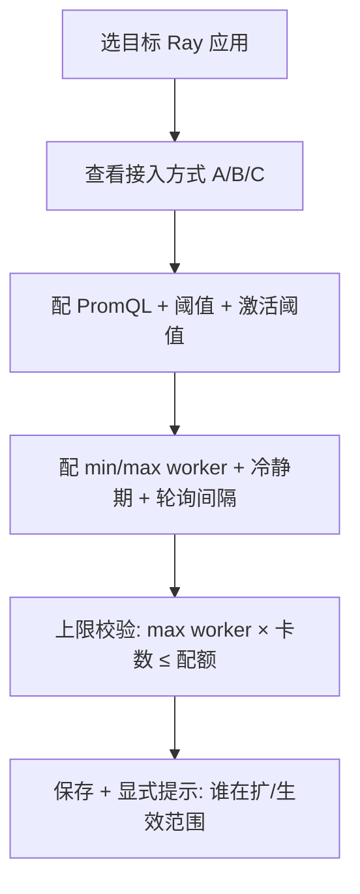
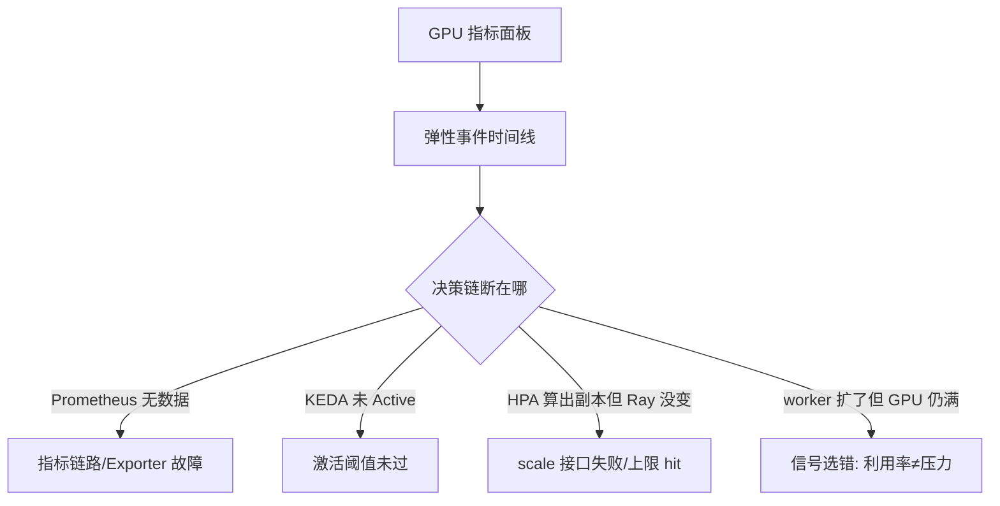
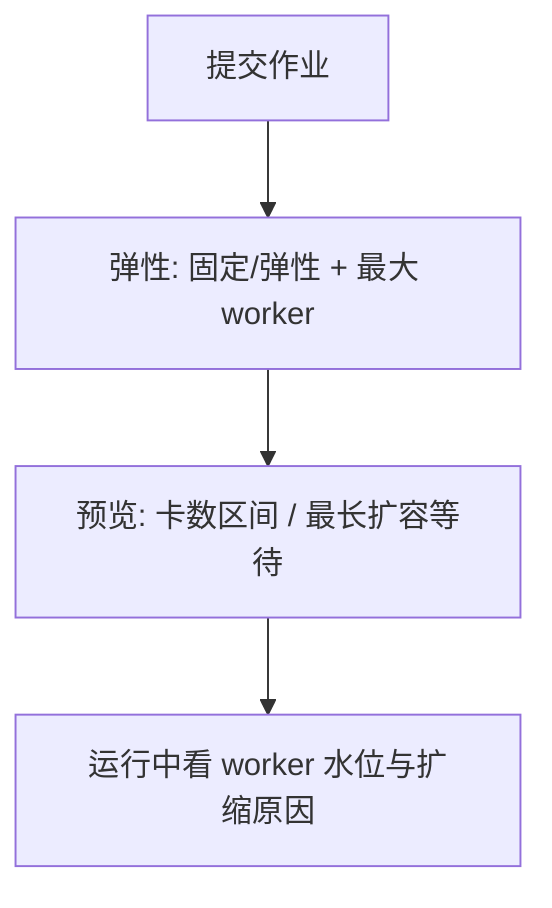

# GPU 指标弹性调度 - 需求分析报告

> 状态：**A2 需求分析（v3，待人工确认）** · 模式 A（正向设计，从零）
> 架构基线（客户确认）：
> **Prometheus（GPU 指标）→ KEDA → 扩缩 Ray（Ray worker），不是扩 Pod**
> 辅：Ray 2.x 自带弹性扩缩容已启用；HPA 是 KEDA 内部生成并执行的执行器
> 技术底稿：[技术调研-GPU指标与弹性扩缩容.md](./技术调研-GPU指标与弹性扩缩容.md)

---

## 1. 目标架构：KEDA 驱动的 Ray 弹性

```
┌────────────────────────────────────────────────────────────────┐
│ 指标层   DCGM Exporter（GPU_UTIL/显存/SM/Tensor）                 │
│          Ray metrics（队列深度/ongoing requests/副本数）          │
│                    ↓ 统一进 Prometheus                          │
├────────────────────────────────────────────────────────────────┤
│ 决策层   KEDA ScaledObject（prometheus scaler, PromQL + 阈值）    │
│                    ↓ KEDA 生成 1 个 HPA                          │
│          HPA controller（执行 1↔N 的写入）                        │
├────────────────────────────────────────────────────────────────┤
│ 执行层   Ray（RayCluster worker replicas / Ray worker 数）        │
│          ← 客户要求：扩 Ray，不扩 Pod                             │
├────────────────────────────────────────────────────────────────┤
│ 干扰项   Ray 自带 Autoscaler（in-tree）——同时也在改 worker 副本    │
└────────────────────────────────────────────────────────────────┘
```

**一句话**：KEDA 是大脑，HPA 是手，Ray 是被扩的对象；Ray 自带的 autoscaler 是潜在的第二个大脑，必须处理。

### 1.1 与「扩 Pod」方案的区别

| 维度 | 扩 Pod（我们不做） | 扩 Ray（客户要求） |
|---|---|---|
| 扩缩对象 | Deployment 副本 | RayCluster worker replicas |
| 扩出来的是什么 | 一个完整 Pod（含 sidecar、调度开销） | 一个 Ray worker（直接进 Ray 资源池） |
| 与 Ray 的关系 | 与 Ray 调度脱节，Ray 感知不到 | Ray 立即感知，可用于 actor/task 调度 |
| 缩容后果 | Pod 被杀 | worker 下线，需先确认无 actor 承载 |

---

## 2. 已知结构性障碍（必须写进需求，不能藏）

KEDA 扩自定义资源（CRD）**只认 `/scale` 子资源**。现状是：

| 目标 | `/scale` 情况 | 结论 |
|---|---|---|
| `RayCluster` | 副本在 `spec.workerGroupSpecs[].replicas`（列表）；是否暴露 `/scale` **待核实** | 可行但需确认接口 |
| `RayService` | 副本写在 `serveConfigV2` 字符串（`num_replicas`），无法配 JSONPath | **确认不可行**（Ray 官方论坛讨论） |

→ 所以「KEDA 扩 Ray」在**决策层成立、执行接口层还缺一块**。A3 必须三选一：

| 候选 | 做法 | 代价 |
|---|---|---|
| **A** RayCluster 直扩 | ScaledObject → RayCluster `/scale` | 最干净；依赖 KubeRay 是否暴露 /scale |
| **B** external scaler + 中间服务 | KEDA → 自建服务 → 调 Ray API 改 workerGroup | 可控性最强；要维护一个组件 |
| **C** KEDA 只调上限 | 改 min/max_workers，由 Ray Autoscaler 实际增减 | 无接口依赖；但「谁在扩」难解释、响应更慢 |

---

## 3. 用户路径分析

### 3.1 平台管理员：配一条 GPU 弹性策略



### 3.2 运维：查「为什么没扩 / 为什么扩了没用」



### 3.3 算法开发者：声明弹性边界



---

## 4. 优先级排序（MoSCoW）

### Must Have

- [ ] **FR-1 GPU 指标面板**：DCGM 口径（GPU_UTIL / 显存 used,total / SM_ACTIVE / Tensor Core / 功耗），按 功能区/云实例/Ray 应用/单卡 下钻；显式标注「利用率 ≠ 算力饱和度」
- [ ] **FR-2 KEDA 弹性策略配置**：PromQL、`threshold`、`activationThreshold`、`pollingInterval`、`cooldownPeriod`、min/max worker 集中配置；**展示 KEDA→HPA→Ray 的真实执行链与接入方式（A/B/C）**
- [ ] **FR-3 弹性决策留痕**：时间线「指标值 → 是否 Active → HPA 期望副本 → Ray 实际 worker → 结果/失败原因」
- [ ] **FR-4 扩缩信号口径**：主信号（队列深度 / ongoing requests / KV cache）为主，GPU 指标为辅；可配阈值、步长、冷静期
- [ ] **FR-5 双写防护**：检测 Ray in-tree autoscaler 与 KEDA 同时管理同一 RayCluster，冲突时阻断并给出处置建议

### Should Have

- [ ] **FR-6 策略预设**：保守/均衡/激进（映射到阈值、轮询间隔、冷静期、max worker）
- [ ] **FR-7 指标链路健康与冻结**：Prometheus/DCGM Exporter 不可达 → 冻结弹性 + 告警；`ignoreNullValues=false` 禁止按「无数据=低负载」缩容
- [ ] **FR-8 上限与配额校验**：max worker × 每 worker 卡数 ≤ 租户配额 / 功能区容量
- [ ] **FR-9 缩 worker 优雅退出**：承载 actor/Serve 副本的 worker 不可直接缩；提示 SIGTERM/checkpoint/idle 判定

### Could Have

- [ ] **FR-10 参数建议**：基于历史曲线推荐阈值与 max worker，仅建议
- [ ] **FR-11 回放 / A-B 对比**：两套策略的 worker 曲线、GPU 利用率、扩容等待

### Won't Have

- [ ] 扩 K8s Pod 作为主路径（客户明确排除）
- [ ] 直接扩 RayService（接口层不可行）
- [ ] 自研扩缩容算法 / reimplement KEDA
- [ ] 非 GPU 弹性；作业卡数弹性

---

## 5. 技术可行性

### 5.1 指标层（可行）

DCGM Exporter + Prometheus 是标准组合（阿里云 ACS / Azure AKS 均为此架构）。Ray 侧另有 `ray_serve_*` 类指标（队列深度、ongoing requests、副本数）可作主信号——比 GPU 利用率更适合做扩缩依据。

### 5.2 决策层（可行，注意两阶段语义）

- KEDA 用 `IsActive` 决定 0↔1，`activationThreshold` **必须「大于」才激活**；`minReplicaCount>=1` 时激活阈值失效
- 1↔N 由 KEDA 生成的 HPA 执行；`pollingInterval`（默认 30s）、`cooldownPeriod`（默认 300s）决定响应速度
- 多指标叠加可用 `advanced.scalingModifiers.formula`（如队列深度与显存压力加权）

### 5.3 执行层（有障碍，见 §2）

RayCluster `/scale` 待核实；RayService 确认不可行。

### 5.4 四个关键悖论

| 悖论 | 表现 | 需求应对 |
|---|---|---|
| 利用率悖论 | GPU_UTIL 是 kernel 活跃时间占比，batch 打满 100% 属正常，拿它当扩容目标会无限扩 | FR-4 主信号换成压力类指标 |
| 显存悖论 | 显存 = 权重 + KV cache，混合量分不清「模型太大」与「请求太多」 | FR-1 拆显存构成 |
| 延迟悖论 | 采集 15~30s + HPA 同步 + worker 启动 + 模型加载，一次扩容 1~3 分钟 | FR-6 冷静期/步长 |
| 双大脑悖论 | Ray in-tree autoscaler 与 KEDA 都改 worker 副本 | FR-5 双写防护 |

### 5.5 风险

| 风险 | 影响 | 缓解 |
|---|---|---|
| RayCluster 无 `/scale` 子资源 | 主路径 A 落不了地 | A3 用 B/C 兜底 |
| KEDA 与 Ray in-tree 双写 | 副本震荡、任务中断 | FR-5；或关掉 `enableInTreeAutoscaling` |
| 缩 worker 杀 actor | 推理请求失败、KV cache 丢 | FR-9 |
| 指标缺失被当低负载 | 缩到下限，服务不可用 | FR-7 + `ignoreNullValues=false` |
| 上限不一致 | 超配额调度失败 | FR-8 |

---

## 6. 待确认

| # | 项 | 优先级 | 阻塞 |
|---|---|---|---|
| C-01 | **现状图/截图**（已同意提供，待路径） | P0 | 接入方式、FR-5 |
| C-02 | RayCluster 是否暴露 `/scale` 子资源 | P0 | 路径 A/B/C 选型 |
| C-03 | Ray in-tree autoscaler 现在是否开着 | P0 | 双写防护是否必须 |
| C-04 | 主信号可得性：队列深度 / ongoing requests / KV cache 哪个有 | P0 | FR-4 |
| C-05 | 每 worker 卡数、配额、功能区 | P1 | FR-8 |
| C-06 | Ray Autoscaler 参数名核对（`ray-schema.json`） | P1 | FR-2 |
| C-07 | 项目目录/路由两级目录名 | P1 | 平台接入 |
| C-08 | 设计系统预设 | P1 | A4 |
