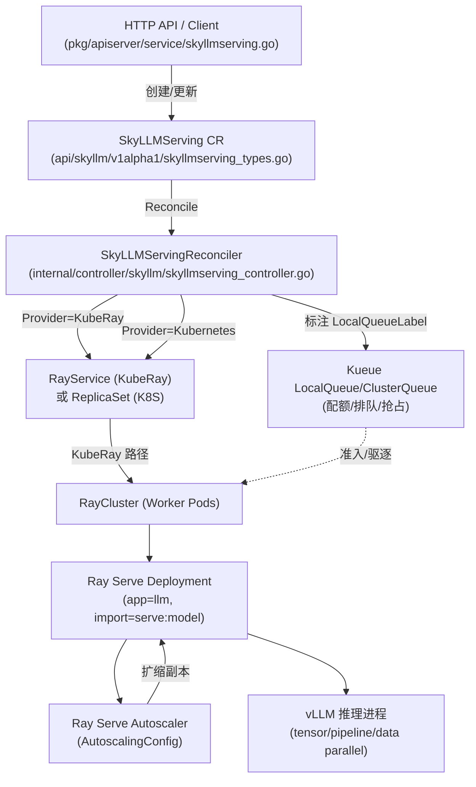
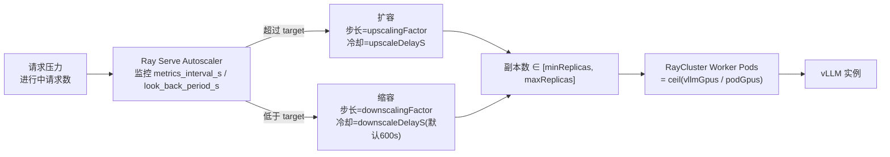

# cap-services 推理服务与弹性扩缩容机制深度调研

> 调研对象：`cap-services` — 一个基于 **Kubernetes + KubeRay + Ray Serve + vLLM** 的 LLM 推理平台 Operator（Go / kubebuilder / controller-runtime）。
> 工作目录：`/Users/kevinliangx/Developer/Repos/PrivateCodeHub/GientechCodeHub/cap-services`

---

## 1. 总体架构

该平台通过自定义资源 `SkyLLMServing`（CRD）来描述一个 LLM 推理服务。Operator 监听该 CR，向下根据所选 **Provider / ResourceType** 生成具体的工作负载（RayService / ReplicaSet），并通过 **Ray Serve 内建 Autoscaler** 实现基于请求压力的弹性扩缩容；配额与排队调度则委托给 **Kueue**（LocalQueue/ClusterQueue +  Gang Scheduling）。

> [!IMPORTANT]
> 弹性扩缩容**不是** Operator 自建的 Go 调度器，而是**复用 Ray Serve 原生的部署级 Autoscaler**（由 `AutoscalingConfig` 驱动）。Operator 的职责是把用户侧的 `Scale` 规格“翻译/映射”进 Ray Serve 的 config，并把 vLLM 并行度（tp/pp/dp）换算成 RayCluster worker pod 数量。

---

## 2. 推理服务实现

### 2.1 核心 CRD：`SkyLLMServing`

定义于 [skyllmserving_types.go](file:///Users/kevinliangx/Developer/Repos/PrivateCodeHub/GientechCodeHub/cap-services/api/skyllm/v1alpha1/skyllmserving_types.go)：

- **Provider**（不可变）：`KubeRay` | `Kubernetes`
- **ResourceType**（不可变）：`RayService` | `Replicaset`
- **关键业务字段**：`ModelRef`、`Image`、`Resources`、`ShareMemory`、`NodeSelector`、`PriorityClassName`、`Tolerations`、`Scale`、`VllmOption`、`HeadEnv`/`WorkerEnv`、`CustomizationField`、`EnableGangScheduling`、`NetworkDeviceConfig`、`Suspend`。

`VllmOption`（[186-215](file:///Users/kevinliangx/Developer/Repos/PrivateCodeHub/GientechCodeHub/cap-services/api/skyllm/v1alpha1/skyllmserving_types.go#L186-L215)）：
- `MaxModelLen`、`HfOverrides`、`ServedModelName`
- 并行度三件套：`TensorParallelSize`、`DataParallelSize`、`PipelineParallelSize`
- `EnableExpertParallel`、`ParallelMode`（`simple` | `distribute`）
- `Config`（YAML 透传）

### 2.2 两条后端路径

`Reconcile` → `reconcileSkyLLMServing`（[397-486](file:///Users/kevinliangx/Developer/Repos/PrivateCodeHub/GientechCodeHub/cap-services/internal/controller/skyllm/skyllmserving_controller.go#L397-L486)）按 `Provider → ResourceType` 分流：

| Provider | ResourceType | 工作负载 | 适用场景 | 内建扩缩容 |
|---|---|---|---|---|
| `KubeRay` | `RayService` | RayService → RayCluster | 主路径（云/集群） | ✅ Ray Serve Autoscaler |
| `Kubernetes` | `Replicaset` | ReplicaSet | 边缘/轻量 | ❌ 固定副本（仅 InitialReplicas） |

`reconcileKubeRayServing`（[488-662](file:///Users/kevinliangx/Developer/Repos/PrivateCodeHub/GientechCodeHub/cap-services/internal/controller/skyllm/skyllmserving_controller.go#L488-L662)）负责构建/下发：RayService、serve-svc、dashboard-svc、ingress、configmap。

> [!WARNING]
> **边缘路径（Kubernetes/ReplicaSet）没有内建弹性扩缩容能力**。它只使用静态的 `InitialReplicas`，不会根据负载自动伸缩。

### 2.3 vLLM 部署方式（Ray Serve）

推理引擎为 **vLLM**，通过 Ray Serve 部署，导入路径为 `serve:model`，应用名 `llm`，HTTP 端口 `8000`，`ProxyLocation: EveryNode`（见 [`buildServerConfigV2`](file:///Users/kevinliangx/Developer/Repos/PrivateCodeHub/GientechCodeHub/cap-services/internal/controller/skyllm/skyllmserving_controller.go#L1320-L1499)）。

并行度 → Pod 副本数换算：
- `getVllmGPUs`（[2067-2102](file:///Users/kevinliangx/Developer/Repos/PrivateCodeHub/GientechCodeHub/cap-services/internal/controller/skyllm/skyllmserving_controller.go#L2067-L2102)）：单个 vLLM 实例所需 GPU 数 `vllmGpus = tp * pp * dp`。
- `getPodWorkerReplicas`（[2038-2056](file:///Users/kevinliangx/Developer/Repos/PrivateCodeHub/GientechCodeHub/cap-services/internal/controller/skyllm/skyllmserving_controller.go#L2038-L2056)）：需要多少个 RayCluster worker pod = `ceil(vllmGpus / podGpus)`（`servingUseMultiplyPod` [2058](file:///Users/kevinliangx/Developer/Repos/PrivateCodeHub/GientechCodeHub/cap-services/internal/controller/skyllm/skyllmserving_controller.go#L2058)）。
- `getvLLMConfig`（[2126-2198](file:///Users/kevinliangx/Developer/Repos/PrivateCodeHub/GientechCodeHub/cap-services/internal/controller/skyllm/skyllmserving_controller.go#L2126-L2198)）：构建 vLLM 启动参数。当 `podGpus < worldSize` 或 `podGpus > worldSize*dp` 时设置 `distributed_executor_backend=ray`；当 `tp > podGpus` 时加 `--enforce-eager`。

> [!NOTE]
> **`DummyGPU`（"dummy-gpu"）**：在 Ray 的 placement group / `RayActorOptions` 中，用虚拟资源名 `dummy-gpu` 来“预留”GPU，而不是在部分 Ray 部署上下文中直接声明真实 GPU（[ray_service_serve_config.go](file:///Users/kevinliangx/Developer/Repos/PrivateCodeHub/GientechCodeHub/cap-services/pkg/util/ray_service_serve_config.go#L116)）。另有 Metax GPU 的特殊处理分支。

### 2.4 外部访问（Endpoint / Ingress）

- `SkyLLMServingStatus`（[246-293](file:///Users/kevinliangx/Developer/Repos/PrivateCodeHub/GientechCodeHub/cap-services/api/skyllm/v1alpha1/skyllmserving_types.go#L246-L293)）暴露 `Endpoint`、`Replicas`、`RunningWorkerPods` 及 Conditions（Admitted / Running / Terminating / Suspended）。
- `calculateStatus` / `calculateStatusForRayService`（[1662-1766](file:///Users/kevinliangx/Developer/Repos/PrivateCodeHub/GientechCodeHub/cap-services/internal/controller/skyllm/skyllmserving_controller.go#L1662-L1766)）从 `RayService.Application["llm"]` 状态 + RayCluster 是否 suspend 汇总状态。

### 2.5 API 层校验与默认值

[`pkg/apiserver/service/skyllmserving.go`](file:///Users/kevinliangx/Developer/Repos/PrivateCodeHub/GientechCodeHub/cap-services/pkg/apiserver/service/skyllmserving.go)：
- 校验：`min ≤ max`，`min ≤ initial ≤ max`（[853-862](file:///Users/kevinliangx/Developer/Repos/PrivateCodeHub/GientechCodeHub/cap-services/pkg/apiserver/service/skyllmserving.go#L853-L862)）。
- ReplicaSet 路径默认值：`min = initial = max`（[193-207](file:///Users/kevinliangx/Developer/Repos/PrivateCodeHub/GientechCodeHub/cap-services/pkg/apiserver/service/skyllmserving.go#L193-L207), [793-850](file:///Users/kevinliangx/Developer/Repos/PrivateCodeHub/GientechCodeHub/cap-services/pkg/apiserver/service/skyllmserving.go#L793-L850)）。

---

## 3. 弹性扩缩容机制（核心）

### 3.1 用户侧 `Scale` 规格

[`Scale` struct](file:///Users/kevinliangx/Developer/Repos/PrivateCodeHub/GientechCodeHub/cap-services/api/skyllm/v1alpha1/skyllmserving_types.go#L28-L81) 字段与默认值：

| 字段 | 默认 | 含义 |
|---|---|---|
| `targetOngoingRequests` | `10` | Autoscaler 目标：每个副本保持的“进行中请求数” |
| `maxOngoingRequests` | `20` | 单副本最大并发（限流） |
| `minReplicas` | `1` | 最小副本数 |
| `maxReplicas` | `1` | 最大副本数 |
| `initialReplicas` | `1` | 初始副本数（需 ∈ [min, max] 且 ≥ 0） |
| `upscaleDelayS` | `30` | 扩容冷却（延迟） |
| `downscaleDelayS` | `600` | 缩容冷却（延迟，远大于扩容） |
| `upscalingFactor` | `1` | 单次扩容步长系数 |
| `downscalingFactor` | `1` | 单次缩容步长系数 |
| `metricsIntervalS` | `10` | 指标采样间隔 |
| `lookBackPeriodS` | `30` | 指标回溯窗口 |

`validateSpec`（[233-269](file:///Users/kevinliangx/Developer/Repos/PrivateCodeHub/GientechCodeHub/cap-services/internal/controller/skyllm/skyllmserving_controller.go#L233-L269)）保证 `InitialReplicas ∈ [MinReplicas, MaxReplicas]` 且 ≥ 0。

### 3.2 映射到 Ray Serve `AutoscalingConfig`

[`buildServerConfigV2`](file:///Users/kevinliangx/Developer/Repos/PrivateCodeHub/GientechCodeHub/cap-services/internal/controller/skyllm/skyllmserving_controller.go#L1320-L1499) 是扩缩容核心，将 `Spec.Scale` 映射为 Ray Serve 的 `AutoscalingConfig`：

- `target_ongoing_requests` ← `TargetOngoingRequests`
- `min_replicas` / `initial_replicas` / `max_replicas`
- `upscale_delay_s` / `downscale_delay_s`
- `upscaling_factor` / `downscaling_factor`
- `metrics_interval_s` / `look_back_period_s`

> [!NOTE]
> `num_replicas`（固定副本数）**不设置**，因为与 `autoscaling_config` 互斥（见 [ray_service_serve_config.go](file:///Users/kevinliangx/Developer/Repos/PrivateCodeHub/GientechCodeHub/cap-services/pkg/util/ray_service_serve_config.go) 注释）。即：要么固定副本，要么交给 Autoscaler。

扩缩容为**基于请求负载（request-load）**而非 CPU/内存 HPA 指标：Autoscaler 监控“进行中请求数”，当持续超过 `targetOngoingRequests` 时扩容，低于时（经过 `downscaleDelayS` 冷却）缩容。`RAY_enable_autoscaler_v2` 在 controller 中被引用（[~927](file:///Users/kevinliangx/Developer/Repos/PrivateCodeHub/GientechCodeHub/cap-services/internal/controller/skyllm/skyllmserving_controller.go#L927)）启用 v2 Autoscaler。

### 3.3 配额与排队调度（Kueue）

- `ConvertCreateReqToSkyLLMServingByProvider`（[pkg/skyllm/serving.go](file:///Users/kevinliangx/Developer/Repos/PrivateCodeHub/GientechCodeHub/cap-services/pkg/skyllm/serving.go#L388)）**总是**设置 `AnnotationElasticJob=true`（用于“支持 raycluster in-tree autoscale”）。
- `buildRayService` / `buildRayServiceSpec`（[720-743](file:///Users/kevinliangx/Developer/Repos/PrivateCodeHub/GientechCodeHub/cap-services/internal/controller/skyllm/skyllmserving_controller.go#L720-L743) 起）把 `AnnotationElasticJob` 与 `LocalQueueLabelKey` 透传到 RayService，从而接入 Kueue 的 LocalQueue/ClusterQueue。
- `EnableGangScheduling` 启用**成组调度**（Gang Scheduling），配合 pod group 注解，保证 vLLM 多副本所需的全部 GPU 一次性拿齐，避免部分分配死锁。
- [`clusterqueue_controller.go`](file:///Users/kevinliangx/Developer/Repos/PrivateCodeHub/GientechCodeHub/cap-services/internal/controller/clusterqueue_controller.go) 从 pod 反向汇聚 gpu-info/资源注解到 ClusterQueue（影响准入/抢占，而非直接控制副本伸缩）。

### 3.4 状态回写（RayCluster Controller）

[`raycluster_controller.go`](file:///Users/kevinliangx/Developer/Repos/PrivateCodeHub/GientechCodeHub/cap-services/internal/controller/skyllm/raycluster_controller.go)（仅 117 行）是关键粘合层：
- 沿 `RayCluster → RayService → SkyLLMServing` 的所有权链上溯；
- 累加 `cluster.Spec.WorkerGroupSpecs[].Replicas`；
- 写回 `SkyLLMServing.Status.Replicas`。

这使得 CR 状态能反映 Autoscaler 实际伸缩后的真实 worker 数量。

### 3.5 暂停 / 恢复（Suspend）

[`setSuspend`](file:///Users/kevinliangx/Developer/Repos/PrivateCodeHub/GientechCodeHub/cap-services/internal/controller/skyllm/skyllmserving_controller.go#L1531-L1660)：
- **Kubernetes/ReplicaSet**：把 replicas 置 0，原值存入 annotation 以便恢复。
- **KubeRay/RayService**：删除 `AnnotationElasticJob` + `LocalQueueLabelKey`（规避 Kueue 干扰的临时方案）并删除 RayCluster。

> [!WARNING]
> 上游 Kueue 会**强行清除 suspend**（相关 upstream PR 已修复）。Operator 的 workaround：suspend 时剥离 Kueue 标签，resume 时重新加回。

### 3.6 已知坑：`AnnotationReplicas`（BUG-1126）

- `buildRayServiceSpec` 使用 `AnnotationReplicas` 作为 workaround：KubeRay **不会**把 RayService 的 `replicas`/`scaleStrategy` 变更传播到 RayCluster（零停机升级的例外路径），因此需借助 annotation 中转，确保副本变更落到 RayCluster。

---

## 4. 关键文件索引

| 关注点 | 文件 | 关键行 |
|---|---|---|
| CRD 定义（含 Scale） | [skyllmserving_types.go](file:///Users/kevinliangx/Developer/Repos/PrivateCodeHub/GientechCodeHub/cap-services/api/skyllm/v1alpha1/skyllmserving_types.go) | 28-293 |
| 主调和器（分流/状态/暂停） | [skyllmserving_controller.go](file:///Users/kevinliangx/Developer/Repos/PrivateCodeHub/GientechCodeHub/cap-services/internal/controller/skyllm/skyllmserving_controller.go) | 121-231 / 397-486 / 488-662 / 1320-1499 / 1531-1660 / 1662-1766 / 2038-2198 |
| 状态回写 | [raycluster_controller.go](file:///Users/kevinliangx/Developer/Repos/PrivateCodeHub/GientechCodeHub/cap-services/internal/controller/skyllm/raycluster_controller.go) | 全文 |
| ServeConfig 结构（含 DummyGPU） | [ray_service_serve_config.go](file:///Users/kevinliangx/Developer/Repos/PrivateCodeHub/GientechCodeHub/cap-services/pkg/util/ray_service_serve_config.go) | 84-116 |
| API 校验/默认值 | [skyllmserving.go](file:///Users/kevinliangx/Developer/Repos/PrivateCodeHub/GientechCodeHub/cap-services/pkg/apisserver/service/skyllmserving.go) | 193-207 / 793-862 / 853-862 |
| 创建请求转换（AnnotationElasticJob） | [serving.go](file:///Users/kevinliangx/Developer/Repos/PrivateCodeHub/GientechCodeHub/cap-services/pkg/skyllm/serving.go) | 388 |
| Kueue 配额同步 | [clusterqueue_controller.go](file:///Users/kevinliangx/Developer/Repos/PrivateCodeHub/GientechCodeHub/cap-services/internal/controller/clusterqueue_controller.go) | 全文 |

---

## 5. 结论摘要

1. **推理服务**：通过 `SkyLLMServing` CR 声明，主路径为 KubeRay `RayService` → `RayCluster` → Ray Serve `serve:model` 部署 → vLLM 进程；并行度 `tp/pp/dp` 决定单实例 GPU 数，进而换算成 worker pod 数（`ceil(vllmGpus/podGpus)`）。
2. **弹性扩缩容**：KubeRay 路径复用 **Ray Serve 原生 Autoscaler**，由用户 `Scale` 规格映射出 `AutoscalingConfig`，按“进行中请求数”相对 `targetOngoingRequests` 做基于负载的伸缩，带上下行冷却与步长系数；非 HPA/CPU 指标。
3. **配额/排队**：交由 Kueue（LocalQueue/ClusterQueue + Gang Scheduling），通过标签透传接入；`AnnotationElasticJob` 标记弹性作业。
4. **状态一致性**：`RayCluster` 控制器把真实 worker 副本数回写到 `SkyLLMServing.Status.Replicas`。
5. **边缘限制**：Kubernetes/ReplicaSet 路径无内建 Autoscaler，仅静态 `InitialReplicas`。
6. **工程细节/坑**：`DummyGPU` 预留 GPU、`AnnotationReplicas`（BUG-1126）中转副本、suspend 时剥离 Kueue 标签规避上游强清 suspend 的行为。
