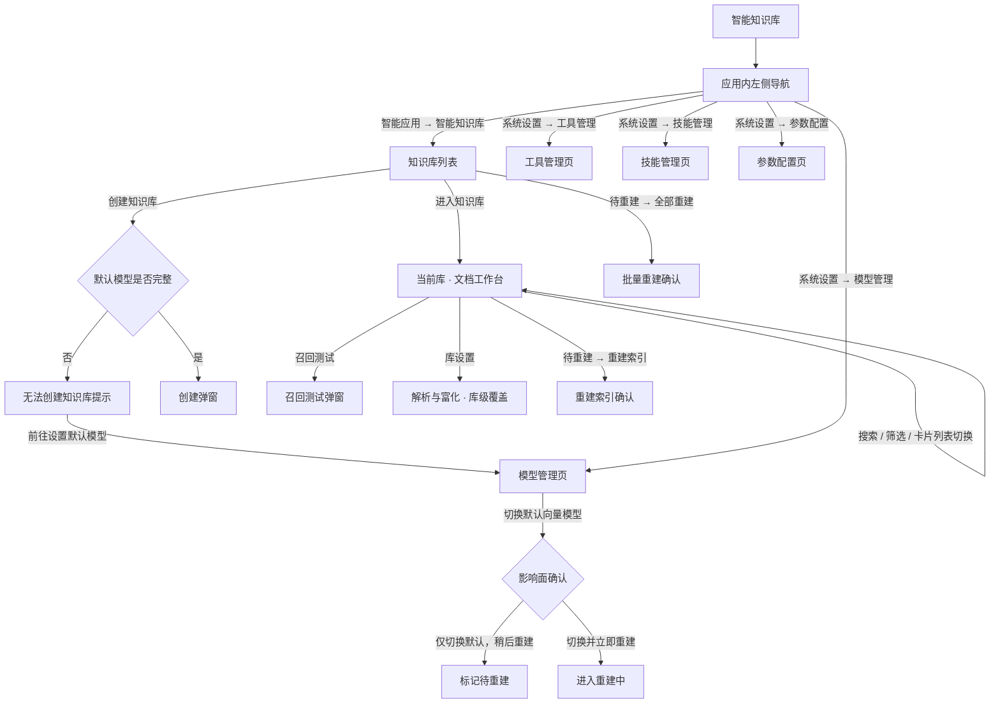
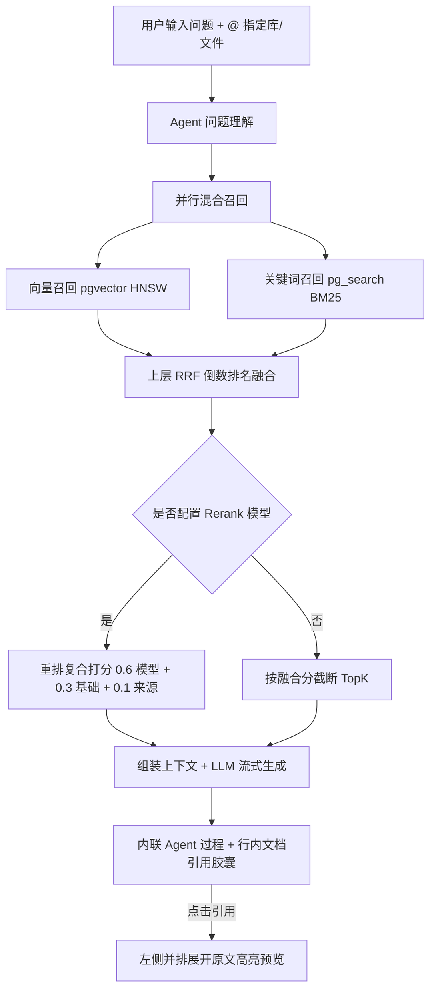

# 智能知识库 PRD

> **产品定位**：基于容器云与算力加速平台底座的企业级「智能知识库 + RAG 问答」应用，参考腾讯开源 **WeKnora** 的入库流水线与混合检索架构设计。

## 0. 文档信息
| 版本 | 日期 | 修改内容 | 作者 |
|------|------|---------|------|
| v0.1 | 2026-10-09 | 以既有平台外壳与设置页为基线复刻，作为「智能知识库」改造起点 | lianghua |
| v0.2 | 2026-11-13 | 参数配置重构：移除继承自智能诊断的运行时资源/并发与配额/回收/审批/会话留存分区，改为「模型与索引 + 知识库默认配置 + 容量与配额」三分区；补充索引重建确认、分区保存与配额校验规则 | lianghua |
| v0.3 | 2026-11-13 | 知识库工作台改版：移除面包屑与占位页，改为标准顶部导航（返回 + 知识库详情）+ 可下拉库名 + 五 Tab；补齐概览、文档列表/卡片、分块、检索测试、设置与库级分块调整弹窗 | lianghua |
| v0.4 | 2026-11-13 | 范围收敛：进入库后固定当前库，不再切库；库内只保留文档卡片/列表，移除概览、分块、检索测试与设置；补齐搜索、状态筛选、视图切换、上传与批量操作 | lianghua |
| v0.5 | 2026-11-13 | 新增文档详情：点击卡片/列表行打开浮层，展示基本信息、可编辑摘要与原文预览；文件内容可在「预览 / 查看分块」间切换，片段支持编辑正文、恢复原文和启停，关闭的片段不参与检索 | lianghua |
| v0.6 | 2026-11-13 | 文档工作台工具栏重排：上传文档左置，状态筛选并入右侧搜索框；库名下方展示知识库描述；文档卡片与列表增加分页、每页条数与页码控制 | lianghua |
| v0.7 | 2026-11-14 | 默认模型落地：模型增加「对话/向量/重排」能力类型，模型管理新增三槽位默认配置（对话、向量必选，重排可选）、缺失警示与默认模型引用保护；知识库创建增加必选默认模型前置校验；参数配置改为运行资源/存储管理/数据保留 | lianghua |
| v0.8 | 2026-11-14 | 新增「多模态（vision）」模型能力，默认模型扩展为四槽位（对话、向量必选，重排、多模态可选）；补齐图片理解与扫描件解析的默认模型配置、缺失提示与可选项语义，多模态不影响知识库创建 | lianghua |
| v0.9 | 2026-11-15 | 多模态收敛为对话模型的能力标记：取消独立「vision」能力与默认槽位，默认模型恢复三槽位（对话、向量必选，重排可选）；对话模型可勾选「支持图片理解」，随对话默认模型生效；旧数据自动并入对话模型 | lianghua |
| v0.10 | 2026-11-15 | 参数配置改为页内双 Tab：保留「运行与存储」，新增「知识库配置」（默认分块策略/块大小/重叠、库创建人调整权限、容量配额）；默认值只影响新建库，知识库创建读取同一份持久化策略；不重复配置模型 | lianghua |
| v0.11 | 2026-11-15 | 知识库配置新增「解析与富化默认值」：AI 问题生成开关、每分块问题数量（1–10，默认 3）、问题生成要求（≤4000 字）；库内标题右侧新增「库设置」入口，可按库覆盖，只影响后续上传与重新解析 | lianghua |
| v0.12 | 2026-11-15 | 补齐向量索引迁移闭环：切换默认向量模型时展示影响面，可选择稍后重建或立即重建；知识库列表与工作台展示「待重建/重建中」状态，支持单库与批量重建并展示进度。新增库内最小「召回测试」：按当前索引模型检索、展示分数/高亮/统计，并可从结果查看原文 | lianghua |
| v0.13 | 2026-11-15 | 参数配置去 Tab、去平台知识库默认值：页面仅保留「运行与存储」（运行资源、存储管理）与「容量与配额」，取消默认分块策略、创建人调整权限与解析富化默认值；分块与解析富化改由库创建人在创建弹窗与库内「库设置」维护，产品只保留推荐预设，不提供平台级继承/覆盖概念 | lianghua |
| v0.14 | 2026-11-16 | 文档上传与列表提效：支持拖拽上传、分裂按钮（主按钮选文件 / 箭头选文件夹）；上传前校验格式、100MB 与库内及批次重名，未通过文件聚合为「部分文件未添加」弹层逐条说明，通过文件照常进入任务中心，单次超 50 个仅软提示；列表新增分块数列、失败与需重新解析行内重试、文件名与更新时间排序；任务中心完成数改为按已结束任务计数，关闭面板后浮层完全消失、不再保留右下角浮标，任务转入后台且进度在列表可见 | lianghua |
| v0.15 | 2026-11-18 | 智能对话重构与知识库检索联动：常驻悬浮球打开右侧半屏抽屉（默认 50% 宽度，支持左边缘自由拖拽调宽与全屏切换）；输入区新增 `@` 知识库/文件检索范围选择器（支持关键词搜索、分类钻取与所在库默认预填）；AI 回复支持内联可折叠的 Agent 检索过程时间线（问题理解 → 检索知识库 → 思考 → 完成）与行内文档引用胶囊；点击引用文档在左侧并排展开双栏文档预览面板（支持全部引用列表 ↔ 单篇原文高亮定位、左右比例联动拖拽） | lianghua |
| v0.16 | 2026-11-18 | 菜单面板改版：九宫格产品导航与左侧应用菜单由原「智能运维 / AIOPS管理（模型管理、工具管理、技能管理、配置管理）」调整为「智能中心」，拆分为「智能应用（智能知识库）」与「系统设置（模型管理、工具管理、技能管理、参数配置）」两大分组 | lianghua |
| v0.17 | 2026-11-18 | 技能管理改版：工具栏「导入技能」与「搜索/过滤」位置互换；技能卡片列表由两列调整为三列；「导入技能」重构为拖拽上传 `.zip` / `SKILL.md`，补充 AgentSkills 规范约束（包结构与 10MB 上限、Frontmatter 必填/可选字段、Instructions 非空、≤500 行/5000 tokens 及相对路径引用）并增加自动解析与校验反馈 | lianghua |
| v0.18 | 2026-11-18 | 补齐知识库删除闭环（含重建中保护与索引清理）；清理 PRD 内残留的智能诊断内容，补充参考 WeKnora 的文档解析、分块策略链、混合检索、RAG 问答链路及技术组件选型 | lianghua |

## 1. 业务背景
- **产品定位**: 智能知识库（Web 端，单入口应用）
- **目标用户**: 业务知识管理员、研发/运维工程师、交付与售后团队、平台管理员
- **用户体系**: 用户身份依托容器云平台底座 **OIDC** 统一认证（应用无独立账号体系）；权限基于 **RBAC** 模型，按「角色 → 权限 → 项目域/知识库范围」授权。业务用户仅能查看与操作有权限的知识库及文档，平台管理员负责系统设置（模型/工具/技能/参数配置）。
- **业务背景**: 企业文档分散在 PDF、Word、Markdown、表格等异构文件中，传统关键词搜索难以解决语义理解与精准溯源问题。参考 **WeKnora**「可配置的入库流水线 + 可配置的检索流水线」理念，将文档解析、分块、向量/关键词索引、召回验证与半屏 RAG 对话整合为统一工作台。
- **商业价值**: 知识入库与检索准备效率提升 60%，问答可溯源率 100%，支持多模型热切换与索引平滑迁移。
- **成功指标**: 模型接入到可用 ≤ 5 分钟，单文档解析状态实时可见，召回测试响应 ≤ 1s，对话首包响应 ≤ 3s。
- **目标产品技术栈**:
  - **前端原型**: React + TypeScript + Vite + Tailwind CSS（Element Plus 视觉风格 + lucide-react 图标库）
  - **参考后端与存储组件（对标 WeKnora）**:
    - 解析层：内置格式解析器（PDF / DOCX / MD / TXT / XLSX）+ MinerU / PaddleOCR-VL（扫描件 OCR）+ VLM 多模态图片理解
    - 索引与检索层：PostgreSQL + `pgvector`（`halfvec` + HNSW 向量召回）+ `pg_search`（BM25 关键词召回）+ 上层 RRF 融合 + Rerank 重排模型
    - 对象存储与缓存：MinIO / S3 兼容对象存储（原文件存储）+ Redis（异步解析任务队列与会话状态）
- **入口位置**: 平台导航「智能中心 → 智能应用 → 智能知识库」，应用内常驻可拖拽悬浮球呼出智能对话抽屉。

## 2. 功能概览
智能知识库围绕「**入库流水线（解析 → 分块 → 富化 → 索引）**」与「**检索消费链路（召回测试 + `@` 范围问答 + 原文高亮溯源）**」构建核心能力，平台管理面统一承载模型、MCP 工具、AgentSkills 技能与运行配额配置。

```
上传 / 导入 → 解析（Parser / OCR / VLM）→ 分块（策略链 + 校验器）→ 富化（AI 问题生成）→ 索引（向量 + BM25）
                                                                                            ↓
用户提问（@ 指定库/文档）→ Agent 问题理解 → 混合召回（Vector + BM25）→ RRF 融合 → Rerank 重排 → 流式生成 + 原文高亮回链
```

| 视图 | 模块 | 功能点 | 优先级 | 类型 |
|------|------|--------|--------|------|
| 应用面 | 智能知识库 | 知识库列表、创建前置默认模型校验、单步创建与删除（含重建中保护） | Must | 新增 |
| 应用面 | 智能知识库 | 库内文档工作台（卡片/列表、六态状态机、筛选排序分页、拖拽/分裂按钮上传、预检弹窗、任务中心） | Must | 新增 |
| 应用面 | 智能知识库 | 文档详情、原文预览与分块片段编辑/恢复/启停 | Must | 新增 |
| 应用面 | 智能知识库 | 库设置（按库覆盖分块策略与解析富化参数） | Must | 新增 |
| 应用面 | 智能知识库 | 向量索引迁移与重建（影响面确认、单库/批量重建与进度） | Must | 新增 |
| 应用面 | 智能知识库 | 召回测试（TopK / 阈值 / 重排开关 / 分数高亮 / 查看原文） | Should | 新增 |
| 应用面 | 智能对话 | 半屏可拖拽抽屉、`@` 知识库/文件选择器、内联 Agent 检索过程、左侧双栏文档原文高亮预览 | Must | 新增 |
| 系统设置 | 模型管理 | 模型注册/启停/删除、三类默认模型（对话/向量/重排）与图片理解标记、工具栏布局调整 | Must | 变更 |
| 系统设置 | 工具管理 | 工具栏「添加 MCP」与「搜索/过滤」位置对调 | Must | 变更 |
| 系统设置 | 技能管理 | 工具栏「导入技能」与「搜索/过滤」互换、三列卡片布局、拖拽导入 `.zip` / `SKILL.md` 与 AgentSkills 规范校验 | Should | 变更 |

### 权限边界（核心原则）
- **系统设置隔离**: 模型管理、工具管理、技能管理、参数配置仅「平台管理员」可见；普通用户无入口。
- **知识库分域隔离**: 用户仅能访问自己所属项目域/授权范围内的知识库、文档与分块；问答检索与召回测试严格按用户可见库范围过滤。
- **工具身份透传（On-behalf-of）**: 统一遵守平台 OIDC + RBAC 管控，工具请求携带发起用户上下文透传到后端鉴权，前端不二次声明权限域。

## 3. 用户故事
- US-1: 作为平台管理员，我想要统一注册并配置对话、向量与重排默认模型（含图片理解标记），以便所有知识库获得一致的索引、重排与问答能力
- US-3: 作为知识库创建人，我想要在建库前确认默认模型就绪，并在建库或「库设置」中按库配置分块策略与 AI 问题富化，以便适配不同类型文档
- US-4: 作为知识库管理员，我想要通过拖拽或批量上传文档/文件夹，在上传前获得格式/大小/重名预检提示，并实时跟踪文档六态解析状态
- US-5: 作为知识库管理员，我想要查看文档原文与分块片段、手工修正片段正文或停用低质量片段，并用「召回测试」验证检索命中效果
- US-6: 作为普通用户，我想要通过常驻悬浮球打开智能对话抽屉，用 `@` 指定知识库或文件提问，查看 Agent 检索过程并点击引用胶囊在左侧并排对照原文高亮片段
- US-7: 作为平台管理员，我想要在切换默认向量模型时查看受影响知识库并选择立即或稍后重建索引，同时维护运行资源与容量配额

## 4. 功能需求详单

**FR-1 模型管理**
| 项目 | 说明 |
|------|------|
| 用户故事 | US-1 |
| 优先级 | Must |
| 描述 | 模型注册、编辑、删除、启停与默认模型设置。模型按能力分为**对话模型（chat）／向量模型（embedding）／重排模型（rerank）**三类，由平台模型服务层统一封装，对外暴露标准协议接口。对话模型可额外标记「支持图片理解」（即多模态模型），不单独占用默认槽位，随对话默认模型一起生效。页面顶部为默认模型配置区，展示三类默认模型的就绪状态（对话与向量必选，重排可选）并提供「设置默认模型」入口；必选项未配置完整时以常驻提示条告知影响 |
| 输入 | 模型服务商（当前为算力加速平台，只读）、API 格式（OpenAI Chat Completions / OpenAI Responses / Anthropic Messages / Google Generative AI，默认 OpenAI Chat Completions）、请求地址 BaseURL（必填）、模型 ID（必填，支持从服务端获取候选列表）、模型能力（对话/向量/重排，必填）、支持图片理解（多模态，仅对话模型可勾选）、API Key（选填，内网或网关部署可留空）、最大输出长度（Token）与上下文窗口（Token，数值步进，默认 4096 / 128000）；默认模型设置：每个能力最多选择一个已启用的模型，对话与向量为必选、重排为可选，允许部分保存 |
| 输出 | 模型列表（含名称、能力标签、协议、请求地址、启用状态，默认模型额外带「默认」标识），按名称/能力检索；默认模型状态区展示「x/2 必选已配置」与三个槽位（重排标注「可选」）；未配置完整时展示缺项提示条 |
| 业务规则 | 1) 触发条件：进入页面加载模型列表与默认模型配置，并实时计算缺失能力 2) 校验逻辑：模型名称、能力、请求地址必填，不通过时在表单内提示；API Key 非必填 3) 能力语义：对话模型用于知识库问答与内容生成，勾选「支持图片理解」后同时处理图片、扫描件与图表问答；向量模型用于文档与问题向量化，二者为知识库可用性的必选能力；重排模型用于召回结果精排，为可选能力。多模态不是独立能力，不单独配置默认模型，跟随对话默认模型生效 4) 默认模型：每个能力最多一个默认模型，允许先保存已确定的槽位；仅当对话与向量均配置时状态为「已完成」，否则保持未完成并继续提示缺失的必选项；重排未配置不视为缺项 5) 引用保护：已被设为默认的模型不可停用、不可删除，需先在默认模型设置中替换 6) 更换向量模型会影响既有向量索引，保存前弹出「确认更换向量模型」提示，说明受影响知识库与文档数，并提供「仅切换默认，稍后重建」与「切换并立即重建」两个动作；具体迁移与重建规则见 FR-7 7) 停用模型后该模型不再出现在默认模型候选中；删除模型需二次确认 8) 检索：搜索框按模型名称、能力名称与「多模态」标记匹配，添加按钮固定居左、搜索固定居右 9) 数据通过 localStorage 持久化，刷新后保留；实际生效依赖后端模型服务 |
| 权限控制 | 仅平台管理员可注册/编辑/删除/启停模型与设置默认模型；业务用户不出现模型管理入口 |
| 状态流转 | 注册 → 列表新增且默认启用；编辑 → 保存后更新；停用 ⇄ 启用（默认模型不可停用）；删除 → 二次确认后移除（默认模型不可删除）；设置默认模型 → 选择槽位 → 保存 → 状态区与卡片标识同步更新 |

**验收标准 (Acceptance Criteria)**
- AC-1: Given 平台管理员已登录，When 进入模型管理页，Then 标题行 + 默认模型状态区 + 工具栏行（添加模型居左、搜索居右，同一行）+ 模型卡片列表，无独立筛选卡片
- AC-2: Given 默认模型均未配置，When 进入页面，Then 状态区显示「0/2 必选已配置」并展示三个槽位（对话、向量待配置，重排标注可选），页面出现常驻提示条说明必选缺项及对创建知识库的影响，不自动弹出设置弹窗
- AC-3: Given 点击「设置默认模型」，When 弹窗打开，Then 三个下拉分别对应对话、向量、重排能力，对话与向量标注必选、重排标注可选，候选仅包含该能力下已启用的模型，重排支持选择「不启用」；对话下拉中支持图片理解的模型名称后展示「（多模态）」
- AC-4: Given 默认模型弹窗，When 仅选择部分能力并保存，Then 已选槽位生效并持久化，状态区显示对应必选项数量；若仍缺少对话或向量则继续提示，不阻断保存
- AC-5: Given 对话与向量均已选择并保存，When 返回列表，Then 状态区显示「2/2 必选已配置」，必选项均为完成态，提示条消失；重排可配置也可留空，不影响完成态；对应模型卡片展示「默认」标识；支持图片理解的对话模型展示「多模态」标记
- AC-6: Given 点击「添加模型」，When 填写请求地址后点击「获取模型列表」，Then 展示可选模型 ID，选择后填写 API 格式、模型能力，对话模型可勾选「支持图片理解」，再填写 API Key 与 Token 参数并提交，列表新增记录且能力标签、多模态标记、上下文窗口正确；请求地址或模型 ID 为空时「添加」不可用
- AC-7: Given 某个模型已被设为默认，When 查看该卡片，Then 停用与删除操作不可用，需先更换默认模型
- AC-8: Given 已配置向量模型，When 在默认模型弹窗中更换为其他向量模型并保存，Then 弹出「确认更换向量模型」提示，说明受影响的知识库与文档量，确认后才写入
- AC-9: Given 旧版本将多模态作为独立能力并设置过独立默认槽位，When 加载升级后的模型数据，Then 原多模态模型自动转为对话模型并保留「多模态」标记，独立默认槽位被移除，对话与向量必选判定不受影响
- AC-9: Given 模型列表，When 输入名称或能力关键词，Then 仅展示匹配的模型；清空搜索后恢复全部
- AC-10: Given 已完成默认模型配置，When 刷新页面，Then 默认模型配置与模型启停状态保持一致

**FR-2 工具管理 (MCP)**
| 项目 | 说明 |
|------|------|
| 优先级 | Must |
| 描述 | 本轮变更仅涉及工具栏「添加 MCP」按钮与「搜索/过滤」输入框的位置对调（添加按钮居左、搜索/过滤居右），其余既有工具管理功能保持不变 |

**FR-3 技能管理**
| 项目 | 说明 |
|------|------|
| 优先级 | Should |
| 描述 | 本轮变更涵盖工具栏布局、卡片列数与导入交互升级：1）工具栏「导入技能」按钮与「搜索/过滤」位置互换（导入居左、搜索居右）；2）技能卡片网格由双列改为三列展示；3）「导入技能」重构为拖拽上传 `.zip` 技能包或 `SKILL.md` 文件，弹窗内明确给出 AgentSkills 规范约束提示并自动解析校验 |
| 业务规则 | 1) **包结构与大小**：`.zip` 根目录须含 `SKILL.md`（可选 `scripts/`、`references/`、`assets/`），或单个 `SKILL.md`，单包 ≤ 10MB；2) **Frontmatter 必填**：`name`（1–64 位小写字母、数字与单连字符，与目录名一致）与 `description`（1–1024 字符）；3) **Frontmatter 可选**：支持 `license`、`compatibility`（≤ 500 字符）、`metadata`、`allowed-tools`；4) **Instructions 约束**：YAML 头部之后须包含非空 Markdown 正文指令，遵循渐进式披露（建议 ≤ 500 行 / 5000 tokens，超长内容拆入 `references/`），引用包内资源须使用相对路径，避免硬编码绝对路径 |
| 状态流转 | 拖拽或选择 `.zip` / `SKILL.md` → 自动解析 Frontmatter 与 Instructions → 校验通过展示预览（含指令行数及规范提示）并可确认导入；不合规阻断导入并逐条报错 |

**验收标准 (Acceptance Criteria)**
- AC-1: Given 进入技能管理页，When 查看工具栏与卡片网格，Then「导入技能」居左、「搜索/过滤」居右，桌面端展示三列技能卡片
- AC-2: Given 打开「导入技能」弹窗，When 查看提示区，Then 完整展示 AgentSkills 包结构、Frontmatter 必填/可选字段及 Instructions 行数/相对路径约束
- AC-3: Given 拖入或选择合规的 `.md` / `.zip`，When 自动解析完成，Then 展示技能名称、描述与指令行数预览并可点击「确认导入」；若缺少正文指令或命名不合规，Then 阻断导入并提示具体原因

**FR-KB-1 知识库列表、创建与删除**
| 项目 | 说明 |
|------|------|
| 用户故事 | US-3 |
| 优先级 | Must |
| 描述 | 知识库卡片墙展示库名、描述、文档数、创建人、创建时间与向量索引状态徽标，支持关键词搜索、分页与删除。建库前校验平台必选默认模型（对话、向量）是否就绪，缺失时弹出阻断提示并引导跳转「模型管理」；就绪后进入单步创建弹窗，支持选择推荐分块预设（自动/标题/语义/固定）及解析富化参数。删除知识库时按空库/非空库分级提示并清理索引状态，重建中的知识库禁止删除 |

**验收标准 (Acceptance Criteria)**
- AC-1: Given 默认对话与向量模型未配置完整，When 点击「创建知识库」，Then 弹出阻断提示弹窗列出缺失项，并提供「前往设置默认模型」跳转入口
- AC-2: Given 默认模型就绪，When 填写库名、选择推荐分块预设与富化参数并确认创建，Then 列表新增该知识库并注册初始向量索引状态
- AC-3: Given 点击知识库卡片「删除」，When 库内存在文档，Then 弹出危险确认弹窗提示将清空文档/分块/向量索引；若该库正在重建索引，Then 禁用「确认删除」并提示等待重建完成
- AC-4: Given 确认删除知识库，When 删除完成，Then 移除库卡片、同步清理索引状态并自动修正分页页码

**FR-KB-2 库内文档工作台、状态机与上传**
| 项目 | 说明 |
|------|------|
| 用户故事 | US-4 |
| 优先级 | Must |
| 描述 | 进入知识库后固定当前库上下文，主体支持卡片/列表双视图切换、六态状态机筛选（`排队中 → 解析中 → 优化中 → 已解析 / 解析失败 / 需重新解析`）、关键词搜索、文件名/更新时间排序与分页，以及批量操作。支持全区拖拽与分裂按钮上传文件/文件夹；上传前校验格式、100MB 与库内/批次重名，未通过文件弹出「部分文件未添加」弹窗逐条说明，通过文件进入右下角「上传与处理任务」浮层；失败与需重新解析文档支持行内一键重试 |

**验收标准 (Acceptance Criteria)**
- AC-1: Given 进入知识库工作台，When 浏览文档列表/卡片，Then 展示六态状态标签（排队中/解析中/优化中/已解析/解析失败/需重新解析），`排队中/解析中/解析失败` 的分块数列显示 `—`
- AC-2: Given 拖拽文件或通过分裂按钮选择文件/文件夹上传，When 存在不支持格式、超 100MB 或重名文件，Then 弹出「部分文件未添加 / 文件未添加」弹窗逐条列示文件名与原因，合规文件照常进入处理
- AC-3: Given 文档开始上传与解析，When 查看右下角「上传与处理任务」浮层，Then 实时展示进度且可折叠；关闭浮层后不保留右下角浮标，任务转入后台且列表状态继续更新
- AC-4: Given 列表存在「解析失败」或「需重新解析」文档，When 点击行内重新解析，Then 文档重新进入解析流转直至完成

**FR-KB-3 文档详情、原文预览与分块编辑**
| 项目 | 说明 |
|------|------|
| 用户故事 | US-5 |
| 优先级 | Must |
| 描述 | 点击文档卡片或列表行打开文档详情，展示基本信息、状态与可编辑摘要；支持在「原文预览」与「查看分块」间切换，支持手工编辑分块片段正文、恢复原文及单独启停片段（停用片段不参与检索与问答召回） |

**验收标准 (Acceptance Criteria)**
- AC-1: Given 点击任一文档进入详情，When 查看概览，Then 展示文档基本信息、状态与可编辑摘要
- AC-2: Given 切换到「查看分块」，When 编辑某个片段正文或点击「恢复原文」，Then 片段内容实时更新并可恢复初始解析文本
- AC-3: Given 停用某个分块片段，When 在库内执行召回测试或问答检索，Then 已停用片段不参与检索命中

**FR-KB-4 库设置（按库覆盖）**
| 项目 | 说明 |
|------|------|
| 用户故事 | US-3 |
| 优先级 | Should |
| 描述 | 文档工作台标题右侧提供「库设置」入口，支持库创建人按库覆盖分块策略（策略、块大小 128–2048、重叠长度）与解析富化参数（AI 问题生成开关、每分块问题数 1–10、要求 ≤4000 字），支持一键恢复推荐预设，保存后仅对后续上传与重新解析生效 |

**验收标准 (Acceptance Criteria)**
- AC-1: Given 在知识库工作台点击「库设置」，When 修改分块参数或解析富化参数，Then 校验块大小（128–2048）、重叠长度（不超过块大小一半）及问题数量（1–10），越界时阻止保存
- AC-2: Given 库设置已自定义，When 点击「恢复推荐值」并保存，Then 恢复为内置推荐预设，且修改仅影响后续上传与重新解析文档

**FR-7 向量索引迁移与重建**
| 项目 | 说明 |
|------|------|
| 用户故事 | US-10（平台管理员更换默认向量模型时可知晓影响面并控制重建时机；知识库创建人可恢复新模型的检索效果） |
| 优先级 | Must |
| 描述 | 默认向量模型变更后，已建知识库的索引不会自动重算。切换前展示受影响的知识库与文档数，切换时允许选择「仅切换默认，稍后重建」或「切换并立即重建」；知识库列表与文档工作台展示「待重建/重建中」状态，支持单库重建与批量重建，并在完成后记录新模型与重建时间。空知识库无索引，直接随新默认模型生效，不进入待重建 |
| 输入 | 1) 平台管理员在「模型管理 → 设置默认模型」中把向量槽位从模型 A 切换为模型 B；2) 已建知识库的文档数与当前索引模型；3) 迁移动作（稍后重建/立即重建）；4) 库内「重建索引」或列表「全部重建」触发 |
| 输出 | 1) 切换确认弹窗（600px）：提示「将影响 N 个知识库、M 篇文档的索引」，逐库展示当前模型、文档数与待重建状态，并提示空库会直接使用新模型；2) 两个确认动作「仅切换默认，稍后重建」「切换并立即重建」；3) 知识库列表顶部待重建提示条与卡片状态徽标（「待重建」/「重建中」），待重建卡片底部提供「重建」；4) 文档工作台标题旁状态徽标、迁移提示条与「重建索引」入口；5) 单库/批量重建确认弹窗，展示目标模型、库数与文档数；6) 重建进度（百分比）与完成提示 |
| 业务规则 | 1) **触发条件**：只有默认向量模型真正发生变化时才进入影响面确认；同一模型保存不触发 2) **影响面**：仅统计已有文档的知识库；空知识库不计入影响数量，并立即把索引模型切换为新默认模型 3) **稍后重建**：保存新默认模型后，受影响库标记为「待重建」，旧索引仍可查看但检索结果需提示模型已过期 4) **立即重建**：保存后立即把受影响库置为「重建中」，从 0% 开始推进，全部完成后统一记录新模型与完成时间 5) **重建目标**：重建期间锁定触发时的目标模型；若默认模型再次变化，待重建库以最新默认模型为准，已在重建的任务完成后再按新目标标记 6) **单库重建**：仅重建当前库，完成后清除该库的待重建状态 7) **批量重建**：仅处理当前所有待重建库，重建中与已就绪库不重复处理 8) **进度与持久化**：索引状态写入 localStorage（`ikb-kb-index-v1`），刷新后保留待重建/重建中/已就绪状态；原型用定时进度模拟，实际由后端任务驱动 9) **完成态**：状态回到「已就绪」，展示新模型名称与重建日期，卡片与工作台不再出现迁移提示 10) **不回溯**：切换默认模型不修改知识库内已选的分块、富化等配置，也不删除旧索引数据 |
| 权限控制 | 切换默认向量模型仅平台管理员可操作；知识库创建人可在自己有权限的库内触发单库重建。普通业务用户只读查看状态，不展示重建入口 |
| 状态流转 | 已就绪（模型 A）→ 切换默认模型 → 影响面确认 → 稍后重建：待重建 → 触发重建 → 重建中（0–100%）→ 已就绪（模型 B）；或立即重建：重建中（0–100%）→ 已就绪（模型 B）；空知识库：已就绪（模型 A）→ 已就绪（模型 B） |

**验收标准 (Acceptance Criteria)**
- AC-1: Given 平台管理员在默认模型设置中把向量模型从 A 切换为 B，When 存在使用 A 建索引的知识库，Then 弹出影响面确认，展示受影响知识库数、文档总数、逐库模型与文档数，并提供「仅切换默认，稍后重建」「切换并立即重建」
- AC-2: Given 影响面确认弹窗，When 存在文档数为 0 的知识库，Then 该库不计入影响数量，并在弹窗中提示空库会直接使用新默认模型
- AC-3: Given 选择「仅切换默认，稍后重建」，When 返回知识库列表，Then 默认向量模型已更新，受影响库显示「待重建」徽标与提示条，空库直接显示新模型且无待重建状态
- AC-4: Given 存在待重建知识库，When 查看知识库列表，Then 顶部提示条展示待重建库数量与旧模型名称，并提供「全部重建」，卡片底部提供单库「重建」
- AC-5: Given 点击单库「重建」，When 确认，Then 弹窗展示目标模型与文档数，确认后该库进入「重建中」并展示进度，其他待重建库不受影响
- AC-6: Given 点击「全部重建」，When 确认，Then 仅所有待重建库进入「重建中」，确认弹窗展示本次重建的库数与文档总数
- AC-7: Given 重建推进到 100%，When 完成，Then 库状态变为「已就绪」，索引模型更新为目标模型并展示重建日期，迁移提示消失
- AC-8: Given 选择「切换并立即重建」，When 保存默认模型，Then 受影响库直接进入「重建中」，不出现待重建中间态
- AC-9: Given 某个待重建库的文档工作台，When 进入，Then 标题旁展示「待重建」徽标与旧模型提示，提供「重建索引」；重建中展示进度与「重建中」徽标
- AC-10: Given 重建状态已写入 localStorage，When 刷新页面，Then 待重建/重建中/已就绪状态与进度保持；重建中任务继续推进至完成

**FR-8 召回测试（库内最小闭环）**
| 项目 | 说明 |
|------|------|
| 用户故事 | US-11（知识库创建人上传文档后，希望用真实问题验证当前索引能否召回正确片段，并快速定位原文） |
| 优先级 | Should |
| 描述 | 文档工作台标题右侧提供「召回测试」入口。弹窗内按当前库索引模型执行一次混合检索，展示命中分块、相似度分数、关键词高亮与检索统计；支持调整 TopK、分数阈值与是否重排（平台已配置默认重排模型时），并可从结果直接打开对应文档。定位为最小验证工具，不在库内展开完整检索调试台 |
| 输入 | 1) 当前知识库与索引模型；2) 查询文本（默认示例问题，支持 Ctrl/⌘+Enter 执行）；3) TopK（1/3/5/10/20，默认 5）；4) 分数阈值（0–1，默认 0.3）；5) 是否重排（仅当存在默认重排模型时可开启）；6) 示例问题快捷项 |
| 输出 | 1) 弹窗（900px）：顶部展示库名、索引模型、文档数与索引状态；2) 查询输入、TopK/阈值控件、重排开关与「开始测试」；3) 结果卡片：排名、文档名与标题、分数（按高低着色）、命中正文（关键词高亮，最多 3 行）、检索策略/消耗 token/AI 问题标记；4) 统计行「命中 N 个分块 · 候选 M · 耗时 Xms · 已重排/未重排」；5) 无结果空态与调整建议；6) 「查看原文」打开对应文档详情 |
| 业务规则 | 1) **入口**：仅在文档工作台内提供，作为库级验证工具，不进入平台参数配置，也不作为独立一级页面 2) **索引模型**：使用该库当前索引模型检索；待重建/重建中时顶部展示模型过期提示，仍允许测试但结果需按旧索引理解 3) **TopK**：只控制返回条数，不改变候选集；候选数用于统计说明 4) **阈值**：低于阈值的分块不进入结果；阈值过高导致空结果时提示降低阈值或更换问法 5) **重排**：未配置默认重排模型时开关禁用并说明原因；开启后对候选结果重新排序并提高标题相关片段的分数 6) **高亮**：按查询中的中文二元词与英文单词匹配正文并高亮，不修改原文 7) **查看原文**：从结果跳转到对应文档详情，保留当前库上下文 8) **范围**：当前只做单轮查询与结果验证，不提供批量评测集、召回率报表、向量/关键词策略切换或检索参数平台化 9) **模拟实现**：原型使用本地模拟分块与打分，耗时与 token 为演示数据，不调用真实向量服务 |
| 权限控制 | 拥有该知识库查看权限的用户可使用召回测试；结果仅展示其有权访问的库内文档 |
| 状态流转 | 打开弹窗 → 自动执行默认查询（或输入后执行）→ 加载 → 展示结果/空态 → 调整 TopK/阈值/重排 → 重新执行 → 查看原文并关闭 |

**验收标准 (Acceptance Criteria)**
- AC-1: Given 某个知识库的文档工作台，When 查看标题右侧操作区，Then 展示「召回测试」与「库设置」入口
- AC-2: Given 打开召回测试，When 弹窗加载完成，Then 展示库名、当前索引模型、文档数，并自动执行默认查询返回结果
- AC-3: Given 查询输入，When 按 Ctrl/⌘+Enter 或点击「开始测试」，Then 执行检索并展示加载态，完成后展示命中结果与统计
- AC-4: Given 结果列表，When 查看卡片，Then 展示排名、文档与标题、分数、最多 3 行高亮正文，以及策略/token/AI 问题信息
- AC-5: Given TopK 从 5 调整为其他值，When 重新执行，Then 返回条数随之变化，候选数与统计同步更新
- AC-6: Given 提高分数阈值，When 重新执行，Then 低于阈值的分块被过滤；无结果时展示空态与调整建议
- AC-7: Given 平台未配置默认重排模型，When 查看重排开关，Then 开关禁用并提示需先配置重排模型；已配置时可切换并按重排结果展示
- AC-8: Given 点击某条结果的「查看原文」，When 跳转，Then 打开对应文档详情并关闭召回测试弹窗
- AC-9: Given 知识库处于待重建状态，When 打开召回测试，Then 顶部展示索引模型过期提示，测试仍可执行
- AC-10: Given 无结果，When 查看，Then 展示空态、当前阈值与 TopK，并给出降低阈值或更换问法的建议

**FR-10 智能对话抽屉与知识库检索联动**
| 项目 | 说明 |
|------|------|
| 用户故事 | US-6 |
| 优先级 | Must |
| 描述 | 通过右下角/边缘可拖拽悬浮球打开右侧半屏智能对话抽屉（默认 50% 宽度，支持左边缘自由拖拽调宽与全屏切换）。输入区支持 `@` 按钮或键入 `@` 唤起「知识库 / 文件」检索范围选择器（支持搜索、分类钻取，在库内打开时自动预填当前库）。AI 回复展示内联可折叠的 Agent 检索过程时间线（问题理解 → 检索知识库 → 思考 → 完成）与行内文档引用胶囊；点击引用胶囊在左侧并排展开双栏文档原文高亮预览面板，支持「全部引用列表 ↔ 单篇原文」切换、高亮定位及双栏比例联动拖拽 |
| 输入 | 自然语言问题 + 可选 `@` 指定的知识库/文档范围 + 可选附件 + 执行模式（手动审批/自动执行） |
| 输出 | 内联可折叠检索过程 + 结构化 Markdown 回答 + 行内 `[📄 文档名]` 引用胶囊 + 左侧双栏原文高亮预览 |
| 状态流转 | 空态欢迎页 → 发送提问 → 检索中（Loading）→ 检索完成（过程时间线 + 引用胶囊回答）→ 点击引用胶囊 → 左侧展开原文高亮预览 |


## 5. 交互流程

### 5.1 页面导航主流程



文字流程：进入智能知识库 → 通过应用内左侧导航切换「智能应用」（智能知识库）与「系统设置」（模型管理/工具管理/技能管理/参数配置）→ 知识库列表可创建知识库，创建前校验平台必选默认模型（对话、向量）是否完整，缺失时弹出阻断提示并可跳转模型管理自动打开「设置默认模型」；默认模型完整时进入单步创建弹窗。点卡片进入当前库的文档工作台；库内固定当前库、不再切库，不提供概览与独立设置页，库名下方展示库描述，主体为文档卡片/列表，支持状态筛选与搜索、分页、文件名与更新时间排序、拖拽或分裂按钮上传（上传前校验格式/大小/重名）与批量操作；点击文档可查看基本信息、摘要与原文预览，并可切换到分块视图编辑、启停片段。工作台标题右侧提供「召回测试」与「库设置」：前者按当前索引模型做一次检索验证，展示分数、高亮与统计，并可查看原文；后者按库覆盖解析与富化配置。管理员在模型管理切换默认向量模型时，若存在受影响知识库，先展示影响面并选择「仅切换默认，稍后重建」或「切换并立即重建」；待重建库在列表与工作台展示徽标和提示条，可从卡片、工作台或列表「全部重建」发起重建并查看进度。参数配置仅管理员可见，单页维护运行资源、存储管理和容量与配额；分块与解析富化改由库创建人在创建弹窗和库内「库设置」维护，只保留内置推荐预设。页面不使用面包屑：顶部为「返回 + 知识库详情」标准导航栏，下方固定展示当前库名与文档数。

### 5.2 文档入库与解析分块流水线（参考 WeKnora）


文字流程：上传文件经格式、大小（100MB）与库内/批次重名预检后落盘对象存储，进入异步任务队列（`排队中`）；解析层按文档类型调用内置解析器（PDF/DOCX/MD/TXT/XLSX）、扫描件 OCR（MinerU / PaddleOCR-VL）或 VLM 图片理解（`解析中`）；随后按库级配置的策略链分块并经过最小/最大块长校验器，结合 AI 问题富化（`优化中`）生成向量与 BM25 倒排索引，最终置为`已解析`或`解析失败`（支持列表与详情一键重试）。

### 5.3 混合检索与智能对话 RAG 链路（参考 WeKnora）



文字流程：用户通过 `@` 范围选择器（在库内打开时自动预填当前库）限定检索域并提问；主 Agent 完成问题理解后并行执行向量召回与 BM25 关键词召回，在上层通过 RRF 融合并结合阈值与可选 Rerank 重排模型过滤 TopK 片段；最终生成带行内 `[📄 文档名]` 引用胶囊的结构化回答，点击任意引用胶囊即可在左侧并排展开文档原文并黄色高亮定位命中片段。

### 5.4 文档状态机与向量索引状态机

- **文档状态机（6 态）**：`排队中 (queued)` → `解析中 (parsing)` → `优化中 (optimizing)` → `已解析 (ready)` / `解析失败 (failed)` / `需重新解析 (stale)`；`解析失败` 与 `需重新解析` 支持行内与详情重新解析。
- **向量索引状态机（3 态）**：`已就绪 (ready)` → 切换默认向量模型（选择稍后重建）→ `待重建 (stale)` → 发起重建 → `重建中 (rebuilding 0–100%)` → `已就绪 (ready)`；空库直接随新默认模型生效，不进入待重建。

## 6. 非功能性需求
- **性能**: 页面加载 ≤ 2s，列表查询 ≤ 500ms，召回测试响应 ≤ 1s，对话首包响应 ≤ 3s
- **安全**: 所有 API 经 OIDC 认证（SSO，无独立账号体系）；RBAC 三级授权（角色→权限→项目域/知识库）；工具调用遵循身份透传（On-behalf-of），前端不二次声明权限域；删除知识库与索引重建等敏感操作需二次确认
- **兼容性**: Chrome 90+ / Firefox 88+ / Edge 90+
- **可访问性**: 键盘导航支持 Tab / Esc 分层关闭，ARIA 标签标注，对比度 AA
- **可用性**: 系统可用性 ≥ 99.9%，MCP 工具连通性测试即时反馈，模型注册表/默认模型/索引状态/库配置本地持久化不丢失
- **可扩展性**: 解析器（OCR/VLM）、分块策略链、向量引擎（pgvector/ES/Milvus）与 MCP 工具支持插件化扩展

## 7. 边界情况
- 空状态: 各列表无数据时显示「暂无数据/暂无匹配」占位；对话历史为空时显示「暂无历史会话」
- 上传预检: 仅支持 `.pdf/.doc/.docx/.md/.markdown/.txt/.xls/.xlsx`，单文件 ≤ 100MB，同名冲突阻断；未通过文件聚合为「部分文件未添加」弹窗逐条说明，单次超过 50 个仅做软提示
- 知识库删除边界: 非空库提示将同步清空文档、分块与向量索引；处于`重建中`的知识库禁止删除
- AgentSkills 边界: 仅支持 `.zip`（根目录含 `SKILL.md`）或 `.md`（≤ 10MB），`name` 需符合 `^[a-z0-9]+(-[a-z0-9]+)*$`（1–64 字符），`description` 1–1024 字符，`instructions` 非空且建议 ≤ 500 行 / 5000 tokens、引用资源使用相对路径
- 默认模型缺失: 模型管理未设置完整必选默认模型（对话 + 向量）时，模型管理页展示常驻警示，知识库列表展示提示且创建入口被阻断；补齐后自动解除，重排是否配置不影响建库
- 配置输入越界: 运行指标或保留期限为空、非数字或小于 1 时不写入；分块大小超出 128–2048 或重叠超过块大小一半时阻止保存；问题数量不在 1–10 或要求超过 4000 字时阻止保存；配额非正整数或单文件大小大于单库存储上限时阻止保存
- 配置持久化: 模型注册表、默认模型、参数配置（`ikb-platform-settings-v1`）、索引状态（`ikb-kb-index-v1`）与库级分块/富化（`ikb-kb-chunk-v1`、`ikb-kb-enrichment-v1`）通过 localStorage 保存，刷新后保留

## 8. 组件与技术栈映射

| 模块 / UI 元素 | 前端实现组件 | 参考后端 / 技术组件（WeKnora 对标） |
|---------|---------|---------|
| 平台外壳 | `PlatformShell`（顶栏 + 左侧「智能中心」导航 + 九宫格） | OIDC + RBAC 统一认证与权限网关 |
| 知识库列表/创建/删除 | `KnowledgeBaseListPage` / `CreateKbDialog` | PostgreSQL 元数据 + 向量库空间初始化 |
| 文档工作台与状态机 | `KnowledgeBaseWorkspace`（六态标签 + 任务浮层） | MinIO/S3 对象存储 + Redis 异步解析队列 |
| 文档解析与分块 | `DocumentDetail`（原文预览 + 分块编辑/启停） | 内置 Parser + MinerU/PaddleOCR-VL + 策略链分块器 |
| 召回测试 | `RetrievalTestDialog`（TopK/阈值/重排/高亮） | `pgvector` (HNSW) + `pg_search` (BM25) + RRF + Rerank |
| 智能对话抽屉 | `ChatInterface` / `MentionPopover` / `AssistantMessage` | Agentic RAG 编排 + 流式输出 + 引用编号回链 |
| 双栏文档原文预览 | `DocumentPreviewPane`（灰底纸张 + 黄色高亮定位） | 分块坐标/原文片段定位映射 |
| 系统设置 | `ModelManagementPage` / `ToolManagementPage` / `SkillManagementPage` / `ConfigManagementPage` | 模型网关 / MCP 协议客户端 / AgentSkills 解析器 / 配额中心 |
