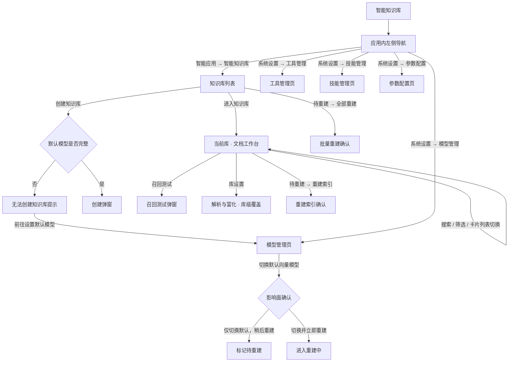
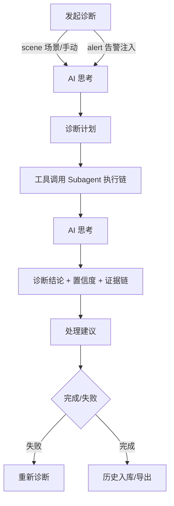
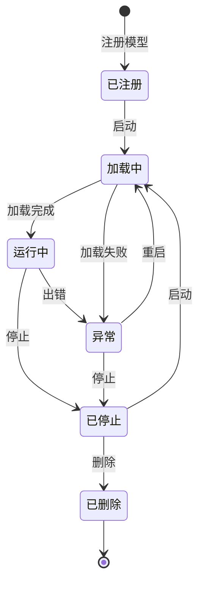
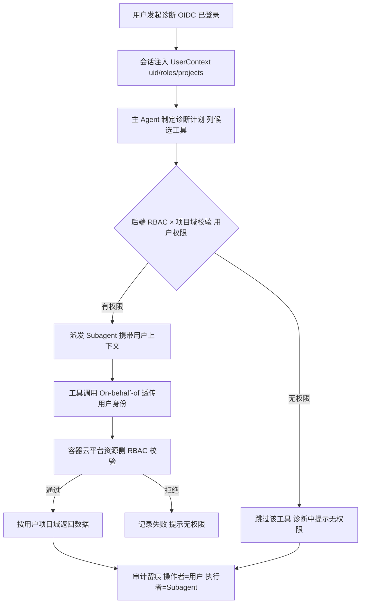
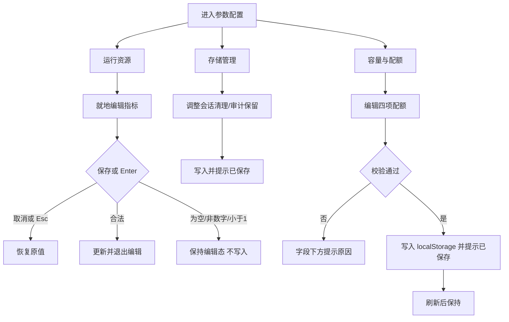

# 智能知识库 PRD

> **基线说明**：文档部分章节仍保留「智能诊断」原型的复刻内容，用于承接页面结构；「模型管理」「参数配置」与「知识库工作台」已按当前实现重写，其余知识库能力待逐项替换。

## 0. 文档信息
| 版本 | 日期 | 修改内容 | 作者 |
|------|------|---------|------|
| v1.0 | 2026-08-07 | 初稿，完整 PRD 结构 | lianghua |
| v2.0 | 2026-08-07 | 与当前原型实现对齐：移除管理面智能对话页、工具管理重构（协议/请求头/连通性测试/查看函数/调试）、告警中心 5 Tab（历史告警无智能诊断）、诊断流程「根因分析→诊断结论」、巡检 Skill 联动场景、历史记录单条导出、暂不支持多对话 Tab | lianghua |
| v3.0 | 2026-08-13 | 同步原型变更：对话助手命名统一为「Copilot AI 智能助手」；技能管理移除创建/编辑能力（仅保留导入/导出/删除）；新增配置管理（FR-6 Agent 运行参数配置） | lianghua |
| v3.1 | 2026-09-22 | 配置管理重构：参数设置→并发与配额、审计保留→会话留存，新增会话留存分区与导出审计数据功能（编辑按钮左侧）；模型/工具/技能管理 Header 对齐平台风格（标题行+工具栏行：创建居左、搜索/筛选居右，去掉独立筛选卡）；配置页标题栏右侧加提示文字 | lianghua |
| v0.1 | 2026-10-09 | 以「智能诊断」原型为 1:1 基线复刻，作为「智能知识库」改造起点 | lianghua |
| v0.2 | 2026-11-13 | 参数配置重构：移除继承自智能诊断的运行时资源/并发与配额/回收/审批/会话留存分区，改为「模型与索引 + 知识库默认配置 + 容量与配额」三分区；补充索引重建确认、分区保存与配额校验规则 | lianghua |
| v0.3 | 2026-11-13 | 知识库工作台改版：移除面包屑与占位页，改为标准顶部导航（返回 + 知识库详情）+ 可下拉库名 + 五 Tab；补齐概览、文档列表/卡片、分块、检索测试、设置与库级分块调整弹窗 | lianghua |
| v0.4 | 2026-11-13 | 范围收敛：进入库后固定当前库，不再切库；库内只保留文档卡片/列表，移除概览、分块、检索测试与设置；补齐搜索、状态筛选、视图切换、上传与批量操作 | lianghua |
| v0.5 | 2026-11-13 | 新增文档详情：点击卡片/列表行打开浮层，展示基本信息、可编辑摘要与原文预览；文件内容可在「预览 / 查看分块」间切换，片段支持编辑正文、恢复原文和启停，关闭的片段不参与检索 | lianghua |
| v0.6 | 2026-11-13 | 文档工作台工具栏重排：上传文档左置，状态筛选并入右侧搜索框；库名下方展示知识库描述；文档卡片与列表增加分页、每页条数与页码控制 | lianghua |
| v0.7 | 2026-11-14 | 默认模型落地：模型增加「对话/向量/重排」能力类型，模型管理新增三槽位默认配置（对话、向量必选，重排可选）、缺失警示与默认模型引用保护；知识库创建增加必选默认模型前置校验；参数配置改为运行资源/存储管理/数据保留 | lianghua |
| v0.8 | 2026-11-14 | 新增「多模态（vision）」模型能力，默认模型扩展为四槽位（对话、向量必选，重排、多模态可选）；补齐图片理解与扫描件解析的默认模型配置、缺失提示与可选项语义，多模态不影响知识库创建 | lianghua |
| v0.9 | 2026-11-15 | 多模态收敛为对话模型的能力标记：取消独立「vision」能力与默认槽位，默认模型恢复三槽位（对话、向量必选，重排可选）；对话模型可勾选「支持图片理解」，随对话默认模型生效；旧数据自动并入对话模型 | lianghua |
| v0.10 | 2026-11-15 | 参数配置改为页内双 Tab：保留「运行与存储」，新增「知识库配置」（默认分块策略/块大小/重叠、库创建人调整权限、容量配额）；默认值只影响新建库，知识库创建读取同一份持久化策略；不重复配置模型 | lianghua |
| v0.11 | 2026-11-15 | 知识库配置新增「解析与富化默认值」：AI 问题生成开关、每分块问题数量（1–10，默认 3）、问题生成要求（≤4000 字）；库内标题右侧新增「库设置」入口，可按库覆盖，只影响后续上传与重新解析 | lianghua |
| v0.12 | 2026-11-15 | 补齐向量索引迁移闭环：切换默认向量模型时展示影响面，可选择稍后重建或立即重建；知识库列表与工作台展示「待重建/重建中」状态，支持单库与批量重建并展示进度。新增库内最小「召回测试」：按当前索引模型检索、展示分数/高亮/统计，并可从结果查看原文 | lianghua |
| v0.13 | 2026-11-15 | 参数配置去 Tab、去平台知识库默认值：页面仅保留「运行与存储」（运行资源、存储管理）与「容量与配额」，取消默认分块策略、创建人调整权限与解析富化默认值；分块与解析富化改由库创建人在创建弹窗与库内「库设置」维护，产品只保留推荐预设，不提供平台级继承/覆盖概念 | lianghua |
| v0.14 | 2026-11-16 | 文档上传与列表提效：支持拖拽上传、分裂按钮（主按钮选文件 / 箭头选文件夹）；上传前校验格式、100MB 与库内及批次重名，未通过文件聚合为「部分文件未添加」弹层逐条说明，通过文件照常进入任务中心，单次超 50 个仅软提示；列表新增分块数列、失败与需重新解析行内重试、文件名与更新时间排序；任务中心完成数改为按已结束任务计数，关闭面板后浮层完全消失、不再保留右下角浮标，任务转入后台且进度在列表可见 | lianghua |

## 1. 业务背景
- **产品定位**: IssuePilot 智能诊断平台（Web 端）
- **目标用户**: 运维人员、SRE 工程师、DBA、安全工程师、平台管理员
- **用户体系**: 用户身份依托容器云平台底座功能 **OIDC** 统一认证（诊断平台无独立账号体系）；权限基于容器云平台 **RBAC** 模型，按「角色 → 权限 → 项目域」三级授权。用户**仅能查看与操作自己所属项目域内的资源**（Pod/服务/告警/巡检计划/日志等），跨项目资源不可见、不可操作（分权限分域隔离）
- **业务背景**: 原有 Electron 桌面端 + Python Server 架构存在部署成本高、算力无法共享、无多租户隔离、无平台级集成等痛点。需升级为 Web 平台化架构，深度融合容器云平台（GTCP+OIDC）和算力加速平台（GTCAP），实现 AI 模型、MCP 工具和诊断技能的统一管理
- **商业价值**: 运维诊断效率提升 60%，GPU 算力利用率提升 40%，多团队协作效率提升 50%
- **成功指标**: 模型注册到部署 ≤ 5 分钟，MCP 工具服务发现 ≤ 10 秒，对话首包响应 ≤ 3s，巡检覆盖率 100%
- **目标产品技术栈**: React + Vite + Tailwind CSS（原型实现，原型已采用 Element Plus 风格 + lucide-react 图标库）
- **入口位置**: 智能诊断平台（单入口子应用），管理面导航 + 应用面常驻对话按钮

## 2. 功能概览
IssuePilot 智能诊断平台提供 AI 驱动的智能诊断能力。架构遵循「统一主 Agent + 预置 Skill + 动态派发 Subagent」：用户不区分 Agent，对话统一由主 Agent 处理，主 Agent 按诊断计划动态派发 Subagent 执行预置 Skill（能力 = SKILL.md 技能文件，执行载体 = 动态 Subagent）。

平台定位「框架 + 内容」：管理面承载模型/工具/技能配置，应用面提供统一诊断入口（常驻对话 + 告警中心），具体故障场景通过定制 Skill 与 MCP 工具实现。

| 视图 | 模块 | 功能点 | 优先级 | 类型 |
|------|------|--------|--------|------|
| 管理面 | 模型管理 | 模型注册 | Must | 新增 |
| 管理面 | 模型管理 | 模型启停控制 | Must | 新增 |
| 管理面 | 模型管理 | 模型能力分类（对话/向量/重排，对话可标记多模态） | Must | 新增 |
| 管理面 | 模型管理 | 默认模型设置（对话 + 向量必选，重排可选） | Must | 新增 |
| 管理面 | 模型管理 | 对话模型「支持图片理解」标记（多模态随对话默认模型生效） | Should | 新增 |
| 管理面 | 模型管理 | 默认模型缺失提示与引用保护 | Must | 新增 |
| 管理面 | 工具管理 (MCP) | 工具添加/编辑/删除/启停 | Must | 新增 |
| 管理面 | 工具管理 (MCP) | 工具类型与协议（SSE/Streamable HTTP） | Must | 新增 |
| 管理面 | 工具管理 (MCP) | 自定义请求头 | Must | 新增 |
| 管理面 | 工具管理 (MCP) | 连通性测试 | Must | 新增 |
| 管理面 | 工具管理 (MCP) | 查看函数（行内展开） | Must | 新增 |
| 管理面 | 工具管理 (MCP) | 函数调试（独立页面） | Must | 新增 |
| 管理面 | 技能管理 | 技能导入/导出/删除 | Must | 新增 |
| 应用面 | 智能知识库 | 库列表 / 创建 / 文档工作台（卡片与列表、状态筛选与搜索、分页、上传文档/文件夹、单文档下载/重新解析/删除、文档详情、原文预览与片段编辑/启停、批量操作） | Must | 新增 |
| 应用面 | 智能知识库 | 向量索引迁移与重建（切换默认向量模型的影响面确认、待重建/重建中状态、单库与批量重建、进度与完成态） | Must | 新增 |
| 应用面 | 智能知识库 | 召回测试（库内按当前索引模型检索、TopK/阈值/重排开关、分数与命中片段高亮、查看原文） | Should | 新增 |
| 管理面 | 参数配置 | 运行与存储（运行资源 + 数据库/对象存储 + 会话清理/审计保留）、容量与配额（单库文档/存储、单文件大小、单用户建库），单页分区 | Should | 新增 |
| 应用面 | 智能诊断 | 常驻对话（场景卡片 6 个 + 手动输入） | Must | 新增 |
| 应用面 | 智能诊断 | 五阶段诊断流程（思考→计划→工具调用→结论→建议） | Must | 新增 |
| 应用面 | 智能诊断 | 工具卡片可视化（指标趋势/链路拓扑/火焰图） | Must | 新增 |
| 应用面 | 智能诊断 | 诊断历史（还原 + 单条导出） | Must | 新增 |
| 应用面 | 智能诊断 | 巡检 Skill 联动（复用平台巡检计划） | Should | 新增 |
| 运维面 | 告警中心 | 告警消息 3 Tab（指标/日志/事件） | Must | 新增 |
| 运维面 | 告警中心 | 告警概览与历史告警 | Must | 新增 |
| 运维面 | 告警中心 | 告警行内「智能诊断」联动 | Must | 新增 |

## 用户与权限模型

### 认证与授权（依托容器云平台）
- **认证**: OIDC统一认证，平台不维护独立账号体系。所有页面与 API 请求携带 OIDC ID Token / Access Token
- **授权**: RBAC 三级模型——**角色（Role）→ 权限（Permission）→ 项目域（Project/Workspace）**。用户在容器云平台被授予角色与所属项目，平台侧不重复授权，直接复用容器云平台的权限判定结果
- **分权限分域**: 用户仅能访问自己所属项目域内的资源。诊断目标（Pod/服务/节点）、日志、指标、链路、告警、巡检计划等全部按项目域过滤；跨项目数据不可见

### Agent 操作平台资源的权限继承方案（框架设计）
> 核心原则：**Agent 不持有平台身份，只代理发起用户的身份执行，权限只减不增**——智能诊断可以操作平台所有资源，但每一次操作都落在发起用户自己的权限边界内。

| 机制 | 说明 |
|------|------|
| **身份透传（On-behalf-of）** | 诊断会话绑定发起用户（OIDC claims：uid/roles/projects）；主 Agent 派发 Subagent 调用工具时，工具请求**携带用户上下文透传到后端**，后端以该用户身份调用容器云平台 API，资源侧 RBAC 自动校验。Agent 无独立账号，天然继承用户权限边界 |
| **项目域强制过滤（数据层兜底）** | 所有工具查询在服务端强制绑定用户所属项目域，即使工具端点可访问跨域数据，返回结果也只允许用户项目域内资源，杜绝越权取数 |
| **操作审计** | Agent 发起的每次工具调用/资源操作记录审计日志（操作者=发起用户、执行载体=Subagent、目标资源、时间、结果）；敏感操作（重启/执行/变更）需二次确认并强制留痕 |

**与现有原型衔接**：
- 工具权限统一由容器云平台 OIDC + RBAC 管控，原型不展示工具级权限声明/预检 UI，权限判定完全落在后端资源侧 RBAC 与项目域过滤
- 处理建议中的可执行项复用平台 RBAC——用户无执行权限时按钮置灰并提示「无 <权限>，无法执行」，与现有 `AGENT_EXEC_ENABLED=false` 逻辑衔接

## 3. 用户故事
- US-1: 作为平台管理员，我想要注册和管理 AI 模型并设置默认模型，以便于为智能诊断提供推理能力
- US-2: 作为平台管理员，我想要注册和管理 MCP 工具服务（协议/请求头/连通性测试/函数调试），以便于主 Agent 调用外部系统能力
- US-3: 作为平台管理员，我想要创建和管理诊断技能（SKILL.md），以便于将模型+工具编排为可复用的诊断能力
- US-4: 作为普通用户，我想要通过常驻对话或场景卡片直接发起智能诊断（无需选择智能体），以便于快速定位故障
- US-5: 作为普通用户，我想要查看诊断过程（Subagent 派发、工具调用、思考过程、证据链），以便于理解诊断逻辑
- US-6: 作为运维人员，我想要查看告警中心并在告警行直接发起智能诊断，以便于及时发现和处理系统异常
- US-7: 作为运维人员，我想要查看历史诊断记录并导出报告，以便于复盘与留档
- US-8: 作为运维人员，我想要询问集群健康状态时自动运行平台巡检计划并解读结果，以便于快速掌握系统健康
- US-9: 作为普通用户，我想要智能诊断只在我所属项目域内、以我的权限执行资源查询与操作，以便于不越权访问或变更他人资源
- US-10: 作为平台管理员，我想要统一配置知识库使用的对话、向量与重排默认模型，并标记对话模型是否支持图片理解，以便于所有知识库获得一致的问答、检索与多模态能力

## 4. 功能需求详单

**FR-1 模型管理**
| 项目 | 说明 |
|------|------|
| 用户故事 | US-1 |
| 优先级 | Must |
| 描述 | 模型注册、编辑、删除、启停与默认模型设置。模型按能力分为**对话模型（chat）／向量模型（embedding）／重排模型（rerank）**三类，由平台模型服务层统一封装，对外暴露标准协议接口。对话模型可额外标记「支持图片理解」（即多模态模型），不单独占用默认槽位，随对话默认模型一起生效。页面顶部为默认模型配置区，展示三类默认模型的就绪状态（对话与向量必选，重排可选）并提供「设置默认模型」入口；必选项未配置完整时以常驻提示条告知影响 |
| 输入 | 模型服务商（当前为算力加速平台，只读）、API 格式（OpenAI Chat Completions / OpenAI Responses / Anthropic Messages / Google Generative AI，默认 OpenAI Chat Completions）、请求地址 BaseURL（必填）、模型 ID（必填，支持从服务端获取候选列表）、模型能力（对话/向量/重排，必填）、支持图片理解（多模态，仅对话模型可勾选）、API Key（选填，内网或网关部署可留空）、最大输出长度（Token）与上下文窗口（Token，数值步进，默认 4096 / 128000）；默认模型设置：每个能力最多选择一个已启用的模型，对话与向量为必选、重排为可选，允许部分保存 |
| 输出 | 模型列表（含名称、能力标签、协议、请求地址、启用状态，默认模型额外带「默认」标识），按名称/能力检索；默认模型状态区展示「x/2 必选已配置」与三个槽位（重排标注「可选」）；未配置完整时展示缺项提示条 |
| 业务规则 | 1) 触发条件：进入页面加载模型列表与默认模型配置，并实时计算缺失能力 2) 校验逻辑：模型名称、能力、请求地址必填，不通过时在表单内提示；API Key 非必填 3) 能力语义：对话模型用于知识库问答与内容生成，勾选「支持图片理解」后同时处理图片、扫描件与图表问答；向量模型用于文档与问题向量化，二者为知识库可用性的必选能力；重排模型用于召回结果精排，为可选能力。多模态不是独立能力，不单独配置默认模型，跟随对话默认模型生效 4) 默认模型：每个能力最多一个默认模型，允许先保存已确定的槽位；仅当对话与向量均配置时状态为「已完成」，否则保持未完成并继续提示缺失的必选项；重排未配置不视为缺项 5) 引用保护：已被设为默认的模型不可停用、不可删除，需先在默认模型设置中替换 6) 更换向量模型会影响既有向量索引，保存前弹出「确认更换向量模型」提示，说明受影响知识库与文档数，并提供「仅切换默认，稍后重建」与「切换并立即重建」两个动作；具体迁移与重建规则见 FR-7 7) 停用模型后该模型不再出现在默认模型候选中；删除模型需二次确认 8) 检索：搜索框按模型名称、能力名称与「多模态」标记匹配，添加按钮固定居左、搜索固定居右 9) 数据通过 localStorage 持久化，刷新后保留；实际生效依赖后端模型服务 |
| 权限控制 | 仅平台管理员可注册/编辑/删除/启停模型与设置默认模型；业务用户不出现模型管理入口 |
| 状态流转 | 注册 → 列表新增且默认启用；编辑 → 保存后更新；停用 ⇄ 启用（默认模型不可停用）；删除 → 二次确认后移除（默认模型不可删除）；设置默认模型 → 选择槽位 → 保存 → 状态区与卡片标识同步更新 |

**验收标准 (Acceptance Criteria)**
- AC-1: Given 平台管理员已登录，When 进入模型管理页，Then 标题行 + 默认模型状态区 + 工具栏行（添加模型居左、搜索居右，同一行）+ 模型卡片列表，无独立筛选卡片
- AC-2: Given 默认模型均未配置，When 进入页面，Then 状态区显示「0/2 必选已配置」并展示三个槽位（对话、向量待配置，重排标注可选），页面出现常驻提示条说明必选缺项及对创建知识库的影响，不自动弹出设置弹窗
- AC-3: Given 点击「设置默认模型」，When 弹窗打开，Then 三个下拉分别对应对话、向量、重排能力，对话与向量标注必选、重排标注可选，候选仅包含该能力下已启用的模型，重排支持选择「不启用」；对话下拉中支持图片理解的模型名称后展示「（多模态）」
- AC-4: Given 默认模型弹窗，When 仅选择部分能力并保存，Then 已选槽位生效并持久化，状态区显示对应必选项数量；若仍缺少对话或向量则继续提示，不阻断保存
- AC-5: Given 对话与向量均已选择并保存，When 返回列表，Then 状态区显示「2/2 必选已配置」，必选项均为完成态，提示条消失；重排可配置也可留空，不影响完成态；对应模型卡片展示「默认」标识；支持图片理解的对话模型展示「多模态」标记
- AC-6: Given 点击「添加模型」，When 填写请求地址后点击「获取模型列表」，Then 展示可选模型 ID，选择后填写 API 格式、模型能力，对话模型可勾选「支持图片理解」，再填写 API Key 与 Token 参数并提交，列表新增记录且能力标签、多模态标记、上下文窗口正确；请求地址或模型 ID 为空时「添加」不可用
- AC-7: Given 某个模型已被设为默认，When 查看该卡片，Then 停用与删除操作不可用，需先更换默认模型
- AC-8: Given 已配置向量模型，When 在默认模型弹窗中更换为其他向量模型并保存，Then 弹出「确认更换向量模型」提示，说明受影响的知识库与文档量，确认后才写入
- AC-9: Given 旧版本将多模态作为独立能力并设置过独立默认槽位，When 加载升级后的模型数据，Then 原多模态模型自动转为对话模型并保留「多模态」标记，独立默认槽位被移除，对话与向量必选判定不受影响
- AC-9: Given 模型列表，When 输入名称或能力关键词，Then 仅展示匹配的模型；清空搜索后恢复全部
- AC-10: Given 已完成默认模型配置，When 刷新页面，Then 默认模型配置与模型启停状态保持一致

**FR-2 工具管理 (MCP)**
| 项目 | 说明 |
|------|------|
| 用户故事 | US-2 |
| 优先级 | Must |
| 描述 | MCP 工具服务的注册与管理中心（仅 MCP Server，不提供自定义工具）。服务端部署：协议仅支持 SSE / Streamable HTTP（不支持 Stdio）；支持自定义请求头（鉴权通过 Authorization 等请求头承载）、连通性测试、函数查看与函数调试；MCP Server 具备完整生命周期状态 |
| 输入 | 协议（SSE/Streamable HTTP）、工具名称、服务器地址、描述、自定义请求头（key-value，可承载鉴权信息） |
| 输出 | 工具列表（含 ID、工具名称、工具类型、协议、路径/来源、开关 + 异常错误图标）+ 统计概览（状态视角：总计/已就绪/异常/已禁用）|
| 业务规则 | 1) 触发条件: 进入页面自动加载工具列表 2) 校验逻辑: 协议仅 SSE / Streamable HTTP（服务端部署不支持 Stdio），端点格式为 URL；鉴权信息通过自定义请求头承载（如 Authorization: Bearer xxx），无需独立鉴权配置 3) 冲突处理: 不可重复注册同一端点 4) 部署方式: 服务端已部署，客户端仅对接，不负责部署 5) 函数调试: 选择函数→按 Schema 填参→运行→深色控制台输出结果 6) 状态与开关: MCP Server 7 态——disabled(管理员停用，开关关)/connecting(开启中，开关开+转圈)/ready(开启成功，开关开)/degraded、authRequired、incompatible、unavailable(均为开启失败，开关回关并附错误图标)；其中 connecting 为开启/刷新过程的瞬时态，4 个异常态为开启失败的稳定态（鼠标移入错误图标展示原因） 7) 连通性测试: 测试返回映射为 ready(成功)/authRequired(鉴权请求头缺失或失效)/incompatible(协议或目录不符)/unavailable(地址或网络不可达) 8) 检索与筛选: 页面提供搜索框（按名称模糊检索，带一键清空）+ 类型筛选 tab（全部/内置工具/MCP 工具）+ 状态筛选 tab（全部/已就绪/异常/已禁用），两类 tab 可组合叠加；统计卡片为状态视角——总计=全部工具数、已就绪=ready、异常=4 个异常态合计、已禁用=disabled；调试功能保留代码（独立页面）但列表操作列不展示「调试」按钮 |
| 权限控制 | 仅平台管理员可注册/编辑/删除/启停工具|
| 状态流转 | 已注册 →(点击开启)→ connecting(转圈) →(成功)→ ready；(开启失败)→ 异常态（开关回关+错误图标）；ready →(停用)→ disabled；函数可查看（行内展开）与调试（独立页面） |

**验收标准 (Acceptance Criteria)**
- AC-1: Given 平台管理员已登录，When 进入工具管理页，Then 标题行 + 工具栏行（添加工具按钮居左、状态 tab + 搜索框居右，同一行），无独立筛选卡片；下方显示工具列表（ID/名称/类型/协议/路径/开关+异常错误图标）与统计概览（状态视角：总计/已就绪/异常/已禁用）
- AC-2: Given 点击「添加工具」，When 表单直接为 MCP Server（无自定义工具选项），填写（协议/名称/地址/请求头）并点击「连通性测试」，Then 显示测试结果并映射为对应状态（ready/authRequired/unavailable 等）
- AC-3: Given 添加工具表单，When 配置自定义请求头（如 Authorization: Bearer xxx），Then 可增删多组请求头，鉴权信息通过该头部承载，无独立鉴权配置项
- AC-4: Given 添加工具表单，When 配置自定义请求头（添加头部 key-value），Then 可增删多组请求头
- AC-5: Given 工具列表操作列，When 点击「查看函数」，Then 在该行下方直接展开函数列表（无弹窗、无遮罩），再次点击收起
- AC-6: Given 工具列表操作列，When 点击「查看函数」，Then 在该行下方直接展开函数列表（无弹窗、无遮罩），再次点击收起；调试功能保留独立页面代码但列表操作列不展示「调试」按钮
- AC-7: Given 工具状态列，When 点击开关开启，Then 先进入 connecting(转圈)，成功落 ready、失败落异常态（开关回关+错误图标）；点击开关关闭，Then 落 disabled

**FR-3 技能管理**
| 项目 | 说明 |
|------|------|
| 用户故事 | US-3 |
| 优先级 | Must |
| 描述 | 可复用的诊断技能管理。技能 = SKILL.md 文件（frontmatter: name/description/version + 正文指令），文件存在即生效，无启用/禁用生命周期状态。原型不提供创建与编辑入口（技能以 SKILL.md 文件形式存在即生效，由开发侧维护），页面仅支持导入/导出/删除 |
| 输入 | 导入：SKILL.md 文件或技能.zip 文件（包含多个 SKILL.md 文件）（解析 frontmatter: name/description/version + 正文指令）；|
| 输出 | 技能卡片列表（含技能名称、描述、版本、更新时间）+ 分页 |
| 业务规则 | 1) 触发条件: 进入页面自动加载技能列表 2) 文件模式: 技能无来源/状态标签，不绑定模型；创建/编辑不在原型 UI 提供（符合"技能即文件"理念，由开发侧维护 SKILL.md）3) 交互: 仅支持导入（解析 frontmatter）、导出（下载 .md）、删除（需确认）|
| 权限控制 | 仅平台管理员可导入/删除技能 |
| 状态流转 | 导入 → 解析 frontmatter → 列表新增卡片；删除 → 确认 → 移除 |

**验收标准 (Acceptance Criteria)**
- AC-1: Given 平台管理员已登录，When 进入技能管理页，Then 标题行 + 工具栏行（导入技能按钮居左、搜索框居右，同一行），无独立筛选卡片，下方显示技能卡片列表和分页
- AC-2: Given 点击「导入技能」，When 上传 .md 文件/zip 文件，Then 自动解析 frontmatter 并预览名称/描述/版本，确认后入库
- AC-3: Given 技能卡片，When 点击「导出」，Then 下载该技能的 SKILL.md 文件/zip 文件
- AC-4: Given 点击「删除」，When 弹窗确认，Then 删除后不可恢复
- AC-5: Given 技能管理页，When 查看操作区，Then 仅显示「导出」「删除」按钮，无「创建」「编辑」入口

**FR-4 智能诊断（应用面统一入口）**
| 项目 | 说明 |
|------|------|
| 用户故事 | US-4, US-5, US-8 |
| 优先级 | Must |
| 描述 | 应用面统一诊断入口。双入口：① 常驻对话（右下角浮动按钮，场景模式+手动输入主题）；② 告警中心行内「智能诊断」（alert 预填模式）。对话助手统一命名为「Copilot AI 智能助手」（顶部标题、欢迎语、导出报告标题均使用该命名）。 |
| 输入 | scene 模式：场景卡片（6 个固定场景）或手动输入（通用诊断主题）；alert 模式：告警行上下文（策略/级别/目标/消息）自动注入 |
| 输出 | 五阶段消息流：用户请求 → AI 思考（折叠）→ 诊断计划 → 工具调用（Subagent 执行链）→ AI 思考（折叠）→ 诊断结论（含置信度 + 可展开证据链）→ 处理建议（可执行项带按钮，无执行能力时提示联系管理员） |
| 业务规则 | 1) 场景卡片固定 6 个：容器故障诊断/日志异常分析/性能剖析/数据库慢查询/网络排障/集群健康巡检 2) 工具卡片两层展示：外层=工具名+参数+结果汇总+Subagent 执行链；内层点击展开=原始内容+SVG 可视化（指标趋势/链路拓扑/火焰图） 3) 执行能力开关 AGENT_EXEC_ENABLED=false 时，处理建议区提示「当前无可执行智能体，请联系平台管理员」 4) 诊断历史持久化（最近 20 条），双入口共用，点击还原完成态，每条可「导出报告」（Markdown 下载） 5) 巡检场景：复用平台已创建的巡检计划，不重复实现定时调度——派发「巡检执行 Subagent」执行 inspection-run/health-check/report-analysis skill |
| 权限控制 | 所有登录用户可发起智能诊断 |
| 状态流转 | 发起 → 思考 → 计划 → 工具调用 → 思考 → 结论 → 建议 → 完成/失败（失败可重新诊断）；scene 模式可「换个场景」；可追问不重置状态 |

**验收标准 (Acceptance Criteria)**
- AC-1: Given 常驻对话入口，When 点击右下角浮动按钮，Then 空态显示 6 个场景卡片 + 手动输入框
- AC-2: Given 场景卡片，When 点击任一场景，Then 以该主题进入五阶段诊断；手动输入走「通用诊断」主题
- AC-3: Given 诊断进行中，When 五阶段推进，Then 每条 AI 消息逐条流式出现（思考折叠/计划/工具/结论/建议）
- AC-4: Given 工具调用阶段，When 展开工具卡片，Then 显示 Subagent 执行链（[subagent] → [skill]）和原始查询结果/SVG 图表
- AC-5: Given 诊断完成，When 查看诊断结论卡，Then 显示「诊断结论」+ 置信度（高/中/低）+ 可展开证据链
- AC-6: Given 处理建议区，When 无执行能力，Then 显示「当前无可执行智能体，请联系平台管理员」
- AC-7: Given 诊断历史，When 点击历史记录，Then 还原该次诊断完成态；点击「导出报告」下载 Markdown
- AC-8: Given 巡检场景，When 用户询问集群健康状态，Then 自动运行平台已创建的巡检计划并解读结果

**FR-5 告警中心**
| 项目 | 说明 |
|------|------|
| 用户故事 | US-6 |
| 优先级 | Must |
| 描述 | 告警消息中心，增加智能诊断入口。 |
| 输入 | 指标告警/日志告警/事件告警 Tab 操作栏增加 智能诊断按钮；告警行上下文（策略/级别/目标/消息）自动注入 |
| 输出 | 五阶段消息流：用户请求 → AI 思考（折叠）→ 诊断计划 → 工具调用（Subagent 执行链）→ AI 思考（折叠）→ 诊断结论（含置信度 + 可展开证据链）→ 处理建议（可执行项带按钮，无执行能力时提示联系管理员）|
| 业务规则 | 1) 指标告警/日志告警/事件告警：行内「智能诊断」按钮 → 注入告警上下文发起诊断（alert 模式） 2) 历史告警：仅展示数据，不提供智能诊断入口  3) 入口：仅 12 宫格全局导航「运维中心 → 告警中心」调出（默认隐藏），告警中心页自带导航栏，隐藏常驻智能中心导航 |
| 权限控制 | 运维人员和项目中普通用户可发起告警智能诊断；各自只能访问自身权限的资源 |
| 状态流转 | Tab 切换 → 筛选 → 查询 → 列表展示；行内「智能诊断」→ 打开共享诊断对话框（alert 模式自动发起） |

**验收标准 (Acceptance Criteria)**
- AC-1: Given 告警中心，When 进入页面，Then 显示 5 个 Tab（概览/指标/日志/事件/历史）
- AC-2: Given 指标/日志/事件告警 Tab，When 点击行内「智能诊断」，Then 打开共享诊断对话框并预填告警上下文自动发起诊断
- AC-3: Given 历史告警 Tab，When 查看列表，Then 不显示「操作」列（无智能诊断入口）
- AC-4: Given 概览 Tab，When 查看，Then 显示统计卡片和告警类型分布
- AC-5: Given 筛选区，When 填写筛选条件并点击「查询」，Then 列表按条件过滤
**FR-6 参数配置（运行与存储 + 容量与配额）**
| 项目 | 说明 |
|------|------|
| 用户故事 | US-10（平台管理员统一维护知识库运行资源、存储保留与容量配额） |
| 优先级 | Should |
| 描述 | 平台管理员单页配置中心，侧边导航名称为「参数配置」，页面标题为「参数配置」。页面不使用 Tab，按分区纵向排列**运行资源**、**存储管理**、**容量与配额**：运行资源沿用执行环境申请量与四项运行指标；存储管理展示数据库/对象存储用量并维护会话清理与审计保留；容量与配额维护平台级资源上限。分块策略与解析富化不再设平台默认值，改由库创建人在创建弹窗与库内「库设置」直接维护，产品只提供内置推荐预设。模型选择不在本页重复配置，统一收敛到「模型管理」 |
| 输入 | 1) 运行与存储：CPU 0.2 核、内存 256 MiB（只读）；执行环境数量上限 50 个、单轮子智能体并发上限 4 个、闲置回收 15 分钟、用户响应时限 30 分钟；数据库/对象存储用量（只读）；会话自动清理 30 天、审计保留 180 天；2) 容量配额：单库文档上限 5000 篇、单库存储上限 50 GB、单文件大小上限 100 MB、单用户建库上限 20 个 |
| 输出 | 页头标题「参数配置」+ 说明「管理运行资源、审批策略与审计留存等平台配置」+ 单列滚动分区。运行资源卡片含 CPU/内存只读条与四项就地编辑指标；存储管理卡片含数据库、对象存储用量与保留策略；容量与配额卡片顶部展示四项当前用量概览，下方为四个配额输入与「还原/保存」，卡片头带「保存后立即生效」徽标 |
| 业务规则 | 1) **导航结构**：系统设置下只保留一个「参数配置」入口，不拆二级导航，也不设页内 Tab 2) **容量语义**：配额为平台级硬上限，调低后仅阻止后续上传，不删除已有文档与数据 3) **配额校验**：四项均为正整数，单文件大小不得超过单库存储上限；非法值阻止保存并在字段下方提示原因 4) **持久化**：仅配额写入 localStorage（`ikb-platform-settings-v1`），刷新后保留；运行指标为演示态内存数据 5) **就地编辑**：运行指标同一时间仅一项处于编辑态，Enter 保存、Esc 取消，为空/非数字/小于 1 不写入 6) **只读项**：执行环境申请量、数据库/对象存储用量不支持手工修改 7) **模型校验**：知识库创建仍只校验对话与向量默认模型，重排可选，与本页无关 8) **边界收敛**：本页不提供默认分块、解析富化、库创建人调整权限等知识库内容配置，避免与库内设置重复；知识库侧只保留内置推荐预设，不引入平台默认继承/覆盖概念 |
| 权限控制 | 仅平台管理员可查看和修改；业务用户不可见本页。知识库创建人只维护自己库的分块与解析富化，不能修改平台配额 |
| 状态流转 | 进入页面 → 自上而下查看运行资源、存储管理、容量与配额 → 就地编辑运行指标（Enter 保存 / Esc 取消）→ 编辑配额 → 保存（校验通过写入并提示已保存）/ 还原（恢复最近一次保存值）；刷新页面后以已保存配额为准 |

**验收标准 (Acceptance Criteria)**
- AC-1: Given 平台管理员已登录，When 进入参数配置页，Then 侧边导航与页面标题均为「参数配置」，页面无 Tab，纵向展示运行资源、存储管理、容量与配额三个分区
- AC-2: Given 默认进入页面，When 查看运行资源，Then 展示 CPU 0.2 核 / 内存 256 MiB 只读条与四项可就地编辑的运行指标，布局与此前一致
- AC-3: Given 运行资源指标，When 点击「编辑」，Then 原数值变为数字输入框并聚焦，出现保存/取消；Enter 保存、Esc 取消，为空、非数字或小于 1 时不写入
- AC-4: Given 查看存储管理，When 查看数据库/对象存储卡片，Then 展示已用、占用构成、可用空间与总容量，且无手工修改入口
- AC-5: Given 存储管理，When 修改会话自动清理或审计保留并保存，Then 写入成功并提示；刷新后保持
- AC-6: Given 容量与配额，When 查看顶部，Then 展示单库文档、单库存储、单文件大小、单用户建库四项当前用量概览
- AC-7: Given 配额输入，When 任一项为空、非数字或非正整数，Then 阻止保存并在字段下方提示原因
- AC-8: Given 单文件大小上限，When 其大于单库存储上限，Then 阻止保存并提示两者关系
- AC-9: Given 合法配额，When 点击保存，Then 写入 localStorage 并提示已保存；刷新页面后保持，点击还原恢复最近一次保存值
- AC-10: Given 调低任一配额，When 保存成功，Then 仅影响后续上传，不删除已有文档与数据
- AC-11: Given 参数配置页，When 浏览全页，Then 不出现默认分块策略、库创建人调整权限、解析与富化默认值等知识库内容配置
- AC-12: Given 新建知识库，When 打开创建弹窗，Then 初始分块参数使用内置推荐预设（自动 512/80），可在高级设置中修改，不读取平台默认值
- AC-13: Given 某个知识库的文档工作台，When 点击标题右侧「库设置」，Then 打开库设置弹窗，可分别维护分块参数与解析富化（AI 问题生成开关、问题数量 1–10、要求 ≤4000 字），展示「使用推荐配置/已自定义」并支持「恢复推荐值」；保存后仅对后续上传与重新解析生效

**FR-7 向量索引迁移与重建**
| 项目 | 说明 |
|------|------|
| 用户故事 | US-10（平台管理员更换默认向量模型时可知晓影响面并控制重建时机；知识库创建人可恢复新模型的检索效果） |
| 优先级 | Must |
| 描述 | 默认向量模型变更后，已建知识库的索引不会自动重算。切换前展示受影响的知识库与文档数，切换时允许选择「仅切换默认，稍后重建」或「切换并立即重建」；知识库列表与文档工作台展示「待重建/重建中」状态，支持单库重建与批量重建，并在完成后记录新模型与重建时间。空知识库无索引，直接随新默认模型生效，不进入待重建 |
| 输入 | 1) 平台管理员在「模型管理 → 设置默认模型」中把向量槽位从模型 A 切换为模型 B；2) 已建知识库的文档数与当前索引模型；3) 迁移动作（稍后重建/立即重建）；4) 库内「重建索引」或列表「全部重建」触发 |
| 输出 | 1) 切换确认弹窗（600px）：提示「将影响 N 个知识库、M 篇文档的索引」，逐库展示当前模型、文档数与待重建状态，并提示空库会直接使用新模型；2) 两个确认动作「仅切换默认，稍后重建」「切换并立即重建」；3) 知识库列表顶部待重建提示条与卡片状态徽标（「待重建」/「重建中」），待重建卡片底部提供「重建」；4) 文档工作台标题旁状态徽标、迁移提示条与「重建索引」入口；5) 单库/批量重建确认弹窗，展示目标模型、库数与文档数；6) 重建进度（百分比）与完成提示 |
| 业务规则 | 1) **触发条件**：只有默认向量模型真正发生变化时才进入影响面确认；同一模型保存不触发 2) **影响面**：仅统计已有文档的知识库；空知识库不计入影响数量，并立即把索引模型切换为新默认模型 3) **稍后重建**：保存新默认模型后，受影响库标记为「待重建」，旧索引仍可查看但检索结果需提示模型已过期 4) **立即重建**：保存后立即把受影响库置为「重建中」，从 0% 开始推进，全部完成后统一记录新模型与完成时间 5) **重建目标**：重建期间锁定触发时的目标模型；若默认模型再次变化，待重建库以最新默认模型为准，已在重建的任务完成后再按新目标标记 6) **单库重建**：仅重建当前库，完成后清除该库的待重建状态 7) **批量重建**：仅处理当前所有待重建库，重建中与已就绪库不重复处理 8) **进度与持久化**：索引状态写入 localStorage（`ikb-kb-index-v1`），刷新后保留待重建/重建中/已就绪状态；原型用定时进度模拟，实际由后端任务驱动 9) **完成态**：状态回到「已就绪」，展示新模型名称与重建日期，卡片与工作台不再出现迁移提示 10) **不回溯**：切换默认模型不修改知识库内已选的分块、富化等配置，也不删除旧索引数据 |
| 权限控制 | 切换默认向量模型仅平台管理员可操作；知识库创建人可在自己有权限的库内触发单库重建。普通业务用户只读查看状态，不展示重建入口 |
| 状态流转 | 已就绪（模型 A）→ 切换默认模型 → 影响面确认 → 稍后重建：待重建 → 触发重建 → 重建中（0–100%）→ 已就绪（模型 B）；或立即重建：重建中（0–100%）→ 已就绪（模型 B）；空知识库：已就绪（模型 A）→ 已就绪（模型 B） |

**验收标准 (Acceptance Criteria)**
- AC-1: Given 平台管理员在默认模型设置中把向量模型从 A 切换为 B，When 存在使用 A 建索引的知识库，Then 弹出影响面确认，展示受影响知识库数、文档总数、逐库模型与文档数，并提供「仅切换默认，稍后重建」「切换并立即重建」
- AC-2: Given 影响面确认弹窗，When 存在文档数为 0 的知识库，Then 该库不计入影响数量，并在弹窗中提示空库会直接使用新默认模型
- AC-3: Given 选择「仅切换默认，稍后重建」，When 返回知识库列表，Then 默认向量模型已更新，受影响库显示「待重建」徽标与提示条，空库直接显示新模型且无待重建状态
- AC-4: Given 存在待重建知识库，When 查看知识库列表，Then 顶部提示条展示待重建库数量与旧模型名称，并提供「全部重建」，卡片底部提供单库「重建」
- AC-5: Given 点击单库「重建」，When 确认，Then 弹窗展示目标模型与文档数，确认后该库进入「重建中」并展示进度，其他待重建库不受影响
- AC-6: Given 点击「全部重建」，When 确认，Then 仅所有待重建库进入「重建中」，确认弹窗展示本次重建的库数与文档总数
- AC-7: Given 重建推进到 100%，When 完成，Then 库状态变为「已就绪」，索引模型更新为目标模型并展示重建日期，迁移提示消失
- AC-8: Given 选择「切换并立即重建」，When 保存默认模型，Then 受影响库直接进入「重建中」，不出现待重建中间态
- AC-9: Given 某个待重建库的文档工作台，When 进入，Then 标题旁展示「待重建」徽标与旧模型提示，提供「重建索引」；重建中展示进度与「重建中」徽标
- AC-10: Given 重建状态已写入 localStorage，When 刷新页面，Then 待重建/重建中/已就绪状态与进度保持；重建中任务继续推进至完成

**FR-8 召回测试（库内最小闭环）**
| 项目 | 说明 |
|------|------|
| 用户故事 | US-11（知识库创建人上传文档后，希望用真实问题验证当前索引能否召回正确片段，并快速定位原文） |
| 优先级 | Should |
| 描述 | 文档工作台标题右侧提供「召回测试」入口。弹窗内按当前库索引模型执行一次混合检索，展示命中分块、相似度分数、关键词高亮与检索统计；支持调整 TopK、分数阈值与是否重排（平台已配置默认重排模型时），并可从结果直接打开对应文档。定位为最小验证工具，不在库内展开完整检索调试台 |
| 输入 | 1) 当前知识库与索引模型；2) 查询文本（默认示例问题，支持 Ctrl/⌘+Enter 执行）；3) TopK（1/3/5/10/20，默认 5）；4) 分数阈值（0–1，默认 0.3）；5) 是否重排（仅当存在默认重排模型时可开启）；6) 示例问题快捷项 |
| 输出 | 1) 弹窗（900px）：顶部展示库名、索引模型、文档数与索引状态；2) 查询输入、TopK/阈值控件、重排开关与「开始测试」；3) 结果卡片：排名、文档名与标题、分数（按高低着色）、命中正文（关键词高亮，最多 3 行）、检索策略/消耗 token/AI 问题标记；4) 统计行「命中 N 个分块 · 候选 M · 耗时 Xms · 已重排/未重排」；5) 无结果空态与调整建议；6) 「查看原文」打开对应文档详情 |
| 业务规则 | 1) **入口**：仅在文档工作台内提供，作为库级验证工具，不进入平台参数配置，也不作为独立一级页面 2) **索引模型**：使用该库当前索引模型检索；待重建/重建中时顶部展示模型过期提示，仍允许测试但结果需按旧索引理解 3) **TopK**：只控制返回条数，不改变候选集；候选数用于统计说明 4) **阈值**：低于阈值的分块不进入结果；阈值过高导致空结果时提示降低阈值或更换问法 5) **重排**：未配置默认重排模型时开关禁用并说明原因；开启后对候选结果重新排序并提高标题相关片段的分数 6) **高亮**：按查询中的中文二元词与英文单词匹配正文并高亮，不修改原文 7) **查看原文**：从结果跳转到对应文档详情，保留当前库上下文 8) **范围**：当前只做单轮查询与结果验证，不提供批量评测集、召回率报表、向量/关键词策略切换或检索参数平台化 9) **模拟实现**：原型使用本地模拟分块与打分，耗时与 token 为演示数据，不调用真实向量服务 |
| 权限控制 | 拥有该知识库查看权限的用户可使用召回测试；结果仅展示其有权访问的库内文档 |
| 状态流转 | 打开弹窗 → 自动执行默认查询（或输入后执行）→ 加载 → 展示结果/空态 → 调整 TopK/阈值/重排 → 重新执行 → 查看原文并关闭 |

**验收标准 (Acceptance Criteria)**
- AC-1: Given 某个知识库的文档工作台，When 查看标题右侧操作区，Then 展示「召回测试」与「库设置」入口
- AC-2: Given 打开召回测试，When 弹窗加载完成，Then 展示库名、当前索引模型、文档数，并自动执行默认查询返回结果
- AC-3: Given 查询输入，When 按 Ctrl/⌘+Enter 或点击「开始测试」，Then 执行检索并展示加载态，完成后展示命中结果与统计
- AC-4: Given 结果列表，When 查看卡片，Then 展示排名、文档与标题、分数、最多 3 行高亮正文，以及策略/token/AI 问题信息
- AC-5: Given TopK 从 5 调整为其他值，When 重新执行，Then 返回条数随之变化，候选数与统计同步更新
- AC-6: Given 提高分数阈值，When 重新执行，Then 低于阈值的分块被过滤；无结果时展示空态与调整建议
- AC-7: Given 平台未配置默认重排模型，When 查看重排开关，Then 开关禁用并提示需先配置重排模型；已配置时可切换并按重排结果展示
- AC-8: Given 点击某条结果的「查看原文」，When 跳转，Then 打开对应文档详情并关闭召回测试弹窗
- AC-9: Given 知识库处于待重建状态，When 打开召回测试，Then 顶部展示索引模型过期提示，测试仍可执行
- AC-10: Given 无结果，When 查看，Then 展示空态、当前阈值与 TopK，并给出降低阈值或更换问法的建议

**F-Copilot 对话助手统一命名 Copilot AI 智能助手**
| 项目 | 说明 |
|------|------|
| 用户故事 | US-1（平台管理员/SRE 使用诊断助手） |
| 优先级 | Must |
| 描述 | 对话助手统一命名为「Copilot AI 智能助手」，覆盖对话框顶部标题、欢迎语、导出报告标题。替代原「智能诊断助手」，定位更通用（对话框已承载诊断/巡检/知识库检索等） |
| 输入 | 无（命名变更，纯文案/标识调整） |
| 输出 | 顶部标题「Copilot AI 智能助手」/「Copilot AI 智能助手 · 告警」；欢迎语「你好，我是 Copilot AI 智能助手」；导出报告「Copilot AI 智能助手诊断报告」 |
| 业务规则 | 1) 触发条件: 渲染对话框任意入口 2) 一致性: 顶部标题/欢迎语/报告标题必须使用同一命名 3) 告警模式下标题追加「· 告警」后缀 |
| 权限控制 | 无 |
| 状态流转 | 无 |

**验收标准 (Acceptance Criteria)**
- AC-1: Given 打开诊断对话框（常驻或告警入口），When 查看顶部标题，Then 显示「Copilot AI 智能助手」或「Copilot AI 智能助手 · 告警」
- AC-2: Given 新对话欢迎态，When 查看，Then 欢迎语为「你好，我是 Copilot AI 智能助手」
- AC-3: Given 导出诊断历史，When 查看 Markdown 报告，Then 一级标题为「Copilot AI 智能助手诊断报告」

**F-Perm 工具权限统一 OIDC + RBAC 管控**
| 项目 | 说明 |
|------|------|
| 用户故事 | US-10（平台管理员保障平台安全与可追溯） |
| 优先级 | Must |
| 描述 | 移除工具级「所需权限域」声明与前端预检 UI，工具权限判定完全落在后端资源侧 RBAC 与项目域过滤。前端不展示工具级权限声明/预检 UI |
| 输入 | 无（移除字段） |
| 输出 | 工具管理表单不含「所需权限域」字段；对话工具卡片不展示「以用户身份执行 · 权限域 · 项目域」 |
| 业务规则 | 1) 触发条件: 加载工具管理页 / 诊断工具调用 2) 权限判定: 由后端 OIDC 身份透传 + 资源侧 RBAC + 项目域强制过滤完成，前端不二次声明 3) 权限不足: 后端拒绝，诊断中提示无权限（前端不预检拦截） |
| 权限控制 | 平台 OIDC + RBAC（资源侧） |
| 状态流转 | 无 |

**验收标准 (Acceptance Criteria)**
- AC-1: Given 平台管理员进入工具管理页，When 查看注册/编辑表单，Then 无「所需权限域」字段
- AC-2: Given 诊断对话展示工具卡片，When 查看，Then 不显示「权限域」字样，仅保留身份透传与项目域信息（如有）
- AC-3: Given 用户无某工具执行权限，When 工具被调用，Then 由后端 RBAC 拒绝并提示无权限，前端不做工具级预检拦截

## 5. 交互流程

### 5.1 页面导航主流程

文字流程：进入智能知识库 → 通过应用内左侧导航切换「智能应用」（智能知识库）与「系统设置」（模型管理/工具管理/技能管理/参数配置）→ 知识库列表可创建知识库，创建前校验平台必选默认模型（对话、向量）是否完整，缺失时弹出阻断提示并可跳转模型管理自动打开「设置默认模型」；默认模型完整时进入单步创建弹窗。点卡片进入当前库的文档工作台；库内固定当前库、不再切库，不提供概览与独立设置页，库名下方展示库描述，主体为文档卡片/列表，支持状态筛选与搜索、分页、文件名与更新时间排序、拖拽或分裂按钮上传（上传前校验格式/大小/重名）与批量操作；点击文档可查看基本信息、摘要与原文预览，并可切换到分块视图编辑、启停片段。工作台标题右侧提供「召回测试」与「库设置」：前者按当前索引模型做一次检索验证，展示分数、高亮与统计，并可查看原文；后者按库覆盖解析与富化配置。管理员在模型管理切换默认向量模型时，若存在受影响知识库，先展示影响面并选择「仅切换默认，稍后重建」或「切换并立即重建」；待重建库在列表与工作台展示徽标和提示条，可从卡片、工作台或列表「全部重建」发起重建并查看进度。参数配置仅管理员可见，单页维护运行资源、存储管理和容量与配额；分块与解析富化改由库创建人在创建弹窗和库内「库设置」维护，只保留内置推荐预设。页面不使用面包屑：顶部为「返回 + 知识库详情」标准导航栏，下方固定展示当前库名与文档数。

### 5.2 五阶段诊断流程

文字流程：发起诊断 → AI 思考（折叠）→ 展示诊断计划 → 动态派发 Subagent 并行执行 Skill（工具卡片可展开原始内容+图表）→ 回收回报后再思考 → 输出诊断结论（置信度+证据链）→ 给出处理建议（可执行项带按钮）→ 完成入库历史

### 5.3 巡检 Skill 联动流程

文字流程：用户询问集群健康状态 → 主 Agent 识别意图 → 派发「巡检执行 Subagent」→ 运行平台已创建的巡检计划（inspection-run）→ 采集健康状态（health-check）→ 分析结果（report-analysis）→ 输出健康结论与风险项解读

### 5.4 模型状态机

文字流程：注册 → 启动 → 加载中 → 运行中 → 停止 → 已删除；运行中/加载中可进入异常状态，异常后停止或重启

### 5.5 Agent 权限执行流程（身份透传）

文字流程：OIDC 登录用户发起诊断 → 会话注入 UserContext → 主 Agent 按「用户权限 × 工具权限声明」预检 → 无权限工具跳过并提示 → 有权限工具由 Subagent 携带用户上下文执行 → 工具调用以用户身份透传到容器云平台 → 资源侧 RBAC 校验 + 项目域过滤 → 每次操作审计留痕

### 5.6 参数配置单页与容量配额流程

文字流程：进入参数配置即展示单页分区，自上而下为运行资源、存储管理、容量与配额。运行指标以就地编辑方式修改，Enter 保存、Esc 取消；存储保留期限修改后立即保存并提示。容量配额编辑四项数值，保存时校验正整数、单文件大小不超过单库存储上限，校验通过写入 localStorage 并提示，还原恢复最近一次保存值。页面不提供默认分块、创建人调整权限或解析富化默认值；新建知识库直接使用内置推荐预设，库内「库设置」由创建人维护分块与解析富化，保存后仅对后续上传与重新解析生效。

## 6. 非功能性需求
- **性能**: 页面加载 ≤ 2s，列表查询 ≤ 500ms，诊断五阶段每步推进 0.8~1.2s（模拟流式），对话首包响应 ≤ 3s
- **安全**: 所有 API 经 OIDC 认证（SSO，无独立账号体系）；RBAC 三级授权（角色→权限→项目域）；项目域数据隔离，用户仅可见所属项目资源；Agent 执行遵循身份透传（On-behalf-of），权限只减不增、不提供独立平台账号；工具调用前做权限声明预检，无权限自动跳过；敏感操作（重启/执行/变更）二次确认；Agent 全量操作审计留痕
- **兼容性**: Chrome 90+ / Firefox 88+ / Edge 90+
- **可访问性**: 键盘导航支持 Tab 切换，ARIA 标签标注，对比度 AA
- **可用性**: 系统可用性 ≥ 99.9%，MCP 工具连通性测试即时反馈，诊断历史本地持久化不丢失
- **可扩展性**: 场景卡片随 Skill 扩展，MCP 工具支持热插拔，诊断流程由 Skill 驱动可编排

## 7. 边界情况
- 空状态: 各列表无数据时显示「暂无数据/暂无匹配」占位；诊断历史为空时显示「暂无历史对话」
- 加载状态: 列表查询时显示 loading，诊断五阶段逐条流式出现（不可一次性全量渲染）
- 错误状态: 网络异常显示「加载失败，请重试」，诊断步骤失败进入失败态（提示原因 + 重新诊断）
- 数据边界: SKILL.md 正文最大 5000 字符，技能名称最大 50 字符
- 默认模型缺失: 模型管理未设置完整必选默认模型时，模型管理页展示常驻警示与 `x/2 必选已配置`，知识库列表展示提示且创建入口被阻断；补齐对话与向量后自动解除，重排是否配置不影响创建，已存知识库的问答与检索不受影响
- 执行能力缺失: 未开通执行能力（AGENT_EXEC_ENABLED=false）时，处理建议区提示联系平台管理员
- 历史记录上限: 诊断历史仅保留最近 20 条，超出后淘汰最旧记录
- 多对话 Tab: 当前不支持多对话 Tab（诊断几秒完成，"进行中"窗口极短），历史记录已覆盖回溯需求
- 工具无函数: MCP 工具未暴露函数时，查看函数/调试页显示「该工具未暴露函数」
- 告警诊断入口: 历史告警（已恢复）不提供智能诊断入口，仅活跃告警可诊断
- 配置输入越界: 运行指标或保留期限为空、非数字或小于 1 时不写入，保持编辑态；分块大小超出 128–2048 或重叠超过块大小一半时阻止保存；问题数量不在 1–10 或问题生成要求超过 4000 字时阻止保存；配额非正整数或单文件大小大于单库存储上限时阻止保存
- 默认值边界: 修改分块默认值只影响新建库与后续上传，不回溯修改已建库；关闭创建人调整权限后，已建库自定义值仍保留
- 配置持久化: 模型注册表、默认模型、参数配置（`ikb-platform-settings-v1`）与库级分块/富化（`ikb-kb-chunk-v1`、`ikb-kb-enrichment-v1`）通过 localStorage 保存，刷新后保留；存储用量与执行环境申请量为只读展示；容量配额原型内完成校验与保存，上传链路暂未强制拦截

## 8. 组件映射

| UI 元素 | 实现方式 | 关键属性 |
|---------|---------|---------|
| 按钮 | 原生 button + Tailwind | className="h-8 px-4 bg-[#409EFF] rounded-[4px]" |
| 数据表格 | 原生 Table + Tailwind | className="w-full text-[13px]" |
| 文本输入 | 原生 input | className="h-9 px-3 text-[14px] border rounded-[4px]" |
| 下拉选择 | 原生 select + ChevronDown 图标 | className="appearance-none" |
| 弹窗 | 固定定位 Modal | className="fixed inset-0 bg-black/50" + z-50 |
| 卡片 | 原生 div + border | className="bg-white rounded-[4px] border" |
| 标签/Badge | 内联 span | className="px-2 py-0.5 text-[12px] rounded-[4px]" |
| 状态指示器 | 圆点 span | className="w-1.5 h-1.5 rounded-full" |
| 图标 | element-plus 图标库 | 按需导入各图标组件 |
| 诊断对话框 | DiagnosisDialog 共享组件 | mode="scene"/"alert"，双入口复用 |
| 平台外壳 | 应用内布局组件 | Header + 应用内左侧导航（智能应用 / 系统设置） |
| 工具调试页 | DebugPage 独立页面 | 面包屑导航，无遮罩 |
| 查看函数 | InlineFuncList 行内展开 | 无弹窗，行下展开 |
| Tab 切换 | 原生 button + border-bottom | className="border-b-2 transition-colors" |
| 参数配置页 | ConfigManagementPage | 单页无 Tab，纵向分区：运行资源（CPU 0.2 核 / 内存 256 MiB 只读条 + 四项就地编辑）、存储管理（用量卡 + 会话清理/审计保留）、容量与配额（四项字段 + 用量概览），保存/还原，配额写入 localStorage；不提供默认分块与解析富化配置 |
| 对话助手命名 | Copilot AI 智能助手 | 顶部标题/欢迎语/导出报告统一命名 |
