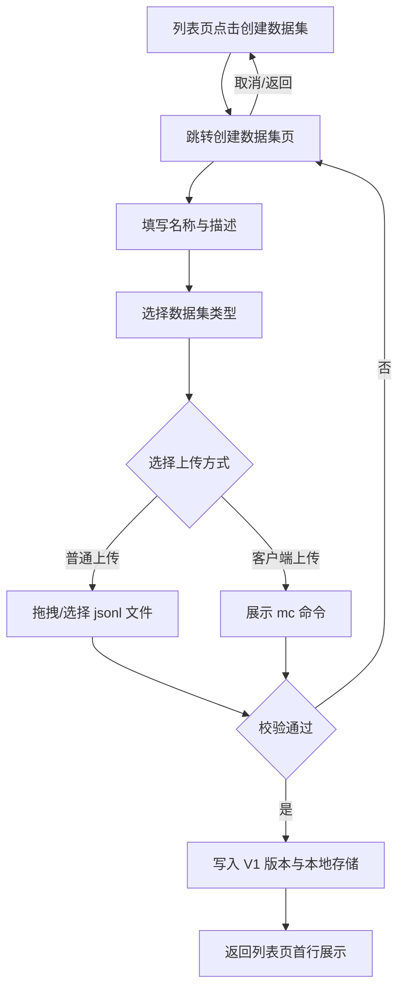

# 创建数据集 · PRD

## 0. 文档信息

| 项目 | 内容 |
| --- | --- |
| 产品 | 算力加速平台 |
| 二级需求 | 数据管理 |
| 页面 | 创建数据集 |
| 版本 | v1.0 |
| 更新日期 | 2026-11-19 |
| 状态 | 草稿（Mock 原型，待评审） |
| 路由 | `/算力加速平台/数据管理/创建数据集` |

## 1. 业务背景

「数据集管理」列表页的创建动作原先以弹窗承载，字段少、扩展性差：无法承载数据集描述、类型说明、模版下载、多文件上传提示等信息，且弹窗高度受限需要滚动。

本次将创建流程改为**独立表单页**，与「创建在线服务」等既有表单页保持一致：进入即全屏表单，字段完整平铺，提交后自动回到列表。

## 2. 功能概览

| 编号 | 功能 | 说明 |
| --- | --- | --- |
| F-1 | 返回栏 | 左侧返回箭头 + 标题「创建数据集」，返回列表页 |
| F-2 | 基本信息 | 数据集名称（必填，≤56，字符集校验）、数据集描述（选填，≤300） |
| F-3 | 数据配置 | 数据集类型单选 + 类型说明文案 + 数据格式说明 / 数据模版入口 |
| F-4 | 数据集上传 | 「普通上传 / 客户端上传」双页签；普通上传支持多文件与 2048M 限制 |
| F-5 | 提交 | 底部「取消 / 创建」，创建成功后写入本地存储并返回列表首位 |
| F-6 | 存储空间校验 | 未配置数据存储空间时点击「创建」不提交，改为弹出「未检测到数据集空间」提示（复用列表页组件） |

## 3. 功能需求详单

### FR-1 返回栏

- **描述**：页面顶部通栏，显示蓝色返回箭头与「创建数据集」标题。
- **规则**：点击返回箭头等同「取消」，直接回到列表页，不保存任何输入。

### FR-2 基本信息

- **数据集名称**（必填）
  - 单行输入，占位「请输入数据集名称」，右侧 `n/56` 计数；
  - 字符集：英文字母、汉字、数字、短划线（-）、下划线（_）；右侧灰色说明常显；
  - 输入非法字符时输入框描边转红，底部提示错误文案。
- **数据集描述**（选填）
  - 多行文本域，占位「请输入」，右下 `n/300` 计数，超过 300 字截断。

### FR-3 数据配置

- **数据集类型**（必填）：单选「评测数据集 / 训练数据集 / 知识库数据集」，默认「评测数据集」；
- 选中项单选框与文字为品牌蓝，未选中为灰色；
- 类型下方灰色说明随所选类型切换：

| 类型 | 说明 |
| --- | --- |
| 评测数据集 | 用于模型性能评估，包括 QA 标准答案和打分维度，支持自动评测。 |
| 训练数据集 | 用于模型微调训练，包含指令与回复样本，支持增量迭代。 |
| 知识库数据集 | 用于知识库检索与问答，包含文档语料与分块索引。 |

- **数据格式说明**：鼠标悬浮弹出说明气泡（jsonl 字段要求、多文件结构一致）；
- **数据模版**：提供 jsonl 模版下载入口（原型为静态链接）。

### FR-4 数据集上传

- **页签**：分段控件，两段等宽（各 116px）共用一个 1px 浅蓝描边外框；选中段为实心品牌蓝 `#1890FF` + 白字，未选中为白底深色字；默认「普通上传」；
- **普通上传**：
  1. 虚线拖拽区，支持拖拽与点击选择，`accept=".jsonl"`、`multiple`；
  2. 说明文案「支持 jsonl 格式，最多上传 20 个文件，单个文件大小不超过 2048M」；
  3. 已选文件按行展示「文件名 + 大小（9.43KB 格式）+ 删除图标」；
  4. 单文件 > 2048M 或非 jsonl 的自动忽略并给出红色提示；超过 20 个仅保留前 20 个；
  5. 上传区下方橙色提示「如果添加多个文件，文件类型必须一致，」（右侧感叹号圆环图标）。
- **客户端上传**：
  1. 面板上方提示文案：「提示：点击【创建】后，系统才会分配专属的存储路径与访问凭证，并生成 V1 版本。创建成功后请在数据集详情页获取可直接执行的命令，再使用本地终端传输文件。」
  2. **创建前不存在真实地址**：存储路径与访问凭证均由平台在提交后分配，因此创建页只展示命令模板，实际取值用占位符（`<别名>` / `<Endpoint>` / `<AccessKey>` / `<SecretKey>` / `<数据集存储路径>`），真实值在创建成功后的数据集详情页回填；
  3. 命令面板底色 `#F8F9FC`，内含三段步骤：

| 步骤 | 命令（创建前模板） | 创建后（详情页回填） |
| --- | --- | --- |
| 1. 配置凭证与 Endpoint | `mc alias set <别名> <Endpoint> <AccessKey> <SecretKey>` | `mc alias set myjfs http://s3-gateway.ai-platform.internal:9000 ak_tenant_... sk_...` |
| 2. 上传单个文件： | `mc cp ./my_dataset.jsonl <别名>/<数据集存储路径>/v1/` | `mc cp ./my_dataset.jsonl myjfs/datasets-pool/<tenant>/<dataset>/v1/` |
| 3. 上传整个本地文件夹（数据集文件需要平铺，不支持子目录） | `mc mirror ./my_dataset_dir/ <别名>/<数据集存储路径>/v1/` | `mc mirror ./my_dataset_dir/ myjfs/datasets-pool/<tenant>/<dataset>/v1/` |

  4. 每条命令右侧带复制图标，点击后复制到剪贴板并将图标切换为对勾（1.6s 后复原）；
  5. 命令面板右侧红色注释「命令根据实际调用 juicefs s3Gateway 命令进行修改」，与面板并排不换行。

- **布局约束**：名称输入框、描述文本域、提示文案、命令面板、拖拽区共用同一宽度（560px）且左右边缘严格对齐；表单区域内不出现横向滚动条。

### FR-5 提交

- **创建按钮启用条件**：名称非空且字符集合法，且（客户端上传 或 普通上传已选至少 1 个文件）；
- **取消按钮**：返回列表，不保存；
- **成功行为**：
  1. 生成 `V1` 版本记录，版本说明按上传方式自动生成；
     - **客户端上传**：状态为「初始化」——平台已分配存储路径与凭证，但文件尚未写入，等待用户本地执行命令；
     - **普通上传**：状态为「导入中」——文件已提交，服务端正在解析与校验；
  2. 状态推进（客户端上传）：`初始化` → `导入中` → `导入成功` / `导入失败`；
     - `初始化`：路径与凭证已分配，等用户在本机执行 `mc` 命令；
     - `导入中`：`mc cp` / `mc mirror` 传输期间即进入该状态，传输结束后服务端继续解析校验，期间以 `upload` 字段回填「已接收 N/M 个文件」；
     - 传输中断、超时或校验不通过 → `导入失败`；
  3. 状态推进（普通上传）：`导入中` → `导入成功` / `导入失败`（文件直达服务端解析）；
  4. 通过 `store.ts` 写入 localStorage，列表页重新进入时读取；
  5. 自动跳回列表页，新数据集位于首行。

## 4. 数据要求

复用「数据集管理」中的 `Dataset` / `DatasetVersion` 结构，新增可选字段 `description`（≤300 字）。

## 5. 交互流程

## 6. 组件映射

| 页面元素 | 实现 |
| --- | --- |
| 平台头 / 左侧导航 | 复用 `../数据集管理/_shared.tsx` 的 `PlatformHeader` / `SideNav` |
| 区块标题 | `SectionTitle`：3px 竖线 + 17px 半粗标题 |
| 字段名 | `FieldLabel`：右对齐 148px 固定宽度，保证输入控件左边缘对齐 |
| 计数输入 | `CounterInput`：input + `n/max` 计数 |
| 单选 | `Radio`：16px 圆环 + 8px 实心圆点 |
| 上传页签 | 分段控件：1px `#A9BDD3` 外框 + 两段各 116px；选中段 `bg-[#1890ff]` 白字 |
| 命令面板 | `#F8F9FC` 底色 + 三条命令 + `CommandBlock` 复制图标（`Copy` / `Check`） |
| 拖拽区 | `<label>` + 隐藏 `<input type="file">`，支持 `onDrop` |
| 跨页数据 | `../数据集管理/store.ts`：localStorage 读写数据集列表 |
