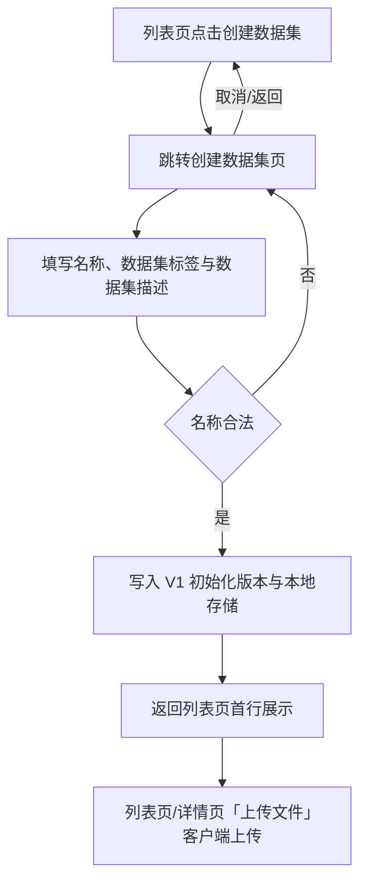

# 创建数据集 · PRD

## 0. 文档信息

| 项目 | 内容 |
| --- | --- |
| 产品 | 算力加速平台 |
| 二级需求 | 数据管理 |
| 页面 | 创建数据集 |
| 版本 | v1.0 |
| 更新日期 | 2026-11-19 |
| 状态 | 草稿（Mock 原型，待评审） |
| 路由 | `/算力加速平台/数据管理/创建数据集` |

## 1. 业务背景

数据集管理作为「算力加速平台 → 数据管理」下的基础页，采用独立表单页承载创建流程，为底层算力任务提供数据资产的登记与版本管理能力。

## 2. 功能概览

| 编号 | 功能 | 说明 |
| --- | --- | --- |
| F-1 | 返回栏 | 左侧返回箭头 + 标题「创建数据集」，返回列表页 |
| F-2 | 基本信息 | 数据集名称（必填，≤56，字符集校验）、数据集标签（选填，≤3 个）、数据集描述（选填，≤300） |
| F-3 | 数据集标签 | 预置标签快选 + 自定义输入，仅用于展示与归类，不参与列表搜索与提交校验 |
| F-4 | 提交 | 底部「取消 / 创建」，名称合法即可创建；创建成功后写入本地存储并返回列表首位 |
| F-5 | 存储空间校验 | 进入创建页时校验数据存储空间；未配置时展示阻断态，创建不可提交 |

## 3. 功能需求详单

### FR-1 返回栏

- **描述**：页面顶部通栏，显示蓝色返回箭头与「创建数据集」标题。
- **规则**：点击返回箭头等同「取消」，直接回到列表页，不保存任何输入。

### FR-2 基本信息

- **数据集名称**（必填）
  - 单行输入，占位「请输入数据集名称」，右侧 `n/56` 计数；
  - 字符集：英文字母、汉字、数字、短划线（-）、下划线（_）；右侧灰色说明常显；
  - 输入非法字符时输入框描边转红，底部提示错误文案。
- **数据集描述**（选填）
  - 多行文本域，占位「例如：客服对话语料，用于 Qwen 微调训练；或 产品手册 PDF，供知识库检索使用」，右下 `n/300` 计数，超过 300 字截断。

### FR-3 数据集标签

> 平台不划分数据集类型：任何格式的文件都可以按原样存入存储目录，并作为容器卷挂载使用。
> 标签只是给使用方的一个归类提示，不参与导入校验，也不影响挂载能力；列表页搜索仅按数据集名称。

- **形态**：标签多选（chips），选填，最多 3 个，单个标签 ≤8 字；
- **取数**：预置标签 `训练语料 / 评测集 / 知识库 / 图片素材 / 音频素材 / 其他` 可一键增删；
  也可在输入框中自由输入并按回车（或点「添加」）新增自定义标签；
- **回退**：超过 3 个后输入框与未选中的预置标签置灰，需先移除已选标签；
- **展示**：列表页「数据集标签」列、详情页「数据集标签」信息位以蓝色 chips 呈现，无标签时展示 `-`；
- **筛选**：列表页搜索仅按数据集名称，数据集标签不参与搜索。

### FR-3b 数据集描述

- 字段沿用「数据集描述」，选填，≤300 字；
- 占位示例引导用户写清「存的是什么 + 谁在用」，例如「客服对话语料，用于 Qwen 微调训练」；

### FR-3c 数据集标签使用规则

| 使用规则 | 说明 |
| --- | --- |
| 不要求选择数据集类型 | 平台不限制数据类型，怎么用由使用方决定 |
| 不提供数据格式说明悬浮气泡 | 文件格式不受限制，无需 jsonl 字段要求 |
| 不提供数据模版下载 | 无固定结构模板需要下载 |
| 不展示文件内容解析说明段落 | 文件按原样存入存储目录，挂载后由容器内程序自行读取 |

### FR-4 提交

- **创建按钮启用条件**：仅要求数据集名称非空且字符集合法；数据集标签与数据集描述均不影响可提交状态；创建页不包含文件上传；
- **取消按钮**：返回列表，不保存；
- **成功行为**：
  1. 生成 `V1` 版本记录，版本状态为「初始化」，版本说明固定为「创建完成，等待上传文件」；
  2. 文件上传不在创建流程内：创建完成后，用户在列表页或详情页通过「上传文件」入口，使用客户端上传命令（`mc`）把文件写入该版本对应的存储路径；
  3. 通过 `store.ts` 写入 localStorage，列表页重新进入时读取；
  4. 自动跳回列表页，新数据集位于首行。

### FR-5 存储空间校验

- **描述**：创建数据集页进入时校验当前租户/项目的数据存储空间配置，未配置时展示阻断态。
- **业务规则**：
  1. 未配置数据存储空间时，表单主体替换为「未检测到数据集空间」阻断态；
  2. 阻断态下创建按钮不可提交，不写入数据集；
  3. 配置状态恢复后，创建数据集流程恢复正常。
- **验收标准**：
  - Given 当前租户/项目未配置数据存储空间，When 进入创建数据集页，Then 展示阻断态而非表单；
  - Given 未配置数据存储空间，When 查看创建按钮，Then 创建不可提交。

## 4. 数据要求

复用「数据集管理」中的 `Dataset` / `DatasetVersion` 结构：

- `tags: string[]`：数据集标签，≤3 个，非必填；
- `description`：数据集描述，≤300 字；
- 数据集记录不包含 `type` 字段。

## 5. 交互流程

## 6. 组件映射

| 页面元素 | 实现 |
| --- | --- |
| 平台头 / 左侧导航 | 复用 `../数据集管理/_shared.tsx` 的 `PlatformHeader` / `SideNav` |
| 区块标题 | `SectionTitle`：3px 竖线 + 15px 半粗标题 |
| 字段名 | `FieldLabel`：右对齐 112px 固定宽度，保证输入控件左边缘对齐 |
| 计数输入 | `CounterInput`：input + `n/max` 计数 |
| 数据集标签 | `../数据集管理/tags.tsx` 的 `TagPicker`（编辑）/ `TagChips`（只读） |
| 字段提示 | 无独立 `HintIcon`；说明直接写入字段占位、标签或信息条 |
| 跨页数据 | `../数据集管理/store.ts`：localStorage 读写数据集列表 |
