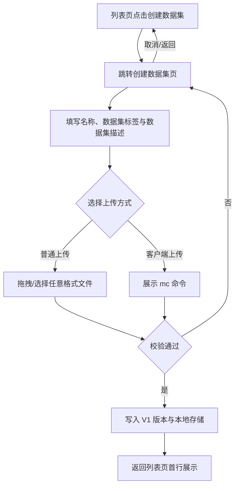

# 创建数据集 · PRD

## 0. 文档信息

| 项目 | 内容 |
| --- | --- |
| 产品 | 算力加速平台 |
| 二级需求 | 数据管理 |
| 页面 | 创建数据集 |
| 版本 | v1.0 |
| 更新日期 | 2026-11-19 |
| 状态 | 草稿（Mock 原型，待评审） |
| 路由 | `/算力加速平台/数据管理/创建数据集` |

## 1. 业务背景

数据集管理作为「算力加速平台 → 数据管理」下的基础页，采用独立表单页承载创建流程，为底层算力任务提供数据资产的登记、版本管理与导入状态跟踪能力。

## 2. 功能概览

| 编号 | 功能 | 说明 |
| --- | --- | --- |
| F-1 | 返回栏 | 左侧返回箭头 + 标题「创建数据集」，返回列表页 |
| F-2 | 基本信息 | 数据集名称（必填，≤56，字符集校验）、数据集标签（选填，≤3 个）、数据集描述（选填，≤300） |
| F-3 | 数据集标签 | 预置标签快选 + 自定义输入，仅用于展示与归类，不参与列表搜索与提交校验 |
| F-4 | 数据集上传 | 「普通上传 / 客户端上传」双页签；**不限制文件格式**，仅限制单文件 2048M 与单次 20 个文件 |
| F-5 | 提交 | 底部「取消 / 创建」，创建成功后写入本地存储并返回列表首位 |
| F-6 | 存储空间校验 | 进入创建页时校验数据存储空间；未配置时展示阻断态，创建不可提交 |

## 3. 功能需求详单

### FR-1 返回栏

- **描述**：页面顶部通栏，显示蓝色返回箭头与「创建数据集」标题。
- **规则**：点击返回箭头等同「取消」，直接回到列表页，不保存任何输入。

### FR-2 基本信息

- **数据集名称**（必填）
  - 单行输入，占位「请输入数据集名称」，右侧 `n/56` 计数；
  - 字符集：英文字母、汉字、数字、短划线（-）、下划线（_）；右侧灰色说明常显；
  - 输入非法字符时输入框描边转红，底部提示错误文案。
- **数据集描述**（选填）
  - 多行文本域，占位「例如：客服对话语料，用于 Qwen 微调训练；或 产品手册 PDF，供知识库检索使用」，右下 `n/300` 计数，超过 300 字截断。

### FR-3 数据集标签

> 平台不划分数据集类型：任何格式的文件都可以按原样存入存储目录，并作为容器卷挂载使用。
> 标签只是给使用方的一个归类提示，不参与导入校验，也不影响挂载能力；列表页搜索仅按数据集名称。

- **形态**：标签多选（chips），选填，最多 3 个，单个标签 ≤8 字；
- **取数**：预置标签 `训练语料 / 评测集 / 知识库 / 图片素材 / 音频素材 / 其他` 可一键增删；
  也可在输入框中自由输入并按回车（或点「添加」）新增自定义标签；
- **回退**：超过 3 个后输入框与未选中的预置标签置灰，需先移除已选标签；
- **展示**：列表页「数据集标签」列、详情页「数据集标签」信息位以蓝色 chips 呈现，无标签时展示 `-`；
- **筛选**：列表页搜索仅按数据集名称，数据集标签不参与搜索。

### FR-3b 数据集描述

- 字段沿用「数据集描述」，选填，≤300 字；
- 占位示例引导用户写清「存的是什么 + 谁在用」，例如「客服对话语料，用于 Qwen 微调训练」；

### FR-3c 数据集标签使用规则

| 使用规则 | 说明 |
| --- | --- |
| 不要求选择数据集类型 | 平台不限制数据类型，怎么用由使用方决定 |
| 不提供数据格式说明悬浮气泡 | 文件格式不受限制，无需 jsonl 字段要求 |
| 不提供数据模版下载 | 无固定结构模板需要下载 |
| 不展示文件内容解析说明段落 | 文件按原样存入存储目录，挂载后由容器内程序自行读取 |

### FR-4 数据集上传

- **页签**：分段控件，两段等宽（各 100px）共用一个 1px 描边外框；选中段为实心品牌蓝 `#1890FF` + 白字，未选中为白底深色字；默认「普通上传」；
- **普通上传**：
  1. 虚线拖拽区，支持拖拽与点击选择，`multiple`，**不设置 `accept`**，任何文件均可选择；
  2. 说明文案「不限文件格式，文件按原样存入存储目录；单个文件不超过 2048M，单次最多 20 个文件」；
  3. 已选文件按行展示「扩展名图标 + 文件名 + 大小（9.43KB 格式）+ 待上传 + 删除图标」；
     - 扩展名图标取文件后缀并大写（最多 4 字符），无后缀时显示 `FILE`；
  4. 单文件 > 2048M 的自动忽略并给出红色提示；超过 20 个仅保留前 20 个；
  5. 不同格式的文件允许混传。
- **客户端上传**：
  1. 面板上方为浅蓝信息条（`#f2f7ff` 底 + `#bcd7ff` 描边 + 蓝色 Info 图标），标题「创建后才会分配存储路径与访问凭证」，下方三步编号要点：
     1. 点击【创建】，系统分配专属存储路径与访问凭证，并生成 V1 版本；
     2. 在数据集列表或详情页点击「上传文件」，切到客户端上传即可复制可直接执行的命令；
     3. 在本地终端执行命令传输文件，完成后状态自动转为「导入成功」。
  2. **创建前不存在真实地址**：存储路径与访问凭证均由平台在提交后分配，因此创建页只展示命令模板，实际取值用占位符（`<别名>` / `<Endpoint>` / `<AccessKey>` / `<SecretKey>` / `<数据集存储路径>`），真实值在创建成功后的数据集详情页回填；
  3. 命令面板底色 `#F8F9FC`，内含三段步骤：

| 步骤 | 命令（创建前模板） | 创建后（详情页回填） |
| --- | --- | --- |
| 1. 配置凭证与 Endpoint | `mc alias set <别名> <Endpoint> <AccessKey> <SecretKey>` | `mc alias set myjfs http://s3-gateway.ai-platform.internal:9000 ak_tenant_... sk_...` |
| 2. 上传单个文件： | `mc cp ./my_file <别名>/<数据集存储路径>/v1/` | `mc cp ./my_file myjfs/datasets-pool/<tenant>/<dataset>/v1/` |
| 3. 上传整个本地文件夹（文件需要平铺，不支持子目录） | `mc mirror ./my_dataset_dir/ <别名>/<数据集存储路径>/v1/` | `mc mirror ./my_dataset_dir/ myjfs/datasets-pool/<tenant>/<dataset>/v1/` |

  4. 每条命令右侧带复制图标，点击后复制到剪贴板并将图标切换为对勾（1.6s 后复原）；
  5. 命令面板标题右侧展示「路径与凭证创建后回填」，命令信息集中展示。

- **布局约束**：名称输入框、描述文本域、提示文案、命令面板、拖拽区共用同一宽度（560px）且左右边缘严格对齐；表单区域内不出现横向滚动条。

### FR-5 提交

- **创建按钮启用条件**：名称非空且字符集合法，且（客户端上传 或 普通上传已选至少 1 个文件）；数据集标签与数据集描述均不影响可提交状态；
- **取消按钮**：返回列表，不保存；
- **成功行为**：
  1. 生成 `V1` 版本记录，版本说明按上传方式自动生成；
     - **客户端上传**：状态为「初始化」——平台已分配存储路径与凭证，但文件尚未写入，等待用户本地执行命令；
     - **普通上传**：状态为「导入中」——文件已提交，服务端正在解析与校验；
  2. 状态推进（客户端上传）：`初始化` → `导入中` → `导入成功` / `导入失败`；
     - `初始化`：路径与凭证已分配，等用户在本机执行 `mc` 命令；
     - `导入中`：`mc cp` / `mc mirror` 传输期间即进入该状态，传输结束后服务端继续解析校验，期间以 `upload` 字段回填「已接收 N/M 个文件」；
     - 传输中断、超时或校验不通过 → `导入失败`；
  3. 状态推进（普通上传）：`导入中` → `导入成功` / `导入失败`（文件直达服务端解析）；
  4. 通过 `store.ts` 写入 localStorage，列表页重新进入时读取；
  5. 自动跳回列表页，新数据集位于首行。

### FR-6 存储空间校验

- **描述**：创建数据集页进入时校验当前租户/项目的数据存储空间配置，未配置时展示阻断态。
- **业务规则**：
  1. 未配置数据存储空间时，表单主体替换为「未检测到数据集空间」阻断态；
  2. 阻断态下创建按钮不可提交，不写入数据集；
  3. 配置状态恢复后，创建数据集流程恢复正常。
- **验收标准**：
  - Given 当前租户/项目未配置数据存储空间，When 进入创建数据集页，Then 展示阻断态而非表单；
  - Given 未配置数据存储空间，When 查看创建按钮，Then 创建不可提交。

## 4. 数据要求

复用「数据集管理」中的 `Dataset` / `DatasetVersion` 结构：

- `tags: string[]`：数据集标签，≤3 个，非必填；
- `description`：数据集描述，≤300 字；
- 数据集记录不包含 `type` 字段。

## 5. 交互流程

## 6. 组件映射

| 页面元素 | 实现 |
| --- | --- |
| 平台头 / 左侧导航 | 复用 `../数据集管理/_shared.tsx` 的 `PlatformHeader` / `SideNav` |
| 区块标题 | `SectionTitle`：3px 竖线 + 15px 半粗标题 |
| 字段名 | `FieldLabel`：右对齐 112px 固定宽度，保证输入控件左边缘对齐 |
| 计数输入 | `CounterInput`：input + `n/max` 计数 |
| 数据集标签 | `../数据集管理/tags.tsx` 的 `TagPicker`（编辑）/ `TagChips`（只读） |
| 字段提示 | 无独立 `HintIcon`；说明直接写入字段占位、标签或信息条 |
| 上传页签 | 分段控件：1px `#d9d9d9` 外框 + 两段各 100px；选中段 `bg-[#1890ff]` 白字 |
| 命令面板 | `#F8F9FC` 底色 + 三条命令 + `CommandBlock` 复制图标（`Copy` / `Check`） |
| 拖拽区 | `<label>` + 隐藏 `<input type="file">`，支持 `onDrop` |
| 跨页数据 | `../数据集管理/store.ts`：localStorage 读写数据集列表 |
