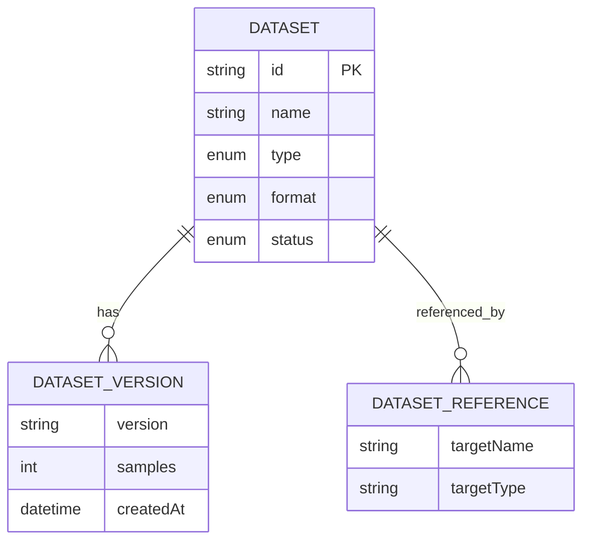
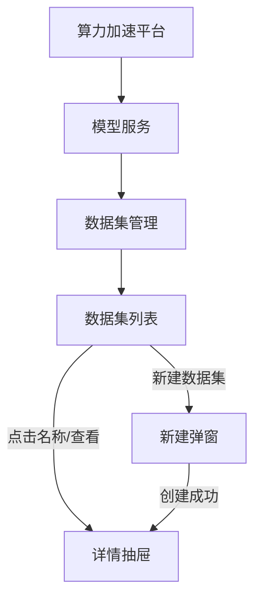
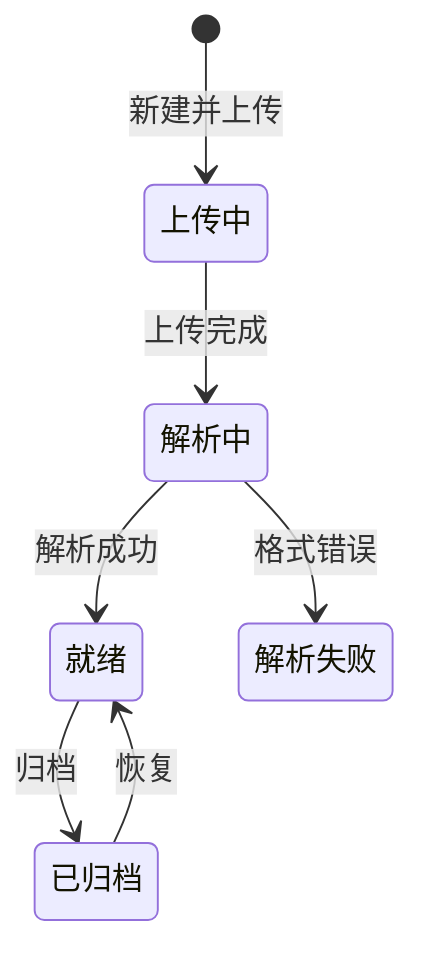

# 数据集管理 PRD

## 0. 文档信息

| 版本 | 日期 | 修改内容 | 作者 |
|------|------|---------|------|
| v1.0 | 2026-11-18 | 初稿（Mock 版，结构待设计稿确认后还原） | lead |

## 1. 业务背景

- **产品定位**: 算力加速平台
- **目标用户**: 算法工程师、模型运维、平台管理员
- **业务背景**: 模型微调、评测与知识库问答都依赖数据集，但当前平台没有统一的数据集入口，数据散落在对象存储目录里，样本量、格式、版本、被谁引用都靠人工记录，导致「训练用的到底是哪一版数据」说不清。
- **商业价值**: 数据集集中管理后，微调任务可直接选数据集而非填路径，减少选错数据导致的训练返工；评测结果可追溯到具体数据版本。
- **成功指标**: 微调任务配置耗时下降 50%；数据版本可追溯率 100%；重复上传的数据集数量下降 30%。
- **目标产品技术栈**: 与算力加速平台现有前端一致（React + TypeScript）
- **设计系统**: 沿用算力加速平台现有设计语言（蓝色主色 `#166eff`、4px 圆角、13px 正文）
- **入口位置**: 算力加速平台 → 模型服务 → 数据集管理

## 2. 功能概览

数据集管理提供「看得到、找得到、建得了、追得回」四件事：列表展示数据集的核心指标（样本量、存储、状态、更新时间），支持按类型/格式/状态筛选与关键词搜索；支持新建数据集并上传数据；详情抽屉展示字段结构、版本记录与被引用关系。

| 模块 | 功能点 | 优先级 | 类型 |
|------|--------|--------|------|
| 数据集列表 | 列表与统计卡 | Must | 新增 |
| 数据集列表 | 类型 Tab / 格式 / 状态筛选 | Must | 新增 |
| 数据集列表 | 名称/ID/创建人搜索 | Must | 新增 |
| 数据集列表 | 分页 | Must | 新增 |
| 数据集管理 | 新建数据集（含上传占位） | Must | 新增 |
| 数据集详情 | 详情抽屉（字段/版本/引用） | Should | 新增 |
| 数据集管理 | 删除数据集 | Should | 新增 |

## 3. 用户故事

- US-1: 作为算法工程师，我想要在一个列表里看到所有数据集的样本量、格式和状态，以便于快速判断哪份数据可以用来训练。
- US-2: 作为算法工程师，我想要按数据集类型和关键词筛选，以便于在几十个数据集里快速定位目标数据。
- US-3: 作为模型运维，我想要新建数据集并上传文件，以便于把新采集的语料纳入平台统一管理。
- US-4: 作为评审人员，我想要查看数据集的字段结构、版本记录和引用关系，以便于确认某次训练/评测用的是哪一版数据。
- US-5: 作为平台管理员，我想要删除废弃的数据集，以便于避免误用过期数据。

## 4. 功能需求详单

**FR-1 数据集列表与统计**

| 项目 | 说明 |
|------|------|
| 用户故事 | US-1 |
| 优先级 | Must |
| 描述 | 以表格展示数据集：名称+ID、类型、格式、样本量、存储、状态、更新时间、创建人、操作；顶部展示 4 张统计卡（数据集总数、占用存储、微调训练集、可用数据集）。 |
| 输入 | 无 |
| 输出 | 表格行；统计卡数值由当前数据集集合实时汇总 |
| 业务规则 | 1) 触发条件：进入页面即加载；2) 校验逻辑：无；3) 冲突处理：无；4) 旧数据兼容：无状态字段的存量数据按「就绪」展示 |
| 权限控制 | 所有登录用户可见 |
| 状态流转 | 数据集状态：上传中 → 解析中 → 就绪；任意状态可 → 已归档 |

**验收标准 (Acceptance Criteria)**
- AC-1: Given 平台内已有 8 个数据集，When 进入数据集管理页，Then 列表展示 8 行，统计卡「数据集总数」为 8、「占用存储」为各数据集大小之和。
- AC-2: Given 某个数据集状态为「解析中」，When 列表渲染，Then 状态列展示蓝色「解析中」徽标，且该行不展示样本量以外的错误信息。
- AC-3: Given 数据集列表为空，When 页面渲染，Then 表格区域展示「没有匹配的数据集，调整筛选条件或新建一个」空状态。

**FR-2 筛选与搜索**

| 项目 | 说明 |
|------|------|
| 用户故事 | US-2 |
| 优先级 | Must |
| 描述 | 类型 Tab（全部/微调训练/模型评测/知识库/多模态，带数量）、格式下拉、状态下拉、关键词输入框组合过滤，任一条件变化后回到第 1 页。 |
| 输入 | keyword: string，匹配名称、ID、描述、创建人；format: 枚举；status: 枚举 |
| 输出 | 过滤后的列表 + 「共 N 个数据集」计数 |
| 业务规则 | 1) 触发条件：任一筛选条件变化；2) 校验逻辑：多条件为「与」关系；3) 冲突处理：无匹配时展示空状态，不清空筛选条件；4) 旧数据兼容：无 |
| 权限控制 | 所有登录用户可用 |
| 状态流转 | 无 |

**验收标准 (Acceptance Criteria)**
- AC-1: Given 列表有 3 个「微调训练」数据集，When 点击「微调训练」Tab，Then 仅展示这 3 行，Tab 右侧计数为 3。
- AC-2: Given 关键词为「qwen」，When 输入完成，Then 仅展示名称/ID/描述/创建人包含「qwen」的数据集（不区分大小写）。
- AC-3: Given 已设置格式=JSONL 且状态=解析中，When 点击「重置」，Then 清空全部筛选条件、Tab 回到「全部」并回到第 1 页。

**FR-3 新建数据集**

| 项目 | 说明 |
|------|------|
| 用户故事 | US-3 |
| 优先级 | Must |
| 描述 | 弹窗填写名称（必填）、类型、格式、来源、描述，并可拖拽/点击上传文件（Mock 不实际传输）；提交后新数据集以「解析中」状态插入列表首位并自动打开详情抽屉。 |
| 输入 | name: string，1-50 字符，必填；type/format/source: 枚举；description: string，≤ 200 字 |
| 输出 | 新数据集记录；列表刷新并定位到第 1 页 |
| 业务规则 | 1) 触发条件：点击「新建数据集」或「导入数据」；2) 校验逻辑：名称为空时「创建数据集」按钮禁用；3) 冲突处理：同名数据集允许创建，但需在详情中通过 ID 区分；4) 旧数据兼容：无版本信息的新数据默认生成 v1 |
| 权限控制 | 算法工程师及以上可创建 |
| 状态流转 | 新建 → 解析中 →（解析成功）就绪 |

**验收标准 (Acceptance Criteria)**
- AC-1: Given 新建弹窗已打开，When 名称为空，Then「创建数据集」按钮置灰不可点。
- AC-2: Given 已填写名称「客服对话评测集 v3」，When 点击「创建数据集」，Then 弹窗关闭、列表首位出现该数据集、状态为「解析中」、详情抽屉自动打开。
- AC-3: Given 新建时选择来源「对象存储」，When 提交，Then 详情中「数据来源」展示「对象存储」。

**FR-4 数据集详情**

| 项目 | 说明 |
|------|------|
| 用户故事 | US-4 |
| 优先级 | Should |
| 描述 | 右侧抽屉展示基础信息（样本量、存储、来源、路径、创建人、更新时间、字段）、版本记录（版本号、说明、样本量、时间，最新版标「当前」）、引用关系（被哪些推理服务/评测任务引用）。 |
| 输入 | datasetId |
| 输出 | 抽屉内容 |
| 业务规则 | 1) 触发条件：点击数据集名称或「查看」；2) 校验逻辑：无；3) 冲突处理：数据集已删除时关闭抽屉；4) 旧数据兼容：无版本记录时展示「解析后生成」 |
| 权限控制 | 所有登录用户可见 |
| 状态流转 | 无 |

**验收标准 (Acceptance Criteria)**
- AC-1: Given 点击某数据集名称，When 抽屉打开，Then 顶部展示名称与 ID，基础信息区展示样本量与存储路径。
- AC-2: Given 数据集有 3 个版本，When 查看版本记录，Then 版本按时间倒序排列，最新版本带「当前」标签。
- AC-3: Given 数据集未被任何服务引用，When 查看引用关系，Then 展示「暂未被服务或评测任务引用」。

**FR-5 删除数据集**

| 项目 | 说明 |
|------|------|
| 用户故事 | US-5 |
| 优先级 | Should |
| 描述 | 行操作「删除」将数据集从列表移除；若删除的是当前详情对象，同时关闭抽屉。 |
| 输入 | datasetId |
| 输出 | 列表更新 + 成功提示 |
| 业务规则 | 1) 触发条件：点击行尾删除图标；2) 校验逻辑：Mock 版不二次确认，正式版需二次确认并校验是否被运行中任务引用；3) 冲突处理：被引用时禁止删除并提示引用方；4) 旧数据兼容：无 |
| 权限控制 | 平台管理员 / 数据集创建人 |
| 状态流转 | 任意状态 → 已删除 |

**验收标准 (Acceptance Criteria)**
- AC-1: Given 列表有 8 个数据集，When 删除 1 个，Then 列表剩 7 个，统计卡「数据集总数」同步为 7。
- AC-2: Given 正在查看某数据集详情，When 删除该数据集，Then 详情抽屉关闭。

**FR-6 分页**

| 项目 | 说明 |
|------|------|
| 用户故事 | US-1 |
| 优先级 | Must |
| 描述 | 每页 6 条，展示「第 X / Y 页，共 N 条」，支持上一页、页码、下一页。 |
| 输入 | page: number |
| 输出 | 当前页数据 |
| 业务规则 | 1) 触发条件：点击分页控件；2) 校验逻辑：页码不超过总页数；3) 冲突处理：筛选后总页数减少时自动收敛到最后一页；4) 旧数据兼容：无 |
| 权限控制 | 所有登录用户可用 |
| 状态流转 | 无 |

**验收标准 (Acceptance Criteria)**
- AC-1: Given 共 8 条数据、每页 6 条，When 进入页面，Then 展示 6 行且总页数为 2。
- AC-2: Given 当前在第 2 页，When 筛选后仅剩 3 条，Then 自动回到第 1 页。

## 5. 数据要求

### 5.1 Dataset（数据集）

| 字段 | 类型 | 必填 | 校验规则 | 说明 |
|------|------|------|---------|------|
| id | string | 是 | 全局唯一 | 数据集 ID，如 ds-qwen3-35b-sft |
| name | string | 是 | 1-50 字符 | 数据集名称 |
| type | enum | 是 | 微调训练/模型评测/知识库/多模态 | 用途分类 |
| format | enum | 是 | JSONL/Parquet/CSV/Markdown/图片+标注 | 数据格式 |
| samples | number | 是 | ≥ 0 | 样本条数 |
| sizeGB | number | 是 | ≥ 0 | 占用存储（GB） |
| status | enum | 是 | 就绪/解析中/上传中/已归档 | 状态 |
| creator | string | 是 | — | 创建人 |
| description | string | 否 | ≤ 200 字 | 用途说明 |
| source | enum | 是 | 本地文件/对象存储/已有数据集 | 数据来源 |
| location | string | 是 | — | 存储路径 |
| fields | string[] | 否 | — | 数据字段名 |
| usedBy | string[] | 否 | — | 引用方 |

### 5.2 DatasetVersion（数据集版本）

| 字段 | 类型 | 必填 | 校验规则 | 说明 |
|------|------|------|---------|------|
| version | string | 是 | v1/v2... | 版本号 |
| note | string | 是 | — | 版本说明 |
| samples | number | 是 | ≥ 0 | 该版本样本量 |
| createdAt | datetime | 是 | — | 生成时间 |

### 5.3 ER 图

## 6. 交互流程

### 6.1 页面导航主流程

文字流程：从算力加速平台左侧「模型服务」进入数据集管理默认列表；列表可打开详情抽屉或新建弹窗，创建成功后直接进入新数据集详情。

### 6.2 核心操作流程

文字流程：列表页点击新建 → 填写名称/类型/格式/来源/描述 → 名称为空则按钮禁用 → 提交后数据以「解析中」插入首位 → 自动打开详情。

### 6.3 状态机

## 7. 非功能性需求

- **性能**: 列表首屏 ≤ 1.5s；筛选/搜索响应 ≤ 200ms（前端本地过滤）
- **安全**: 存储路径与样本内容按租户隔离；删除操作记录审计日志
- **兼容性**: Chrome 90+ / Edge 90+ / Safari 15+
- **可访问性**: 表格表头语义化、按钮具备 aria-label、键盘可聚焦

## 8. 边界情况

- 空状态: 无数据集或筛选无结果时展示空提示与「新建数据集」入口
- 加载状态: 首次加载用骨架屏；解析中数据集展示进度态徽标
- 错误状态: 文件格式不支持时提示「仅支持 JSONL / Parquet / CSV / Markdown / 图片+标注」
- 数据边界: 单数据集名称 ≤ 50 字、描述 ≤ 200 字；单次上传 ≤ 100GB；单页 6 条

## 9. 待办问题

- [ ] Q1: 数据集是否需要支持在线预览样本（前 N 条）？ @产品
- [ ] Q2: 数据集删除是否需要二次确认并强制校验运行中任务引用？ @产品
- [ ] Q3: 「数据集管理」在左侧导航的确切位置（模型服务 / 基础资源）待设计稿确认 @设计

## 10. 组件映射

| UI 元素 | Ant Design | Element Plus | 关键属性 |
|---------|-----------|--------------|---------|
| 按钮 | Button | ElButton | type="primary" / "default" |
| 数据表格 | Table | ElTable | columns, dataSource, pagination, scroll |
| 文本输入 | Input | ElInput | placeholder, allowClear |
| 下拉选择 | Select | ElSelect | options, placeholder, allowClear |
| 标签页 | Tabs | ElTabs | activeKey, onChange |
| 状态徽标 | Tag | ElTag | color, bordered |
| 弹窗 | Modal | ElDialog | title, open, onOk, onCancel |
| 抽屉 | Drawer | ElDrawer | open, placement="right", width |
| 分页 | Pagination | ElPagination | total, current, pageSize |
| 上传 | Upload | ElUpload | drag, beforeUpload |
