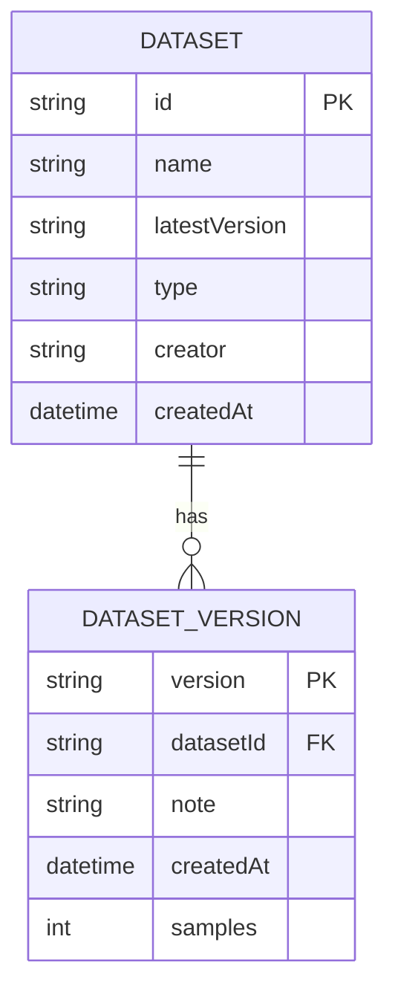
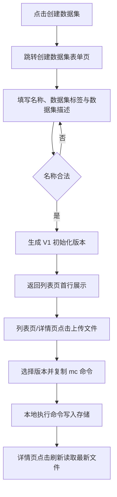
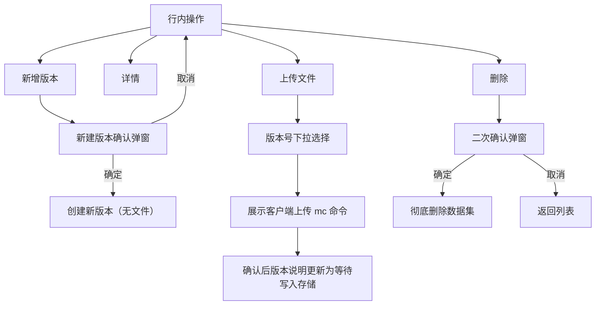

# 数据集管理 · PRD

## 0. 文档信息

| 项目 | 内容 |
| --- | --- |
| 产品 | 算力加速平台 |
| 二级需求 | 数据管理 |
| 页面 | 数据集管理 |
| 版本 | v1.0 |
| 更新日期 | 2026-11-18 |
| 状态 | 草稿（Mock 原型，待评审） |

## 1. 业务背景

大模型微调训练与模型评测都依赖结构化的数据集资产。当前数据散落在各团队的本地目录与对象存储桶中，缺少统一的登记与版本管理，导致：

- 训练任务引用数据集时无法确认版本，复现困难；
- 导入失败（如存储桶容量不足）没有统一入口暴露，排查依赖人工询问；
- 数据集归属与创建信息不清晰，删除操作缺少二次确认。

数据集管理作为「算力加速平台 → 数据管理」下的基础页，为底层算力任务提供数据资产的登记与版本管理能力。

## 2. 功能概览

| 编号 | 功能 | 说明 |
| --- | --- | --- |
| F-1 | 数据集列表 | 按表格展示数据集名称、最新版本、数据集标签、创建者、创建时间与操作 |
| F-2 | 搜索 | 仅按数据集名称检索，点击搜索按钮或回车后生效 |
| F-3 | 创建数据集 | 跳转独立表单页，填写名称、数据集标签与数据集描述即可创建；创建后写入 V1 初始化版本并返回列表，文件上传为独立操作 |
| F-4 | 编辑名称 | 点击列表中的数据集名称，弹窗修改名称（≤56 字符） |
| F-5 | 新增版本 | 二次确认「新建版本」弹窗，版本号按已有版本自动递进 |
| F-6 | 删除数据集 | 二次确认后彻底删除数据集及其版本 |
| F-7 | 详情 | 跳转详情页查看基础信息、存储路径与版本文件记录 |
| F-8 | 分页 | 支持 10 / 20 / 50 条每页 |
| F-9 | 存储空间前置校验 | 进入页面即检测当前租户/项目是否已创建数据存储空间；未配置时弹出「未检测到数据集空间」提示，并阻断创建数据集、新增版本、上传文件等写入操作 |

页面不包含数据集内容预览与在线标注，二者为后续迭代范围。

## 3. 用户故事

| 编号 | 角色 | 用户故事 |
| --- | --- | --- |
| US-1 | 算法工程师 | 作为算法工程师，我希望把本地数据集注册到平台并看到导入进度，以便训练任务直接引用。 |
| US-2 | 算法工程师 | 作为算法工程师，我希望对已有数据集上传新版本，以便在不破坏历史版本的前提下迭代数据。 |
| US-3 | 数据管理员 | 作为数据管理员，我希望按数据集名称检索数据集，以便快速定位某个团队的数据资产。 |
| US-4 | 数据管理员 | 作为数据管理员，我希望导入失败时能看到失败原因，以便及时扩容或重新上传。 |
| US-5 | 数据管理员 | 作为数据管理员，我希望删除前有二次确认，以免误删被训练任务引用的数据。 |

## 4. 功能需求详单

### FR-1 数据集列表

- **用户故事**：US-1、US-4
- **优先级**：P0
- **描述**：以表格形式展示当前租户下的数据集，默认按创建时间倒序。
- **列定义**：

| 列 | 内容 | 说明 |
| --- | --- | --- |
| 数据集名称 | 蓝色链接 + 编辑图标 | 点击名称进入「数据集详情」页；点击右侧编辑图标打开「编辑数据集名称」弹窗 |
| 最新版本 | `V1` / `V2` … | 灰底描边标签，取版本记录中的最新一条 |
| 数据集标签 | 标签 chips（≤3 个，蓝色描边浅蓝底） | 选填，无标签时展示 `-`；仅用于展示与归类，不参与列表搜索 |
| 创建者 | 用户名 | — |
| 创建时间 | `YYYY-MM-DD HH:mm:ss` | 等宽数字展示 |
| 操作 | 详情 / 新增版本 / 上传文件 / 删除 | 四个操作均不受状态限制；删除为红色，其余为蓝色 |

- **业务规则**：
  1. 列表只展示未删除的数据集，删除后不可恢复，不进入回收站；
  2. 版本号已生成但文件尚未写入时，样本量与存储量为 0；
  3. 无数据时展示空态文案并引导点击「创建数据集」。
- **验收标准**：
  - Given 租户下有 3 个数据集，When 进入页面，Then 表格展示 3 行且按创建时间倒序；
  - Given 查看列表表头，Then 仅展示数据集名称、最新版本、数据集标签、创建者、创建时间、操作 6 列，不含状态列。

### FR-2 搜索

- **用户故事**：US-3
- **优先级**：P1
- **描述**：工具栏右侧采用通用「检索条」素材（`@/lib/search-bar` 的 `SearchBar`）：输入框 + 后置放大镜按钮的组合框，为提交式搜索；控件统一 32px 高、4px 圆角、`#D9DDE3` 描边、`#F5F6F8` 灰底 addon，视觉规格与素材库「检索条」一致。
- **业务规则**：
  1. **仅支持按数据集名称检索**，输入框占位「请输入数据集名称」，检索字段固定为数据集名称；
  2. 关键字为模糊匹配，大小写不敏感；
  3. 输入过程中不过滤，点击放大镜或回车后才执行搜索；
  4. 执行搜索后分页回到第 1 页；清空关键字后再搜索恢复全量。
  5. **点击清空按钮**：输入框有内容时，检索条内显示清空按钮（素材的 `showClear`）；点击后同时清空草稿关键字与生效关键字，并回到第 1 页，避免输入框为空但列表仍被旧关键字过滤。
- **验收标准**：
  - Given 关键字为数据集名称片段，When 输入 `demo` 并点击放大镜，Then 只展示名称模糊匹配 `demo` 的数据集；
  - Given 已执行搜索，When 清空关键字后再点放大镜，Then 列表恢复全量；
  - Given 已执行搜索，When 点击输入框右侧清空按钮，Then 输入框与列表同时恢复全量并回到第 1 页。

### FR-3 创建数据集

- **用户故事**：US-1
- **优先级**：P0
- **描述**：点击左上角「创建数据集」跳转到独立的「创建数据集」表单页（路由 `/算力加速平台/数据管理/创建数据集`），通过独立表单页完成创建。页面上方为返回栏，主体只包含「基本信息」区块，底部固定「取消 / 创建」；创建流程不包含文件上传。
- **产品定位**：数据集不划分类型，就是「能被容器挂载的文件集合」，重点是能上传、能被容器绑定使用；具体怎么用由使用方自行决定，平台只记一个可选标签与一句描述。
- **页面结构**：
  1. 返回栏：左侧返回箭头 + 标题「创建数据集」，点击返回回到列表；
  2. 基本信息：
     - 数据集名称（必填，≤56 字符，右侧 `n/56` 计数；名称右侧灰色说明「仅支持大小写英文字母、汉字、数字、短划线（-）、下划线（_）」）；
     - 数据集标签（选填，≤3 个，预置标签快选 + 自定义输入）；
     - 数据集描述（选填，≤300 字符，多行文本域，右下 `n/300` 计数）；
  3. 创建页不提供文件上传区块：数据集创建只登记名称、标签与描述，文件通过创建完成后的「上传文件」入口（客户端上传）写入。
  4. 数据集创建不要求选择数据集类型，也不要求 jsonl 格式说明或模板下载；平台按可选标签与描述登记数据集（详见「创建数据集」页 PRD FR-3c）。
- **业务规则**：
  1. 仅名称校验通过，「创建」即可点击，不要求选择或上传任何文件；
  2. 名称仅允许英文字母、汉字、数字、短划线、下划线，非法字符时输入框标红并给出提示；
  3. 名称在同租户内唯一，重名时提示「数据集名称已存在」；
  4. 创建成功后写入 `V1` 版本记录（版本说明「创建完成，等待上传文件」），插入列表首位，并自动返回列表页；文件由后续客户端上传写入；
  5. 输入框实时展示字数 `n/56`、`n/300`；
  6. 列表页与表单页通过本地存储（localStorage）共享数据集列表，跨路由返回后数据不丢失。
- **验收标准**：
  - Given 进入列表页，When 点击「创建数据集」，Then 跳转到独立表单页；
  - Given 名称为空，When 查看底部，Then「创建」为禁用态；
  - Given 只填写名称并提交，When 创建成功，Then 自动返回列表，首行出现该数据集且版本为 `V1`。

### FR-4 编辑数据集名称

- **用户故事**：US-3
- **优先级**：P2
- **描述**：点击表格中数据集名称右侧的编辑图标，弹出「编辑数据集名称」弹窗。
- **业务规则**：
  1. 输入框回填当前名称，展示 `n/56` 计数；
  2. 名称不允许为空，且与其他数据集重名时不允许保存；
  3. 保存后仅更新名称，版本记录不变。
- **验收标准**：
  - Given 数据集名为「金融QA数据集」，When 打开弹窗，Then 输入框回填该名称且计数为 `7/56`；
  - Given 名称改为空，When 点击「确定」，Then 按钮禁用。

### FR-5 新增版本

- **用户故事**：US-2
- **优先级**：P1
- **描述**：行内「新增版本」先弹出确认弹窗「新建版本」，确认后**仅创建新版本**（无文件）；上传文件是独立操作，通过行内「上传文件」写入所选版本。新增版本不受数据集状态限制，仅受存储空间开通状态约束。
- **前置条件**：当前租户/项目已开通数据存储空间（未开通时操作置灰）。
- **新建版本弹窗**：
  1. 标题「新建版本」，右上 `×` 关闭；
  2. 正文：「即将为数据集「{名称}」创建新版本 {NextVersion}，是否确定创建？」；
  3. 正文下方灰色辅助说明：「版本号根据已有版本递进自动进行生成」；
  4. 底部「取消」+「确定」，点击确定后**只创建版本并关闭弹窗，不打开上传弹窗**。
- **上传文件弹窗（独立入口）**：
  1. 标题「上传文件」，宽 640，由行内「上传文件」打开；
  2. 「版本号 *」为**下拉选择框**，选项来自该数据集已有的全部版本（默认选中最新版本）；切换版本后下方 `mc` 命令中的存储路径同步切换；
  3. 只提供「客户端上传」：展示三段命令（配置凭证与 Endpoint、上传单个文件、上传整个本地文件夹），底部提示「命令根据实际调用 juicefs s3Gateway 命令进行修改」；
  4. 不提供「普通上传」页签、拖拽区与文件选择；弹窗内不校验文件，「确定」始终可点。
- **业务规则**：
  1. 新版本号只在当前最新版本上自增（`V1 → V2`），弹窗内不可编辑；
  2. 新建版本后该版本样本量与存储量为 0，版本说明「新建版本，等待上传文件」；创建时间更新为提交时间；
  3. 上传文件写入下拉选中的版本：确认后该版本说明更新为「客户端上传，等待写入存储」，文件由用户在本地执行 `mc` 命令写入对应存储路径；
  4. 版本记录按时间倒序追加，历史版本保留可查。
- **验收标准**：
  - Given 数据集最新版本为 `V3`，When 点击「新增版本」，Then 弹窗文案显示「创建新版本 V4」并提示版本号自动递进；
  - Given 在新建版本弹窗点击「确定」，Then 仅新增 V4 版本（无文件），不打开上传文件弹窗；
  - Given 点击行内「上传文件」，Then「版本号」为下拉框且默认选中最新版本 `V4`；
  - Given 在版本号下拉中切到 `V2`，Then 命令中的存储路径变为 `.../v2/`；
  - Given 打开上传弹窗，Then 只展示客户端上传的三段 `mc` 命令，不含「普通上传」页签与拖拽区；
  - Given 点击「确定」，Then 该版本说明更新为「客户端上传，等待写入存储」，弹窗关闭。

### FR-6 删除数据集

- **用户故事**：US-5
- **优先级**：P1
- **描述**：行内「删除」打开二次确认弹窗，标题「删除数据集」。
- **业务规则**：
  1. 弹窗文案必须包含数据集名称，如「数据集 金融QA 将会被彻底删除，请谨慎操作」；
  2. 点击「取消」或遮罩关闭；点击「确定」删除数据集及其全部版本；
  3. 若数据集仍被在线服务或评测任务引用，需提示引用关系并阻止删除（后续实现）。
- **验收标准**：
  - Given 点击删除，When 确认弹窗出现，Then 文案包含该数据集名称；
  - Given 点击确定，When 删除完成，Then 列表不再包含该数据集。

### FR-7 详情页

- **用户故事**：US-2、US-4
- **优先级**：P2
- **描述**：点击数据集名称跳转到独立详情页（路由 `/算力加速平台/数据管理/数据集详情?id=<id>`），展示基础信息、存储路径与版本文件记录。
- **内容**：返回栏、基础信息（名称、数据集标签、创建者、创建时间、数据集描述）、存储路径、操作按钮（新建版本 / 上传文件 / 刷新 / 删除）、版本分组与文件表格。
- **说明**：详情页不展示状态；删除按钮为红色；「刷新」重新读取存储，用于展示通过 `mc` 客户端上传后的新文件。

### FR-8 分页

- **优先级**：P2
- **描述**：表格右下角分页，含上一页、页码、下一页与每页条数选择；统一使用共享组件 `TablePagination`。
- **业务规则**：默认 10 条/页；筛选后按过滤结果重新分页；无数据时隐藏页码控件；当前页为蓝底实心 + 白字，上一页 / 下一页为描边按钮。

### FR-9 存储空间前置校验（未检测到数据集空间）

- **优先级**：P0
- **描述**：数据集依赖租户/项目级的数据存储空间（RustFS 等 S3 兼容对象存储桶）。进入「数据集管理」时先校验存储空间是否已创建，未创建则弹出阻断提示弹窗。
- **提示弹窗**：宽度约 376px 的窄弹窗，右上角关闭；内容居中——双色「数据库 + 存储块」插画、标题「未检测到数据集空间」、说明「系统检测到该项目尚未在平台中分配数据存储空间，无法直接读取或上传数据集。请联系管理员」；无底部操作按钮，仅可关闭。
- **业务规则**：
  1. 触发时机：进入列表页自动校验；`?noSpace=1` 为原型演示开关，强制进入未配置态。
  2. 阻断范围：`创建数据集`、`新增版本`、`上传文件`（列表页与详情页）在未配置时统一弹出该提示，不打开写入弹窗或表单页。
  3. 只读操作（搜索、分页、查看详情、编辑名称、编辑描述、删除数据集）不受影响，保证已有数据的可读性。
  4. 创建数据集页在未配置时点击「创建」同样弹出提示，不写入数据集。
  5. 配置状态本地持久化为 `calspeed.storage.space.v1`（字段 `configured` / `provider` / `bucket` / `updatedAt`），默认 `configured: true` 以便正常演示；`provider` 默认 `RustFS`，`bucket` 默认 `datasets-pool`。
  6. 提示文案中的「数据存储空间」既覆盖对象存储（RustFS / S3 桶）也覆盖平台侧数据存储配置，避免用户误解为仅数据库。
  7. 未开通状态的完整评审见平行页面「未开通数据空间」（`/算力加速平台/数据管理/未开通数据空间`），该页强制呈现未开通态。
  8. 关闭行为：弹窗除右上角 X 外提供「返回」主按钮；关闭即视为离开模块，退回上一页（无历史则回平台首页总览）。未开通时写入入口（创建数据集 / 新增版本 / 上传文件）直接置灰不可点，不做「点击后弹窗」的兜底。

## 5. 数据要求

### 5.1 数据集 Dataset

| 字段 | 类型 | 必填 | 说明 |
| --- | --- | --- | --- |
| id | string | 是 | 数据集唯一标识 |
| name | string | 是 | 名称，≤56 字符，租户内唯一 |
| latestVersion | string | 是 | 最新版本号，如 `V2` |
| type | enum | 是 | 评测数据集 / 训练数据集 / 知识库数据集 |
| creator | string | 是 | 创建者账号 |
| createdAt | datetime | 是 | 创建时间，`YYYY-MM-DD HH:mm:ss` |
| location | string | 是 | 存储路径，未上传时为「待上传」 |
| samples | number | 是 | 样本量，未解析完成时为 0 |
| sizeGB | number | 是 | 占用存储（GB） |

### 5.2 版本 DatasetVersion

| 字段 | 类型 | 必填 | 说明 |
| --- | --- | --- | --- |
| version | string | 是 | 版本号，`V` + 自增数字 |
| note | string | 是 | 版本说明 |
| createdAt | datetime | 是 | 版本生成时间 |
| samples | number | 是 | 该版本样本量 |

## 6. 交互流程

### 6.1 创建与上传

### 6.2 版本与删除

### 6.3 客户端上传后的存储探测（后续演进）

客户端通过 `mc` 直传 RustFS，平台不参与数据传输，因此状态必须由「反面探测」得出——不监听上传行为，而是定时观察桶前缀的变化：

**探测方式**：调用 S3 兼容接口 `ListObjectsV2(Prefix=<dataset_prefix>, Delimiter='')`，获取 `KeyCount`、各对象 `Size` 之和与 `LastModified` 最大值。

**轮询策略**：

| 参数 | 取值 | 说明 |
| --- | --- | --- |
| 轮询间隔 | 10s（前 10 分钟），30s（之后） | 上传通常较短，前期加密探测 |
| 稳定判定窗口 | 连续 3 次探测对象数与总字节均无变化 | 避免大文件传输间隙被误判为「已结束」 |
| 最长等待 | 24h 未检测到任何对象 | 转超时提醒（不自动改状态，避免误判） |

**状态映射规则（实现阶段参考）**：

| 探测结果 | 判定状态 |
| --- | --- |
| `KeyCount = 0` 且未超过起始窗口 | 初始化 |
| `KeyCount > 0` 且最近 3 次探测仍在增长 | 保持「导入中」，并回填传输进度 `filesReceived` / `bytesReceived` |
| `KeyCount > 0` 且连续 3 次探测稳定 | 保持「导入中」，触发服务端解析任务 |
| 解析任务返回成功 / 失败 | 导入成功 / 导入失败 |

**结论**：该方案完全可实现，且不需要客户端上报。代价是「传输结束 → 开始解析」的切换有最长约 30s 的探测延迟；若需秒级切换，可增加一条 `mc` 侧回调或对象存储事件通知（S3 Event Notification → webhook）作为补充通道，把稳定判定从轮询降级为事件触发。

> 说明：当前原型不展示导入状态，详情页通过「刷新」重新读取数据集存储，展示 `mc` 客户端上传后的新文件；上述探测机制保留为实现阶段的参考。

## 7. 非功能性需求

| 类别 | 要求 |
| --- | --- |
| 性能 | 首屏 ≤ 1s；1000 条以内前端分页无卡顿 |
| 兼容性 | Chrome / Edge 最近两个大版本，最小宽度 1280px |
| 可用性 | 表格列固定宽度不换行；操作区不因长名称被挤压 |
| 安全 | 删除、写操作需具备数据集管理权限；仅可见本租户数据 |
| 可观测 | 导入失败必须记录原因并可查询 |

## 8. 边界情况

| 场景 | 处理 |
| --- | --- |
| 名称为空或全空格 | 「确定」禁用 |
| 名称超长 | 输入截断至 56 字符并展示计数 |
| 名称重复 | 提交时提示「数据集名称已存在」 |
| 列表为空 | 展示空态并引导创建 |
| 搜索无结果 | 展示空态文案 |
| 删除最后一条 | 删除后展示空态，分页回到第 1 页 |
| 未配置数据存储空间 | 进入页面即弹出「未检测到数据集空间」，创建数据集 / 新增版本 / 上传文件被阻断并复用同一提示 |

## 9. 待办问题

| 编号 | 问题 | 状态 |
| --- | --- | --- |
| Q1 | 删除时若数据集被训练任务引用，是阻断删除还是仅提示？ | 待确认 |
| Q2 | 是否需要「数据集市场」共享其他租户的公开数据集？ | 待确认 |
| Q3 | 导入失败是否支持自动重试？重试次数上限？ | 待确认 |

## 10. 组件映射

| 页面元素 | 实现 |
| --- | --- |
| 平台头 / 左侧导航 | `_shared.tsx` → `PlatformHeader` / `SideNav` |
| 创建数据集按钮 | 蓝色主按钮 + 左侧 `Plus` 图标，无角标；点击 `navigate` 到「创建数据集」表单页 |
| 搜索区 | 原生 `input`（数据集名称，有内容时显示 `X` 清空按钮）+ 放大镜按钮（`Search`），提交式搜索 |
| 数据集表格 | 语义 `table`，表头 `bg-[#f5f5f7]`，行间不画分割线 |
| 版本标签 | 浅灰底 `#f6f6f6` 无描边 `V1/V2` 标签 |
| 数据集标签列 | `tags.tsx` → `TagChips`：蓝色描边浅蓝底 chips，最多展示 3 个 |
| 分页 | `TablePagination` 共享组件（`ChevronLeft` / 页码 / `ChevronRight` + 条数 `select`）；当前页为蓝底实心 + 白字 |
| 弹窗 | `Dialog` 通用骨架（支持任意宽度）+ `RenameDialog` / `DeleteDialog` / `NewVersionDialog` / `UploadDialog` |
| 创建数据集页 | 独立路由 `/算力加速平台/数据管理/创建数据集`，组件 `创建数据集/index.tsx`；区块 `SectionTitle` + `FieldLabel` + `CounterInput`，复用 `_shared.tsx` 外壳 |
| 新建版本 | `NewVersionDialog`：确认文案 + 版本号自动递进说明 |
| 上传文件 | `UploadDialog`：版本号为下拉选择（选项为已有版本）+ 仅客户端上传三段 `mc` 命令，路径随版本切换 |
| 详情 | 独立路由「数据集详情」页 |
| Mock 数据 | `mock.ts`（`MOCK_DATASETS`、`PRESET_TAGS`、`MAX_TAGS`、`PAGE_SIZES`） |
| 存储空间提示 | `space-notice.tsx` → `SpaceNoticeDialog`（插画 + 标题 + 说明 + 关闭）；`storage.ts` 提供 `readSpaceConfig` / `isSpaceReady`，三个页面共用 |