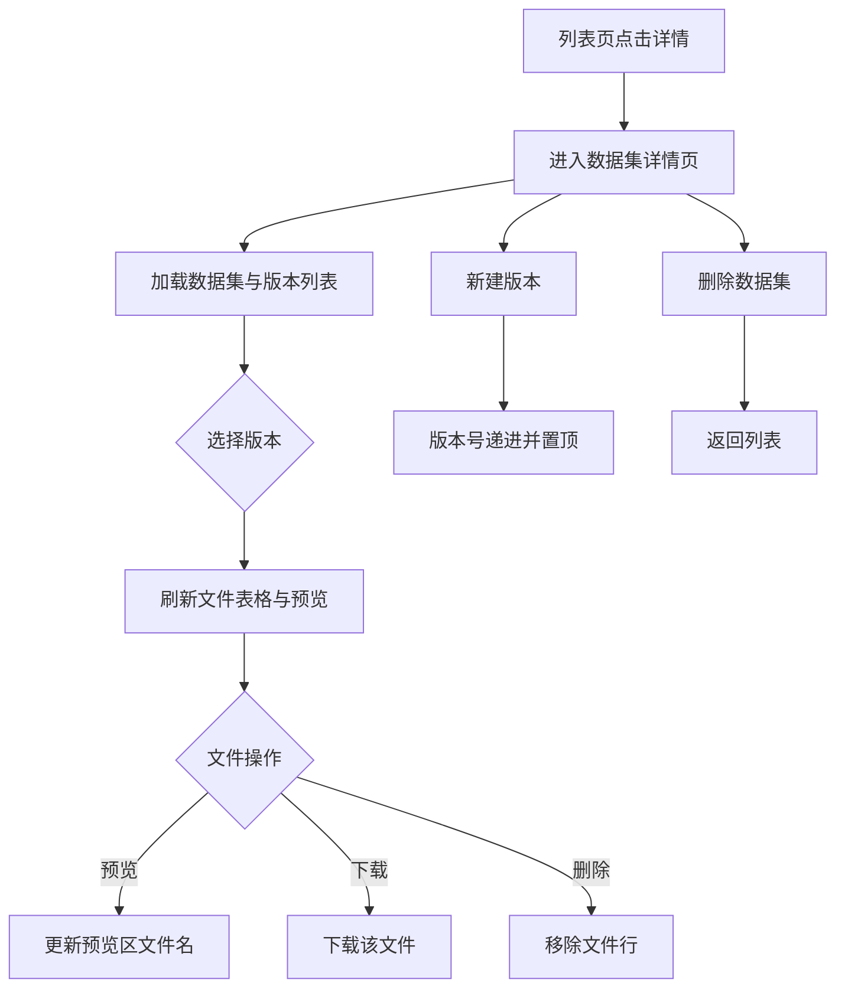

# 数据集详情 · PRD

## 0. 文档信息

| 项目 | 内容 |
| --- | --- |
| 产品 | 算力加速平台 |
| 二级需求 | 数据管理 |
| 页面 | 数据集详情 |
| 版本 | v1.0 |
| 更新日期 | 2026-11-19 |
| 状态 | 草稿（Mock 原型，待评审） |
| 路由 | `/算力加速平台/数据管理/数据集详情?id={datasetId}` |

## 1. 业务背景

数据集在列表页只呈现名称、版本、状态等概要字段，算法工程师需要查看单个数据集的完整信息：由谁创建、当前版本有哪些文件、每个文件的大小与样本量，并可直接预览 jsonl 前若干行以确认数据质量。

原实现以侧滑抽屉承载，空间不足以容纳「版本列表 + 文件表格 + 文件内容预览」三层信息，故改为独立详情页。

## 2. 功能概览

| 编号 | 功能 | 说明 |
| --- | --- | --- |
| F-1 | 返回栏 | 返回箭头 + 「数据集详情」标题，返回列表页 |
| F-2 | 基础信息 | 数据集名称 / 状态 / 数据集类型 / 创建者 / 描述 / 创建时间，三列布局 |
| F-3 | 操作 | 信息区左下「新建版本」「删除」；仅「导入成功」可新建版本，非成功态置灰 |
| F-4 | 版本列表 | 左侧独立边框卡片展示全部版本，选中项蓝色高亮 + 绿色「最新」标签 |
| F-5 | 版本文件表格 | 独立边框卡片 + 右上实心按钮（上传文件/批量下载/批量删除）+ 文件表格；仅「导入成功」展示数据，其他状态显示「暂无数据」 |
| F-6 | 文件内容预览 | 深色代码块展示所选文件前 100KB jsonl 内容 + 下载该文件；仅「导入成功」可用 |
| F-7 | 存储空间校验 | 未配置数据存储空间时，「新建版本」与「上传文件」不打开弹窗，改为弹出「未检测到数据集空间」提示（同列表页） |

## 3. 功能需求详单

### FR-1 基础信息

- 三列网格布局，字段顺序：数据集名称、状态、数据集类型、创建者、描述、创建时间；
- 标签灰色（`#86909C`）后缀冒号，值深色（`#1D2129`）；
- 状态前置指示：导入成功绿色圆点、初始化淡蓝等待点、导入中蓝色加载图标、导入失败红色圆点并展示失败原因；
- 描述为空时展示占位内容。

### FR-2 版本列表

- 标题「共 N 版本」，灰色 13px；
- 每项展示版本号 + 「最新」标签（仅首项）+ 「数据量 {size}GB（总文件数：{n}）」；
- 选中项：左侧 2px 蓝色竖条 + `#F0F5FF` 浅蓝底 + 版本号加粗变蓝；
- 点击切换版本，右侧文件表格与预览随之更新。

### FR-3 版本文件表格

| 列 | 内容 |
| --- | --- |
| 文件名 | 复选框占位 + 文件名 |
| 文件大小 | `40GB` |
| 样本评估 | `约 250,000 条` |
| 操作 | 预览 / 下载（蓝）/ 删除（红） |

- **操作按钮**：「上传文件」（蓝色实心）/「批量下载」（蓝色实心）/「批量删除」（红色实心）；「上传文件」仅「导入成功」可点，其他状态置灰并悬浮提示「仅导入成功的数据集可上传文件」；
- 仅当前版本「导入成功」时展示文件行与文件操作；初始化 / 导入中 / 导入失败统一在表格内展示「暂无数据」，内容预览同步为空态；
- 表头底色 `#F8F9FC`，行间 1px `#F2F3F5` 分隔线，外部为圆角边框卡片；
- 表格上方左侧「版本文件列表（总文件数：N）」，操作列纯文字「预览 / 下载 / 删除」。

### FR-4 文件内容预览

- 标题「文件内容预览：{文件名}（仅展示前 100KB 内容）」，文件名蓝色；
- 右上「下载该文件」；
- 深色代码块（`#323232`）展示 messages 结构的 jsonl 示例，最大高度 320px 可滚动；
- 点击表格「预览」更新预览区文件名。

## 4. 交互流程

## 5. 组件映射

| 页面元素 | 实现 |
| --- | --- |
| 平台头 / 左侧导航 | 复用 `../数据集管理/_shared.tsx` |
| 基础信息项 | `InfoItem`：灰色 label + 深色 value |
| 状态圆点 | `StatusDot`：按状态映射绿/红/橙 |
| 版本列表 | 左侧 2px 竖条 + 浅蓝选中底 |
| 文件表格 | 语义 `table` + `table-fixed`，表头 `#F8F9FC` |
| 文件预览 | `<pre>` + `bg-[#323232]` 等宽字体 |
| 数据来源 | `../数据集管理/store.ts` 的 localStorage 列表，`?id=` 指定数据集 |
