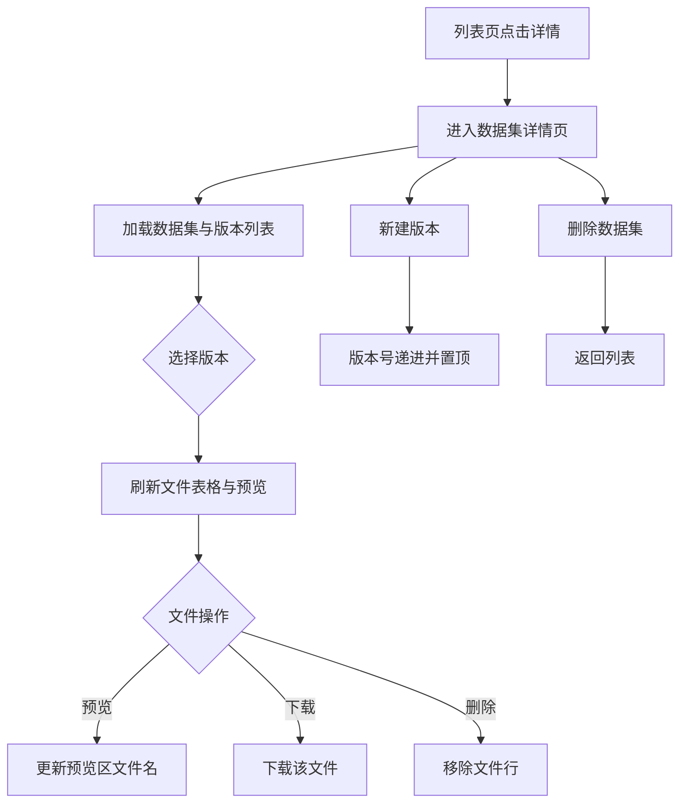

# 数据集详情 · PRD

## 0. 文档信息

| 项目 | 内容 |
| --- | --- |
| 产品 | 算力加速平台 |
| 二级需求 | 数据管理 |
| 页面 | 数据集详情 |
| 版本 | v1.0 |
| 更新日期 | 2026-11-19 |
| 状态 | 草稿（Mock 原型，待评审） |
| 路由 | `/算力加速平台/数据管理/数据集详情?id={datasetId}` |

## 1. 业务背景

数据集在列表页只呈现名称、版本、状态等概要字段，算法工程师需要查看单个数据集的完整信息：由谁创建、当前版本有哪些文件、每个文件的大小与样本量，并可直接预览文本类文件的前若干行以确认数据质量。

数据集详情使用独立详情页承载版本列表、文件表格与文件内容预览。

## 2. 功能概览

| 编号 | 功能 | 说明 |
| --- | --- | --- |
| F-1 | 独立详情页 | 返回栏、基础信息、版本列表、文件表格与文件内容预览集中在独立页面 |
| F-2 | 基础信息展示 | 数据集名称 / 状态 / 数据集标签 / 创建者 / 数据集描述 / 创建时间，三列布局 |
| F-3 | 基础信息编辑 | 数据集名称与描述支持弹窗编辑，保存后同步详情页与列表 |
| F-4 | 数据集操作 | 信息区左下提供「新建版本」「删除」，新建版本带出递进版本号 |
| F-5 | 版本列表 | 左侧独立边框卡片展示全部版本，选中项蓝色高亮 + 绿色「最新」标签 |
| F-6 | 版本文件表格 | 表格展示版本文件，并提供上传文件、批量下载、批量删除按钮 |
| F-7 | 版本文件上传 | 上传弹窗支持只读版本号、普通上传与客户端上传 |
| F-8 | 文件操作 | 文件行支持预览、下载、删除，支持多选后的批量下载与批量删除 |
| F-9 | 文件内容预览 | 文本类文件深色代码块预览，非文本类提示下载后查看 |
| F-10 | 存储空间校验 | 未配置数据存储空间时，新建版本与上传文件禁用并显示悬浮提示 |

## 3. 功能需求详单

### FR-1 返回栏

- 页面顶部展示返回箭头、竖向分隔线与「数据集详情」标题；
- 点击返回箭头回到数据集列表；
- 平台头与左侧导航沿用数据管理模块公共外壳。

### FR-2 基础信息展示

- 三列网格布局，字段顺序：数据集名称、状态、数据集标签、创建者、数据集描述、创建时间；
- 标签灰色（`#86909C`）后缀冒号，值深色（`#1D2129`）；
- 状态前置指示：导入成功绿色圆点、初始化淡蓝等待点、导入中蓝色加载图标、导入失败红色圆点并展示失败原因；
- 数据集标签以蓝色 chips 展示（`TagChips`），无标签时展示 `-`；数据集描述为空时展示占位内容。

### FR-3 基础信息编辑

- 数据集名称、数据集描述右侧提供编辑图标；
- 编辑名称弹窗限制 56 字符，名称非空且字符集合法后允许保存；
- 编辑描述弹窗限制 500 字，保存后更新详情页与数据集列表中的数据；
- 编辑名称校验规则：仅支持大小写英文字母、汉字、数字、短划线（-）、下划线（_），提示文案为「数据集名称仅支持大小写英文字母、汉字、数字、短划线（-）、下划线（_）」。

### FR-4 数据集操作

- 基础信息区左下展示「新建版本」「删除」两个按钮；
- 新建版本仅「导入成功」可点，其他状态置灰并悬浮提示「仅导入成功的数据集可新建版本」；
- 新建版本确认弹窗展示递进后的版本号，确认后打开上传文件弹窗并写入新版本；
- 删除数据集通过确认弹窗二次确认，确认后从数据集列表移除并返回列表页。

### FR-5 版本列表

- 标题「共 N 版本」，灰色 13px；
- 每项展示版本号 + 「最新」标签（仅首项）+ 「数据量 {size}GB（总文件数：{n}）」；
- 选中项：左侧 2px 蓝色竖条 + `#F0F5FF` 浅蓝底 + 版本号加粗变蓝；
- 点击切换版本，右侧文件表格与预览随之更新。

### FR-6 版本文件表格

| 列 | 内容 |
| --- | --- |
| 文件名 | 复选框占位 + 文件名 |
| 文件大小 | `40GB` |
| 文件类型 | 扩展名大写，如 `JSONL` / `TAR` / `MD`；无后缀显示 `未知` |
| 操作 | 预览 / 下载（蓝）/ 删除（红） |

- **操作按钮**：「上传文件」（蓝色实心）/「批量下载」（蓝色实心）/「批量删除」（红色实心）；「上传文件」仅「导入成功」可点，其他状态置灰并悬浮提示「仅导入成功的数据集可上传文件」；
- **文件数据**：仅当前版本「导入成功」时展示文件行与文件操作；初始化 / 导入中 / 导入失败统一在表格内展示「暂无数据」，内容预览同步为空态；
- 表头底色 `#F8F9FC`，行间 1px `#F2F3F5` 分隔线，外部为圆角边框卡片；
- 表格上方左侧「版本文件列表（总文件数：N）」，操作列纯文字「预览 / 下载 / 删除」。

### FR-7 版本文件上传

- 上传文件弹窗顶部展示当前版本号，新建版本流程中版本号只读；
- 弹窗提供「普通上传」与「客户端上传」两个页签；
- 普通上传支持拖拽与文件选择器，不限制文件格式，单文件不超过 2048M，单次最多 20 个文件；
- 客户端上传展示真实数据集路径与版本目录拼出的 mc 命令，并提供复制按钮；
- 上传确认后按目标版本写入数据集数据。

### FR-8 文件操作

- 文件行展示预览、下载、删除三个操作入口；
- 文件名前复选框支持单选与多选，批量下载与批量删除按已选文件执行；
- 删除文件通过确认弹窗二次确认，确认后从当前版本移除对应文件行；
- 批量下载在存在已选文件时可用，批量删除在存在已选文件时可用。

### FR-9 文件内容预览

- 标题「文件内容预览：{文件名}（仅展示前 100KB 内容）」，文件名蓝色；
- 右上「下载该文件」；
- 深色代码块（`#323232`）展示文本内容示例，最大高度 340px 可滚动；
- 是否可预览由扩展名判定：`jsonl / json / txt / csv / md / tsv / yaml / yml / log` 走代码块预览，其余类型提示「该文件类型不支持在线预览」并提供「下载后查看」入口；
- 点击表格「预览」更新预览区文件名；无文件时预览区展示「暂无数据」。

### FR-10 存储空间校验

- 详情页校验当前租户/项目的数据存储空间配置；
- 未配置数据存储空间时，「新建版本」与「上传文件」禁用，分别悬浮提示「未开通数据存储空间，暂不可新建版本」「未开通数据存储空间，暂不可上传文件」；
- 存储空间未就绪时不打开写入弹窗、不写入数据。

## 4. 交互流程

## 5. 组件映射

| 页面元素 | 实现 |
| --- | --- |
| 平台头 / 左侧导航 | 复用 `../数据集管理/_shared.tsx` |
| 基础信息项 | `InfoItem`：灰色 label + 深色 value |
| 状态圆点 | `StatusDot`：按状态映射绿/红/橙 |
| 版本列表 | 左侧 2px 竖条 + 浅蓝选中底 |
| 文件表格 | 语义 `table` + `table-fixed`，表头 `#F8F9FC` |
| 文件预览 | `<pre>` + `bg-[#323232]` 等宽字体 |
| 数据来源 | `../数据集管理/store.ts` 的 localStorage 列表，`?id=` 指定数据集 |
